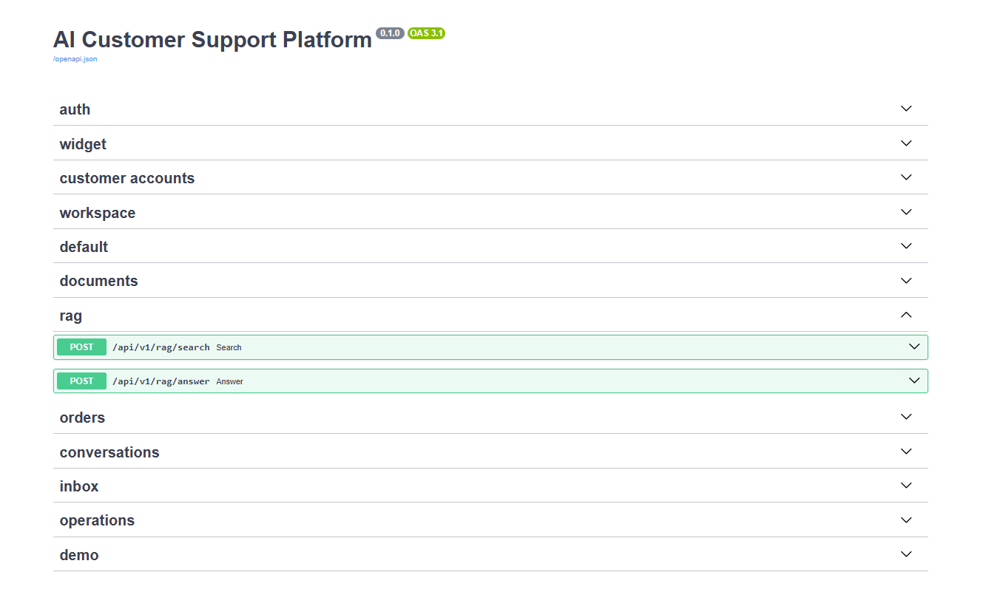
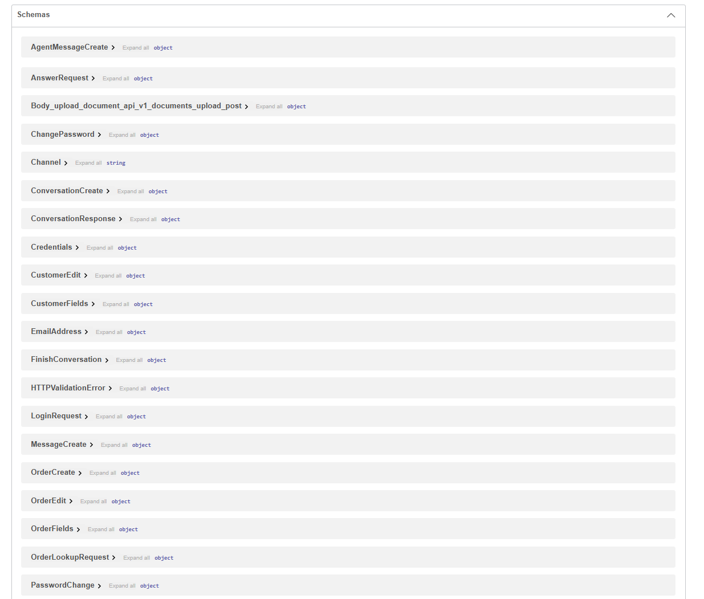
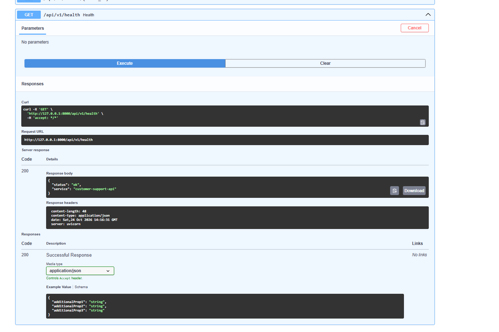

# Đặc tả API local

Đối chiếu mã và OpenAPI ngày 21/09/2026: 47 cặp method/path dưới /api/v1. Swagger tại /docs, schema tại /openapi.json trên backend đang chạy là nguồn tham chiếu kiểu dữ liệu. Các route trả dict hiện chưa khai báo đầy đủ response_model hoặc lỗi runtime trong OpenAPI; bảng dưới bổ sung hợp đồng nghiệp vụ thực có, không tuyên bố OpenAPI đã mô tả hết bảo mật/lỗi.

## Phiên và quyền truy cập

Mọi thao tác ghi yêu cầu header `X-CSRF-Protection: 1`. Trình duyệt gửi cookie cùng origin. Staff là tài khoản admin hoặc agent đang hoạt động với cookie `rag_session` (path /api, tối đa 8 giờ); khách dùng `rag_widget_session` (path /api/v1/widget, tối đa 24 giờ). Token chỉ lưu hash SHA-256 trong DB, HttpOnly/SameSite Strict và Secure khi APP_ENV khác development. Không nhận token qua payload.

Admin quản lý tài khoản/tài liệu và tạo/sửa khách/đơn nội bộ. Staff đọc toàn bộ Inbox nội bộ; trả lời và hoàn tất vẫn phải là người phụ trách, kể cả admin. Khách chỉ truy cập hội thoại gắn với cookie, không tự chọn customer_id/conversation_id. Tên tự khai không cấp quyền đơn hàng.

## Danh mục endpoint

> Tổng cộng: **61 operation (method + path)** theo `docs/openapi.json`.

## 1. Nhóm xác thực và tài khoản nhân viên

| Nhóm API                     | Method | Đường dẫn (Path)      | Chức năng                               | Quyền truy cập         | Mã Use Case |
| ---------------------------- | ------ | --------------------- | --------------------------------------- | ---------------------- | ----------- |
| Xác thực nhân viên           | POST   | `/api/v1/auth/login`  | Đăng nhập, tạo phiên làm việc nhân viên | Công khai + CSRF       | UC02        |
| Xác thực nhân viên           | GET    | `/api/v1/auth/me`     | Lấy thông tin nhân viên hiện tại        | Nhân viên đã đăng nhập | UC02        |
| Xác thực nhân viên           | POST   | `/api/v1/auth/logout` | Đăng xuất, kết thúc phiên nhân viên     | Phiên nhân viên + CSRF | UC02        |
| Quản trị tài khoản nhân viên | POST   | `/api/v1/auth/users`  | Cấp tài khoản nhân viên mới             | Admin                  | UC01        |

## 2. Nhóm hội thoại Website riêng

| Nhóm API          | Method | Đường dẫn (Path)          | Chức năng                                        | Quyền truy cập       | Mã Use Case |
| ----------------- | ------ | ------------------------- | ------------------------------------------------ | -------------------- | ----------- |
| Phiên Website     | POST   | `/api/v1/widget/session`  | Khởi tạo hoặc khôi phục phiên hội thoại Website  | Khách Website + CSRF | UC03        |
| Phiên Website     | GET    | `/api/v1/widget/session`  | Lấy thông tin phiên và lịch sử hội thoại Website | Phiên khách Website  | UC03        |
| Phiên Website     | DELETE | `/api/v1/widget/session`  | Kết thúc phiên hội thoại Website                 | Phiên khách Website  | UC03        |
| Hội thoại Website | POST   | `/api/v1/widget/messages` | Gửi tin nhắn trong hội thoại Website             | Phiên khách Website  | UC03        |
| Hỗ trợ trực tiếp  | POST   | `/api/v1/widget/handoff`  | Yêu cầu chuyển hội thoại cho nhân viên           | Phiên khách Website  | UC06        |

## 3. Nhóm tra cứu đơn hàng của khách

| Nhóm API          | Method | Đường dẫn (Path)                   | Chức năng                              | Quyền truy cập                                     | Mã Use Case |
| ----------------- | ------ | ---------------------------------- | -------------------------------------- | -------------------------------------------------- | ----------- |
| Quyền tra cứu đơn | POST   | `/api/v1/widget/order-access`      | Nhập và xác nhận mã quyền tra cứu đơn  | Phiên khách Website + CSRF                         | UC13        |
| Tra cứu đơn hàng  | GET    | `/api/v1/widget/orders/{order_id}` | Xem đơn hàng đã được cấp quyền tra cứu | Phiên khách Website đã được cấp quyền cho đúng đơn | UC13        |

## 4. Nhóm quản lý tài khoản khách

| Nhóm API        | Method | Đường dẫn (Path)                                         | Chức năng                                | Quyền truy cập                     | Mã Use Case |
| --------------- | ------ | -------------------------------------------------------- | ---------------------------------------- | ---------------------------------- | ----------- |
| Tài khoản khách | POST   | `/api/v1/widget/account/register`                        | Đăng ký tài khoản khách                  | Công khai + CSRF                   | UC15        |
| Tài khoản khách | POST   | `/api/v1/widget/account/login`                           | Đăng nhập tài khoản khách                | Công khai + CSRF                   | UC15        |
| Tài khoản khách | POST   | `/api/v1/widget/account/logout`                          | Đăng xuất tài khoản khách                | Phiên tài khoản khách + CSRF       | UC15        |
| Tài khoản khách | POST   | `/api/v1/widget/account/password`                        | Đổi mật khẩu tài khoản khách             | Phiên tài khoản khách + CSRF       | UC15        |
| Tài khoản khách | GET    | `/api/v1/widget/account/conversations`                   | Xem danh sách hội thoại của khách        | Phiên tài khoản khách              | UC15        |
| Tài khoản khách | GET    | `/api/v1/widget/account/conversations/{conversation_id}` | Xem chi tiết/lịch sử hội thoại của khách | Phiên tài khoản khách              | UC15        |
| Tài khoản khách | GET    | `/api/v1/widget/account/email-status`                    | Kiểm tra trạng thái xác thực email       | Phiên tài khoản khách              | UC15        |
| Tài khoản khách | POST   | `/api/v1/widget/account/verification-request`            | Yêu cầu gửi email xác thực               | Phiên tài khoản khách + CSRF       | UC15        |
| Tài khoản khách | POST   | `/api/v1/widget/account/verify-email`                    | Xác thực địa chỉ email                   | Công khai bằng mã xác thực + CSRF  | UC15        |
| Tài khoản khách | POST   | `/api/v1/widget/account/forgot-password`                 | Yêu cầu khôi phục mật khẩu               | Công khai + CSRF                   | UC15        |
| Tài khoản khách | POST   | `/api/v1/widget/account/reset-password`                  | Đặt lại mật khẩu bằng mã khôi phục       | Công khai bằng mã khôi phục + CSRF | UC15        |

## 5. Nhóm quản lý hồ sơ khách và đơn bán lẻ

| Nhóm API          | Method | Đường dẫn (Path)                                  | Chức năng                                      | Quyền truy cập | Mã Use Case |
| ----------------- | ------ | ------------------------------------------------- | ---------------------------------------------- | -------------- | ----------- |
| Hồ sơ khách hàng  | GET    | `/api/v1/workspace/customers`                     | Danh sách, tìm kiếm và phân trang khách hàng   | Nhân viên      | UC16/UC20   |
| Hồ sơ khách hàng  | POST   | `/api/v1/workspace/customers`                     | Tạo hồ sơ khách hàng                           | Admin          | UC16/UC20   |
| Hồ sơ khách hàng  | GET    | `/api/v1/workspace/customers/{customer_id}`       | Xem chi tiết hồ sơ, hội thoại và đơn của khách | Nhân viên      | UC16/UC20   |
| Hồ sơ khách hàng  | PATCH  | `/api/v1/workspace/customers/{customer_id}`       | Cập nhật hồ sơ khách hàng                      | Admin          | UC16/UC20   |
| Đơn bán lẻ        | GET    | `/api/v1/workspace/orders`                        | Danh sách, tìm kiếm và lọc đơn hàng            | Nhân viên      | UC16/UC20   |
| Đơn bán lẻ        | POST   | `/api/v1/workspace/orders`                        | Tạo đơn hàng                                   | Admin          | UC16/UC20   |
| Đơn bán lẻ        | PATCH  | `/api/v1/workspace/orders/{order_id}`             | Cập nhật trạng thái/thông tin đơn hàng         | Admin          | UC16/UC20   |
| Quyền tra cứu đơn | POST   | `/api/v1/workspace/orders/{order_id}/access-code` | Cấp hoặc xoay vòng mã quyền tra cứu đơn        | Admin          | UC19        |
| Quyền tra cứu đơn | DELETE | `/api/v1/workspace/orders/{order_id}/access-code` | Thu hồi mã quyền tra cứu đơn                   | Admin          | UC19        |

## 6. Nhóm workspace nội bộ

| Nhóm API  | Method | Đường dẫn (Path)             | Chức năng                          | Quyền truy cập | Mã Use Case                      |
| --------- | ------ | ---------------------------- | ---------------------------------- | -------------- | -------------------------------- |
| Workspace | GET    | `/api/v1/workspace/summary`  | Xem tổng quan hoạt động workspace  | Nhân viên      | Ngoài danh sách UC được cung cấp |
| Workspace | GET    | `/api/v1/workspace/settings` | Xem thiết lập workspace            | Nhân viên      | Ngoài danh sách UC được cung cấp |
| Workspace | GET    | `/api/v1/workspace/users`    | Xem danh sách người dùng workspace | Nhân viên      | Ngoài danh sách UC được cung cấp |
| Workspace | POST   | `/api/v1/workspace/password` | Đổi mật khẩu tài khoản nhân viên   | Nhân viên      | Ngoài danh sách UC được cung cấp |

## 7. Nhóm quản lý kho tri thức

| Nhóm API     | Method | Đường dẫn (Path)                                    | Chức năng                                          | Quyền truy cập | Mã Use Case |
| ------------ | ------ | --------------------------------------------------- | -------------------------------------------------- | -------------- | ----------- |
| Kho tri thức | GET    | `/api/v1/documents`                                 | Liệt kê tài liệu và trạng thái lập chỉ mục         | Nhân viên      | UC05        |
| Kho tri thức | GET    | `/api/v1/documents/runtime`                         | Kiểm tra trạng thái runtime/mô hình xử lý tài liệu | Nhân viên      | UC05        |
| Kho tri thức | POST   | `/api/v1/documents/upload`                          | Tải tài liệu lên kho tri thức                      | Admin          | UC05        |
| Kho tri thức | POST   | `/api/v1/documents/{document_id}/reindex`           | Lập chỉ mục lại tài liệu                           | Admin          | UC05        |
| Kho tri thức | DELETE | `/api/v1/documents/{document_id}`                   | Xóa tài liệu khỏi kho tri thức                     | Admin          | UC05        |
| Kho tri thức | GET    | `/api/v1/documents/{document_id}/chunks`            | Liệt kê các đoạn nội dung của tài liệu             | Nhân viên      | UC05        |
| Kho tri thức | GET    | `/api/v1/documents/{document_id}/chunks/{chunk_id}` | Xem chi tiết một đoạn nội dung                     | Nhân viên      | UC05        |

## 8. Nhóm hỏi đáp và tìm kiếm RAG

| Nhóm API | Method | Đường dẫn (Path)     | Chức năng                                      | Quyền truy cập | Mã Use Case                      |
| -------- | ------ | -------------------- | ---------------------------------------------- | -------------- | -------------------------------- |
| RAG      | POST   | `/api/v1/rag/answer` | Trả lời câu hỏi chính sách kèm nguồn trích dẫn | Nhân viên      | UC04                             |
| RAG      | POST   | `/api/v1/rag/search` | Tìm kiếm thử nghiệm trong kho tri thức         | Nhân viên      | Ngoài danh sách UC được cung cấp |

## 9. Nhóm Inbox và xử lý hỗ trợ

| Nhóm API           | Method | Đường dẫn (Path)                                         | Chức năng                                             | Quyền truy cập      | Mã Use Case |
| ------------------ | ------ | -------------------------------------------------------- | ----------------------------------------------------- | ------------------- | ----------- |
| Theo dõi Inbox/SLA | GET    | `/api/v1/inbox/conversations`                            | Theo dõi, lọc và phân trang các hội thoại trong Inbox | Nhân viên           | UC11        |
| Theo dõi Inbox/SLA | GET    | `/api/v1/inbox/conversations/{conversation_id}`          | Xem chi tiết hội thoại, trạng thái, phân công và SLA  | Nhân viên           | UC11        |
| Theo dõi Inbox/SLA | POST   | `/api/v1/inbox/conversations/{conversation_id}/read`     | Đánh dấu hội thoại đã đọc                             | Nhân viên + CSRF    | UC11        |
| Theo dõi Inbox/SLA | POST   | `/api/v1/inbox/conversations/{conversation_id}/unread`   | Đánh dấu hội thoại chưa đọc                           | Nhân viên + CSRF    | UC11        |
| Tiếp nhận hỗ trợ   | POST   | `/api/v1/inbox/conversations/{conversation_id}/accept`   | Tiếp nhận hội thoại đang chờ hỗ trợ                   | Nhân viên           | UC07        |
| Phản hồi khách     | POST   | `/api/v1/inbox/conversations/{conversation_id}/messages` | Gửi phản hồi cho khách trong hội thoại đang phụ trách | Nhân viên phụ trách | UC08        |
| Hoàn tất hỗ trợ    | POST   | `/api/v1/inbox/conversations/{conversation_id}/finish`   | Hoàn tất lượt hỗ trợ và cập nhật ticket               | Nhân viên phụ trách | UC09        |
| Giao lại tin nhắn  | POST   | `/api/v1/inbox/messages/{message_id}/retry-delivery`     | Gửi lại tin Telegram bị lỗi                           | Nhân viên           | UC14        |

## 10. Nhóm hội thoại và đơn hàng nội bộ/legacy

| Nhóm API           | Method | Đường dẫn (Path)                                   | Chức năng                                     | Quyền truy cập | Mã Use Case                      |
| ------------------ | ------ | -------------------------------------------------- | --------------------------------------------- | -------------- | -------------------------------- |
| Hội thoại nội bộ   | POST   | `/api/v1/conversations`                            | Tạo hội thoại nội bộ cho khách                | Nhân viên      | Ngoài danh sách UC được cung cấp |
| Hội thoại nội bộ   | POST   | `/api/v1/conversations/{conversation_id}/messages` | Thêm tin nhắn/xử lý tin nhắn trong hội thoại  | Nhân viên      | Ngoài danh sách UC được cung cấp |
| Hội thoại nội bộ   | POST   | `/api/v1/conversations/{conversation_id}/tickets`  | Tạo hoặc tái sử dụng ticket đang hoạt động    | Nhân viên      | Ngoài danh sách UC được cung cấp |
| Hội thoại nội bộ   | POST   | `/api/v1/conversations/{conversation_id}/process`  | Xử lý nội dung hội thoại qua quy trình hỗ trợ | Nhân viên      | Ngoài danh sách UC được cung cấp |
| Tra cứu đơn nội bộ | GET    | `/api/v1/orders/{order_id}`                        | Lấy thông tin đơn hàng theo khách hàng        | Nhân viên      | Ngoài danh sách UC được cung cấp |
| Tra cứu đơn nội bộ | POST   | `/api/v1/orders/lookup`                            | Tra cứu đơn theo mã đơn và khách hàng         | Nhân viên      | Ngoài danh sách UC được cung cấp |

## 11. Nhóm vận hành và demo

| Nhóm API     | Method | Đường dẫn (Path)    | Chức năng                                                   | Quyền truy cập     | Mã Use Case                      |
| ------------ | ------ | ------------------- | ----------------------------------------------------------- | ------------------ | -------------------------------- |
| Vận hành     | GET    | `/api/v1/ready`     | Kiểm tra mức sẵn sàng của hệ thống và các dịch vụ phụ thuộc | Công khai/vận hành | Ngoài danh sách UC được cung cấp |
| Vận hành     | GET    | `/api/v1/health`    | Kiểm tra trạng thái sống của API                            | Công khai          | Ngoài danh sách UC được cung cấp |
| Dữ liệu demo | POST   | `/api/v1/demo/seed` | Tạo dữ liệu mẫu phục vụ demo                                | Admin              | Ngoài danh sách UC được cung cấp |

API staff cho phép chỉ định khách để vận hành nội bộ, không dùng thay xác minh khách công khai. Bộ lọc sla nhận on_track, overdue, met, breached, cancelled hoặc none; giá trị khác trả 422. status/priority hiện là chuỗi lọc so khớp, giá trị không có có thể trả danh sách rỗng.

Inbox phân trang từ 22/09/2026: limit mặc định 25, từ 1 đến 100; offset từ 0 đến 2147483647; q tối đa 160 ký tự. Tham số sai trả 422. q tìm chuỗi con không phân biệt hoa/thường trong tên khách, mã khách và kênh; giữ dấu tiếng Việt, coi %/\_ là ký tự thường. Lọc trước phân trang, sắp thời điểm tin cuối (hoặc thời điểm tạo nếu chưa có tin) giảm dần rồi ID hội thoại tăng dần. count là số dòng trang trả về, total là tổng khớp bộ lọc, has_more cho biết còn trang; offset vượt tổng trả mảng rỗng nhưng giữ total. Client cũ phải chuyển sang đọc total và phân trang, không coi count là tổng.

Không tìm kiếm/lọc SLA thì SQL chỉ lấy trang yêu cầu và tính SLA trang đó. Có q hoặc sla thì quét theo lô 200 hội thoại bằng cùng công thức SLA và cùng mốc giờ trong request; giới hạn dữ liệu trả về nhưng thời gian lọc vẫn tăng theo dữ liệu. Chưa có chỉ mục tìm kiếm Unicode hoặc SLA tổng hợp. Phân trang offset là danh sách sống, không phải snapshot: dữ liệu mới/trạng thái đổi có thể dịch ranh giới trang giữa hai lần gọi.

Từ 09/10/2026, `unread_only` là boolean, mặc định false; giá trị không hợp lệ trả 422. Khi true, SQL lọc hội thoại có ít nhất một tin khách nằm sau cursor đọc **của nhân viên trong phiên**, trước phân trang/tìm kiếm/SLA. Tin AI/nhân viên không làm hội thoại trở thành chưa đọc. `total` và `has_more` tính theo toàn bộ bộ lọc, không chỉ trang đang hiển thị. Mỗi dòng trả `last_activity_at`, `last_message` (content tối đa 160 ký tự, sender_type) và `unread_count`. GET không ghi đã đọc. POST `/inbox/conversations/{conversation_id}/read` chỉ nhận `message_id` thuộc hội thoại, kiểm tra staff/CSRF; không nhận user_id từ client. Cursor so theo thời gian/ID và không lùi khi request cũ đến sau. Không thay schema v10 ở đợt bổ sung lọc này.

POST `/inbox/conversations/{conversation_id}/unread` nhận `{ "message_id": "..." }` và trả `conversation_id`, `unread_from_message_id`. Chỉ chấp nhận tin khách trong hội thoại; ID sai/hội thoại thiếu/tin AI trả 404, trường thừa trả 422. Cursor riêng nhân viên lùi về tin khách trước đó theo `(created_at, id)`, hoặc bị xóa nếu không có tin khách trước. Tin khách này và tin khách mới hơn trở thành chưa đọc. GET vẫn không ghi trạng thái; tab khác đang đọc cùng tài khoản có thể cập nhật cursor sau thao tác này. Không thay schema v10.

## Snapshot widget

GET /widget/session trả conversation_id, display_name, status, expires_at, history_truncated, message_page và messages. Mỗi tin chứa id, sender_type, content, created_at, client_message_id của tin khách hoặc null, cùng citations chỉ gồm source/page/location/quote. Không trả ticket, ghi chú nội bộ, agent_id, ID tài liệu/chunk hoặc retrieval thô.

Từ 26/09/2026, mặc định trả 50 tin gần nhất theo thứ tự created_at/id tăng dần; GET nhận limit 1-100 và before là ID dài 1-64 ký tự. Mốc phải thuộc hội thoại gắn với cookie, không nhận hội thoại đích từ khách; mốc không có hoặc thuộc phiên khác đều trả cùng lỗi 404. Tham số sai trả 422; phiên thiếu/hết hạn/thu hồi trả 401. SQL lấy tối đa limit+1 tin, không tải toàn bộ lịch sử. message_page gồm limit, before, has_more và next_before; next_before là tin đầu trang nếu còn tin cũ, ngược lại null. history_truncated giữ làm cờ tương thích, bằng has_more. Các POST trả snapshot 50 tin mới nhất với before=null. Client phải theo next_before để đọc đủ lịch sử, không suy ra hội thoại chỉ có 50 tin. POST /widget/messages thêm message_id, duplicate và ai_error. Lỗi provider sau khi lưu tin có thể trả 200 kèm ai_error và không có tin AI mới; 200 không tự chứng minh đã có đáp án. Nếu phiên bị thu hồi/hết hạn trong lúc model chạy, kiểm tra lại phiên trước trả snapshot và trả 401.

UUID phải giữ khi thử lại cùng tin. Cùng UUID khác nội dung trả 409; retry tin cũ sau resolved không tạo ticket mới. Hội thoại closed từ chối gửi kể cả retry. UUID chưa được xác nhận chỉ giữ trong trang hiện tại, tải lại trang có thể mất draft/UUID. Tin agent nhận client_message_id UUID tùy chọn, giao diện gửi và giữ ID khi thử lại cùng nội dung. Cùng ID khác nội dung/người gửi trả 409; gửi lại vẫn phải đúng người phụ trách và hội thoại assigned. Tải lại trang có thể mất UUID; đọc lịch sử trước khi gửi bằng ID mới.

Widget polling trang đang đọc bằng cùng before; tin mới không đẩy người đọc khỏi trang cũ. Tin mới hơn quay lại trang lịch sử đã mở, Về tin mới nhất tải cửa sổ hiện tại và cuộn xuống cuối. Như Inbox, quay về mới nhất không phải snapshot liên tục; đoạn vừa trượt khỏi cửa sổ vẫn đọc được qua Tin cũ hơn. Bản nháp giữ khi đổi trang hoặc tải trang lỗi; gửi tin/handoff/cấp quyền tra đơn thành công trở về mới nhất. Hết phiên xóa lịch sử khỏi giao diện; hội thoại closed vẫn xem được lịch sử khi cookie chưa hết hạn và chưa bấm Kết thúc. Khách chỉ đọc trạng thái và mã vận đơn của đúng đơn đã xác nhận qua mã truy cập; không đọc hồ sơ, sản phẩm hoặc ghi đơn.

## Hoàn tất ticket

Payload ví dụ, các ID phải lấy từ GET chi tiết hiện tại:

```json
{
  "status": "resolved",
  "ticket_id": "ticket-id-from-detail",
  "last_customer_message_id": "message-id-from-detail",
  "note": "Đã hướng dẫn điều kiện đổi trả."
}
```

status chỉ resolved/closed. ticket_id dài 1-64; last_customer_message_id bắt buộc có trường nhưng được null nếu chưa có tin khách, chuỗi tối đa 64. note dài 1-2000, trim và không được rỗng. Schema không nhận trường thừa. Ticket phải thuộc hội thoại. Hoàn tất áp dụng cho tất cả ticket open/assigned trong hội thoại, lưu cùng transaction với thông báo trạng thái chung.

Thành công trả `{"status":"resolved","duplicate":false}`. Retry cùng ticket/trạng thái/người/ghi chú đã chốt trả duplicate true và trạng thái hội thoại hiện tại; không sửa lượt đang hoạt động mới. Sai người hoặc tin khách cuối đã đổi trả 409. Client đọc lại chi tiết, giữ ghi chú để người phụ trách quyết định tiếp. Khách nhắn sau resolved mở ticket mới và xóa phân công; closed yêu cầu kết thúc phiên và tạo phiên mới.

## Chọn công cụ và nhật ký

Từ migration v5, mỗi message trong GET chi tiết Inbox có thêm tool_trace (dict hoặc null), chỉ cho staff. Trường này ghi pending, clarification, executed, rag, provider_error hoặc skipped, kèm mã đơn/tool/kết quả kiểm tra khi có. Không chứa mã vận đơn hay phản hồi thô của model. Pending chỉ có nghĩa đã bắt đầu lựa chọn, không chứng minh tool đã chạy; tiến trình dừng hoặc lỗi DB có thể giữ pending. Widget vẫn dùng snapshot lọc riêng và không nhận trace.

Tin có đúng một mã đơn rõ ràng thêm bước chọn tool ngoài SQL transaction. Backend kiểm tra schema, khóa lại hội thoại và chỉ thực thi khi còn open/đúng tin khách cuối; chủ đơn lấy theo khách trong DB. Model chọn rag thì dùng RAG chính sách hiện có. Tool trả trạng thái qua mẫu cố định, không đưa dữ liệu đơn cho model sinh lại. Lỗi chọn tool dùng ai_error như lỗi provider; lỗi SQL khi tra đơn trả 503, giữ inbound đã commit. Không thêm endpoint tool công khai hoặc quyền cho model.

## SLA và lỗi

SLA gồm ticket_id, conversation_id, target_minutes, due_at, responded_at và status. due_at/response là ISO 8601 UTC; datetime khác trong JSON có thể không chứa offset do SQLite, frontend hiện diễn giải timestamp lưu DB là UTC. Hạn từ tạo ticket theo ưu tiên, không reset khi tiếp nhận; đúng thời điểm hạn vẫn đạt. cancelled là kết thúc trước phản hồi, không phải đạt. Ticket terminal lấy first_response_at đã chốt. Tóm tắt chọn ticket đang chờ có hạn sớm nhất, nếu không có chọn ticket mới nhất.

| HTTP | Ý nghĩa cần xử lý                                                                   |
| ---- | ----------------------------------------------------------------------------------- |
| 400  | File không hợp lệ hoặc vượt giới hạn ở upload                                       |
| 401  | Chưa đăng nhập, phiên hết hạn/thu hồi hoặc tài khoản vô hiệu                        |
| 403  | Thiếu CSRF, sai vai trò hoặc thiếu quyền admin                                      |
| 404  | Hội thoại/ticket/tài liệu/nguồn không tồn tại hoặc đơn không thuộc khách            |
| 409  | Tranh chấp trạng thái, tin mới, UUID khác nội dung, tài liệu đang đổi hoặc nguồn cũ |
| 422  | Payload/schema không hợp lệ; detail có thể là danh sách lỗi Pydantic                |
| 429  | Giới hạn IP hoặc AI widget bận; đọc Retry-After                                     |
| 503  | ProviderError tới handler chung; không tự coi là RAG từ chối                        |

Lỗi nghiệp vụ thường có `detail` dạng chuỗi. Giới hạn widget mỗi IP/phút: 6 tạo phiên, 10 gửi tin, 6 handoff; đăng nhập 10 lần/phút. Một lượt AI widget chạy cùng lúc; slot bận trả 429 trước lưu tin. Chưa điều phối cùng các API RAG nội bộ. Từ chối RAG có nguồn thiếu/kiểm định không đạt là kết quả nghiệp vụ, khác lỗi provider và khác giới hạn gửi.

## Các trang quản lý nội bộ

Tiền tố /api/v1/workspace. GET yêu cầu Staff; POST/PATCH yêu cầu CSRF. Danh sách trả items và total; offset >= 0, limit mặc định 25, tối đa 100. Payload cấm trường thừa.

| Method | Path                     | Quyền | Hợp đồng                                                                                                                                          |
| ------ | ------------------------ | ----- | ------------------------------------------------------------------------------------------------------------------------------------------------- |
| GET    | /customers               | Staff | q <= 160 ký tự tìm tên/email/ID, offset/limit; số hội thoại/đơn từng khách                                                                        |
| GET    | /customers/{customer_id} | Staff | Hồ sơ, số lượng và tối đa 20 hội thoại/đơn; không tồn tại 404                                                                                     |
| POST   | /customers               | Admin | display_name 1–160 không trắng, email tùy chọn <= 255; ID server sinh, 201                                                                        |
| PATCH  | /customers/{customer_id} | Admin | display_name/email mới và expected chứa hai giá trị cũ; khác/mất bản ghi trả 409                                                                  |
| GET    | /orders                  | Staff | q, status, customer_id, offset/limit; tên khách/trạng thái/vận đơn                                                                                |
| POST   | /orders                  | Admin | id DH/ORD 6–64 ký tự, customer_id, status, tracking_code <= 100; 201, trùng 409, thiếu khách 404                                                  |
| PATCH  | /orders/{order_id}       | Admin | status/tracking_code và expected chứa giá trị cũ; không nhận customer_id, xung đột 409                                                            |
| GET    | /summary                 | Staff | days thuộc 7/30/90; totals toàn bộ, period theo UTC, SLA nullable khi chưa có mẫu                                                                 |
| GET    | /settings                | Staff | Người dùng công khai, SLA cố định và tình trạng hỗ trợ kênh; không có secrets                                                                     |
| GET    | /users                   | Admin | offset/limit; người dùng công khai và active, không password_hash                                                                                 |
| POST   | /password                | Staff | current_password 1–128, new_password 12–128; sai mật khẩu cũ 400, không đổi 422, tranh chấp 409; thành công thu hồi mọi phiên của chính người đổi |

status đơn nhận processing/paid/shipping/shipped/delivered/cancelled. Không đổi chủ đơn/xóa qua workspace. Công thức thống kê, phạm vi quản trị và bằng chứng tại [WORKSPACE.md](WORKSPACE.md). API /auth/users hiện có được dùng để tạo tài khoản từ Cài đặt; không thêm endpoint tạo tài khoản trùng.

## Mã truy cập từng đơn

Bổ sung POST và DELETE /api/v1/workspace/orders/{order_id}/access-code cho Admin + CSRF, POST /api/v1/widget/order-access cho phiên khách + CSRF. Snapshot widget bổ sung order_access, chỉ có mã đơn và thời điểm hết quyền, không có mã truy cập/hash. Hợp đồng payload, trạng thái lỗi, retry, rotation và giới hạn tại [ORDER_ACCESS.md](ORDER_ACCESS.md).

## Phân trang lịch sử Inbox

`GET /api/v1/inbox/conversations/{conversation_id}?limit=50&before=MESSAGE_ID` trả tối đa 50 tin mặc định, cho phép limit 1-100. Bỏ before để lấy trang gần nhất; before là ID dài 1-64 ký tự, phải thuộc chính hội thoại, không lấy lại tin làm mốc. Mốc không tồn tại/sai hội thoại trả 404, tham số sai trả 422; vẫn yêu cầu phiên nhân viên.

SQL lấy tối đa limit+1 tin theo created_at và id giảm dần, rồi đảo trang thành thứ tự tăng dần cho giao diện. Hai tin cùng thời gian được phân biệt bằng id. `message_page` gồm limit, before, has_more (còn tin cũ hơn), next_before (ID tin đầu trang nếu còn tin cũ, ngược lại null). Trường messages chỉ còn một trang; client cần theo next_before nếu muốn đọc toàn bộ. Danh sách ticket/SLA vẫn trả đầy đủ, không thuộc giới hạn tin nhắn.

Inbox giữ tối đa 50 tin trên giao diện, có Tin cũ hơn và Tin mới hơn để quay lại các trang lịch sử đã mở; Về tin mới nhất lấy lại cửa sổ mới nhất. Trang lịch sử polling cùng before để giữ mốc và cập nhật delivery/tool_trace; không thêm tin mới vào trang cũ. Quay về mới nhất có thể bỏ qua đoạn vừa trượt khỏi cửa sổ 50 tin; dùng Tin cũ hơn từ đó để đọc tiếp, không coi đây là snapshot toàn hội thoại. Bản nháp/ghi chú được giữ khi đổi trang; gửi thành công trở về tin mới nhất. Giao diện yêu cầu về trang mới nhất trước khi hoàn tất ticket, backend vẫn kiểm tra last_customer_message_id. Widget cũng đã phân trang từ 26/09/2026; xem hợp đồng Snapshot widget.

## Gửi tin Telegram

POST /api/v1/inbox/messages/{message_id}/retry-delivery yêu cầu Staff + CSRF và đúng người phụ trách hội thoại Telegram, kể cả hội thoại đã đóng. Body: `{"action":"retry","confirm_uncertain":false}`; action nhận retry hoặc skip, mặc định retry, cấm trường thừa. Chỉ xử lý delivery failed/uncertain; uncertain + retry cần confirm_uncertain=true. Không tìm thấy tin trả 404, sai người/kênh 403, sai trạng thái hoặc thiếu xác nhận 409. Thành công trả status pending hoặc skipped. Không gọi Telegram trực tiếp trong request này.

GET chi tiết Inbox bổ sung delivery cho tin gửi Telegram: state, error, sent_at; pending có thể chưa có hai trường sau. Kênh khác/tin khách trả null. GET /workspace/settings trả trạng thái Telegram thực của worker: not_connected, connecting, connected hoặc error và detail đã lọc token. Không có endpoint webhook; worker dùng polling. SLA Telegram tính theo sent_at khi API Telegram xác nhận gửi, Website theo Message.created_at; ticket kết thúc giữ snapshot cũ. Chi tiết vận hành tại [TELEGRAM.md](TELEGRAM.md).

## Kiểm tra sẵn sàng

GET /api/v1/ready yêu cầu Staff. Trả ready và checks gồm database, knowledge, vectors, ollama; HTTP 200 nếu tất cả ok, 503 nếu chưa đạt, Cache-Control: no-store. Các mã trạng thái và phạm vi tại [OPERATIONS.md](OPERATIONS.md). Không sinh đáp án, không gửi Telegram; không thay /health công khai. Auth chạy trước probe; DB không đủ để xác thực có thể lỗi trước khi tạo checks. Không có payload hoặc quyền quản trị mới.

## Tài khoản khách hàng

Prefix: `/api/v1/widget/account`. Cookie phiên khách, độc lập phiên staff. Tất cả phản hồi thành công đặt Cache-Control: no-store; POST yêu cầu CSRF như widget.

| Method | Path                | Nội dung                                                                                                               |
| ------ | ------------------- | ---------------------------------------------------------------------------------------------------------------------- |
| POST   | /register           | {display_name, email, password}; tên 1–80, mật khẩu 15–128 ký tự; trả 201 và snapshot, email đã dùng trả 409           |
| POST   | /login              | {email, password}; trả snapshot; thông tin sai trả 401 với thông báo chung                                             |
| POST   | /logout             | Yêu cầu tài khoản khách; thu hồi phiên hiện tại, giữ lịch sử                                                           |
| POST   | /password           | {current_password, new_password}; mật khẩu mới 15–128, khác cũ; thu hồi mọi phiên; sai mật khẩu cũ 400, tranh chấp 409 |
| GET    | /conversations      | offset >= 0, limit 1–50 (mặc định 20); trả items, total, has_more của chính tài khoản                                  |
| GET    | /conversations/{id} | limit 1–100 (mặc định 50), before tùy chọn; trả snapshot lịch sử; sai chủ hoặc không tồn tại trả 404                   |

Snapshot widget thêm `account: {email, email_verified}` cho tài khoản, null cho khách vãng lai. Đăng ký tạo hồ sơ khách mới; không tự ghép hồ sơ theo email hoặc chuyển lịch sử guest. POST register/login thay cookie hiện tại. DELETE `/api/v1/widget/session` với tài khoản trả snapshot hội thoại mới, giữ lịch sử; với guest giữ hành vi kết thúc phiên. Giới hạn mỗi IP/phút: đăng ký 6, đăng nhập 10, đổi mật khẩu 5; vượt trả 429. Chi tiết tại [CUSTOMER_AUTH.md](CUSTOMER_AUTH.md).

### Xác minh email và khôi phục mật khẩu

Cùng prefix `/api/v1/widget/account`, POST yêu cầu CSRF. GET/POST không trả token hoặc thông tin SMTP.

| Method | Path                  | Hợp đồng                                                                                                                     |
| ------ | --------------------- | ---------------------------------------------------------------------------------------------------------------------------- |
| GET    | /email-status         | Công khai; {configured: boolean}, chỉ kiểm tra cấu hình                                                                      |
| POST   | /verification-request | Phiên tài khoản khách; 202 message; gửi cho email tài khoản chưa xác minh                                                    |
| POST   | /verify-email         | {token, password}; mật khẩu hiện tại + token verify còn hạn; 200 message, sai/đã dùng/hết hạn 400                            |
| POST   | /forgot-password      | {email}; 202 với thông báo chung cho tài khoản đã xác minh/chưa xác minh/không tồn tại; gửi nền chỉ khi đã xác minh          |
| POST   | /reset-password       | {token, new_password}; mật khẩu 15–128 ký tự khác mật khẩu cũ; 200 message, thu hồi mọi phiên/token; sai/đã dùng/hết hạn 400 |

Hai endpoint yêu cầu gửi trả 503 khi cấu hình mail không hợp lệ; 202 chỉ là tiếp nhận yêu cầu, không xác nhận thư đã giao. Payload thừa/sai kiểu trả 422, vượt giới hạn IP trả 429. Token verify hạn 60 phút, reset 15 phút; chỉ POST hợp lệ mới tiêu thụ token, mở GET không đổi dữ liệu. Xác minh không đăng nhập tự động và không cấp quyền đơn. Snapshot trả cờ email_verified thực từ DB. Chi tiết giới hạn, cấu hình và retry tại [CUSTOMER_AUTH.md](CUSTOMER_AUTH.md).

## Đặc tả chi tiết các API luồng chính (Task TV2-02)

Dưới đây là đặc tả chi tiết 6 luồng API cốt lõi của hệ thống, bao gồm hợp đồng request/response, ví dụ dữ liệu giả lập và các mã lỗi cần xử lý.

---

### 1. Luồng đăng nhập nhân viên

- **API:** `POST /api/v1/auth/login`
- **Mã Use Case:** UC02
- **Quyền truy cập:** Công khai + bắt buộc Header `X-CSRF-Protection: 1`

#### Request Body (`application/json`)

| Trường     | Kiểu dữ liệu | Bắt buộc | Mới/Giới hạn                          | Mô tả                   |
| ---------- | ------------ | -------- | ------------------------------------- | ----------------------- |
| `username` | string       | Có       | 1–64 ký tự, regex `^[a-zA-Z0-9_.-]+$` | Tên đăng nhập nhân viên |
| `password` | string       | Có       | 1–128 ký tự                           | Mật khẩu                |

```json
{
  "username": "admin",
  "password": "AdminPassword123!"
}
```

#### Response 200 OK (Thành công)

Tự động thiết lập Cookie HttpOnly rag_session (thời hạn 8 giờ).

```json
{
  "id": "usr_01HGBX1234567890",
  "username": "admin",
  "display_name": "Quản trị viên",
  "role": "admin"
}
```

#### Response Lỗi

- **401 Unauthorized:** Mật khẩu hoặc tài khoản không chính xác.

```json
{ "detail": "Invalid username or password" }
```

- **422 Unprocessable Entity:** Sai cấu trúc request (Pydantic validation).

```json
{
  "detail": [
    {
      "loc": ["body", "password"],
      "msg": "field required",
      "type": "value_error.missing"
    }
  ]
}
```

---

### 2. Luồng gửi tin nhắn khách hàng (Widget Chat)

- **API:** `POST /api/v1/widget/messages`
- **Mã Use Case:** UC03
- **Quyền truy cập:** Phiên khách hàng (rag_widget_session)

#### Request Body (`application/json`)

| Trường              | Kiểu dữ liệu  | Bắt buộc | Giới hạn      | Mô tả                                            |
| ------------------- | ------------- | -------- | ------------- | ------------------------------------------------ |
| `client_message_id` | string (UUID) | Có       | UUID v4 chuẩn | Mã định danh tin nhắn phía client để chống trùng |
| `content`           | string        | Có       | 1–4000 ký tự  | Nội dung tin nhắn của khách hàng                 |

```json
{
  "client_message_id": "c7a8b3d2-4e5f-4a1b-8c2d-9e0f1a2b3c4d",
  "content": "Cho mình hỏi chính sách bảo hành bình giữ nhiệt như thế nào?"
}
```

#### Response 200 OK (Thành công)

Trả về snapshot 50 tin nhắn mới nhất kèm cờ trạng thái xử lý AI.

```json
{
  "conversation_id": "cv_01HGBX9999999999",
  "display_name": "Khách hàng vãng lai",
  "status": "open",
  "duplicate": false,
  "ai_error": false,
  "messages": [
    {
      "id": "msg_01HGBX0001",
      "sender_type": "customer",
      "content": "Cho mình hỏi chính sách bảo hành bình giữ nhiệt như thế nào?",
      "created_at": "2026-10-24T10:00:00Z",
      "client_message_id": "c7a8b3d2-4e5f-4a1b-8c2d-9e0f1a2b3c4d",
      "citations": null
    },
    {
      "id": "msg_01HGBX0002",
      "sender_type": "ai",
      "content": "Sản phẩm bình giữ nhiệt được bảo hành 12 tháng đối với lỗi giữ nhiệt của nhà sản xuất.",
      "created_at": "2026-10-24T10:00:03Z",
      "client_message_id": null,
      "citations": [
        {
          "source": "chinh-sach-bao-hanh.pdf",
          "page": 2,
          "location": "Đoạn 1",
          "quote": "Bình giữ nhiệt bảo hành 12 tháng lỗi giữ nhiệt."
        }
      ]
    }
  ]
}
```

#### Response Lỗi

- **401 Unauthorized:** Phiên khách hàng hết hạn hoặc không tồn tại.
- **409 Conflict:** Cùng `client_message_id` (UUID) nhưng nội dung tin nhắn khác nhau.
- **429 Too Many Requests:** Giới hạn tần suất gửi tin nhắn (quá 10 tin/phút) hoặc slot AI đang bận.

---

### 3. Luồng tải tài liệu lên Kho tri thức

- **API:** `POST /api/v1/documents/upload`
- **Mã Use Case:** UC05
- **Quyền truy cập:** Admin + CSRF Header (rag_session)

#### Request Body (`multipart/form-data`)

| Trường | Kiểu dữ liệu        | Bắt buộc | Giới hạn                                | Mô tả                    |
| ------ | ------------------- | -------- | --------------------------------------- | ------------------------ |
| `file` | UploadFile (Binary) | Có       | Tối đa 10 MB, định dạng PDF/DOCX/TXT/MD | File tài liệu chính sách |

#### Response 201 Created (Thành công)

```json
{
  "id": "doc_01HGBX7777777777",
  "filename": "chinh-sach-doi-tra-2026.pdf",
  "status": "processing",
  "chunk_count": 0,
  "created_at": "2026-10-24T10:05:00Z",
  "index_version": null
}
```

**Ghi chú nghiệp vụ:** Backend xử lý bất đồng bộ trong tiến trình: đọc file $\rightarrow$ chia đoạn $\rightarrow$ tạo embedding $\rightarrow$ ghi Qdrant. Client cần kiểm tra lại trạng thái qua GET /api/v1/documents cho đến khi status chuyển sang indexed.

#### Response Lỗi

- **400 Bad Request:** File không đúng định dạng hỗ trợ hoặc dung lượng vượt quá 10 MB.
- **403 Forbidden:** Tài khoản không phải Admin.
- **409 Conflict:** Tài liệu có SHA-256 trùng lặp hoàn toàn với một tài liệu đã tồn tại.
- **503 Service Unavailable:** Lỗi kết nối dịch vụ Embedding Ollama.

---

### 4. Luồng truy vấn hỏi đáp RAG (Nội bộ)

- **API:** `POST /api/v1/rag/answer`
- **Mã Use Case:** UC04
- **Quyền truy cập:** Nhân viên (rag_session)

#### Request Body (`application/json`)

| Trường  | Kiểu dữ liệu | Bắt buộc | Mặc định / Giới hạn | Mô tả                                         |
| ------- | ------------ | -------- | ------------------- | --------------------------------------------- |
| `query` | string       | Có       | 1–2000 ký tự        | Câu hỏi truy vấn chính sách                   |
| `top_k` | integer      | Không    | Default: 5, Max: 20 | Số lượng đoạn tài liệu ứng viên lấy từ Qdrant |

```json
{
  "query": "Thời hạn đổi trả hàng là bao nhiêu ngày?",
  "top_k": 3
}
```

#### Response 200 OK (Thành công)

```json
{
  "query": "Thời hạn đổi trả hàng là bao nhiêu ngày?",
  "answer": "Khách hàng có quyền đổi trả sản phẩm trong vòng 30 ngày kể từ ngày nhận hàng.",
  "grounded": true,
  "citations": [
    {
      "source_id": "doc_01HGBX7777777777",
      "sentence_id": "doc_01HGBX7777777777_s2",
      "text": "Khách hàng có quyền đổi trả sản phẩm trong vòng 30 ngày kể từ ngày nhận hàng."
    }
  ],
  "reviewed_sources": [
    {
      "source_id": "doc_01HGBX7777777777",
      "filename": "chinh-sach-doi-tra-2026.pdf"
    }
  ]
}
```

#### Response Lỗi

- **503 Service Unavailable (Provider Error):** Lỗi kết nối Ollama/Qdrant hoặc mô hình suy luận gặp lỗi.

```json
{ "detail": "Ollama service unavailable or timeout during LLM inference" }
```

---

### 5. Luồng tra cứu đơn hàng của khách hàng

Luồng tra cứu đơn hàng bảo mật gồm 2 bước: Nhập mã truy cập $\rightarrow$ Đọc chi tiết đơn hàng.

#### Bước 5a: Xác thực mã tra cứu đơn

- **API:** `POST /api/v1/widget/order-access`
- **Mã Use Case:** UC13 / UC19
- **Quyền truy cập:** Phiên khách hàng (rag_widget_session) + CSRF

##### Request Body

```json
{
  "order_id": "DH123456",
  "code": "a1b2c3d4e5f6a1b2c3d4e5f6a1b2c3d4e5f6a1b2c3d"
}
```

##### Response 200 OK

```json
{
  "status": "granted",
  "order_id": "DH123456",
  "expires_at": "2026-10-24T10:30:00Z"
}
```

#### Bước 5b: Lấy thông tin đơn hàng được cấp quyền

- **API:** `GET /api/v1/widget/orders/{order_id}`
- **Mã Use Case:** UC13
- **Quyền truy cập:** Phiên khách hàng đã kích hoạt quyền thành công cho đúng order_id

##### Response 200 OK

```json
{
  "order_id": "DH123456",
  "status": "shipping",
  "tracking_code": "VNPOST888999111"
}
```

#### Response Lỗi

- **404 Not Found:** Mã truy cập không hợp lệ, đơn hàng không tồn tại, hết hạn (quá 15 phút) hoặc không thuộc quyền phiên hiện tại. Không tiết lộ thông tin sự tồn tại của đơn hàng để bảo mật.

---

### 6. Luồng yêu cầu chuyển nhân viên (Handoff)

- **API:** `POST /api/v1/widget/handoff`
- **Mã Use Case:** UC06
- **Quyền truy cập:** Phiên khách hàng (rag_widget_session)

#### Request Body (`application/json`)

```json
{
  "client_message_id": "e9f8a7b6-5c4d-3e2f-1a0b-9c8d7e6f5a4b"
}
```

#### Response 200 OK (Thành công)

Trạng thái hội thoại chuyển sang handoff_requested, hệ thống dừng tự động trả lời của AI và đưa lượt vào hàng chờ Inbox của nhân viên.

```json
{
  "conversation_id": "cv_01HGBX9999999999",
  "display_name": "Khách hàng vãng lai",
  "status": "handoff_requested",
  "duplicate": false,
  "messages": [
    {
      "id": "msg_01HGBX0003",
      "sender_type": "system",
      "content": "Yêu cầu gặp nhân viên hỗ trợ đã được tiếp nhận. Vui lòng đợi trong giây lát.",
      "created_at": "2026-10-24T10:10:00Z",
      "client_message_id": "e9f8a7b6-5c4d-3e2f-1a0b-9c8d7e6f5a4b",
      "citations": null
    }
  ]
}
```

#### Response Lỗi

- **401 Unauthorized:** Phiên khách hàng hết hạn.
- **409 Conflict:** Yêu cầu handoff bị lặp hoặc hội thoại đã ở trạng thái closed.

## Minh chứng và Hướng dẫn truy cập Swagger UI (Task TV2-03)

### 1. Hướng dẫn mở Swagger UI

1. Khởi động Backend tại thư mục gốc dự án:

   ```bash
   python -m uvicorn app.main:app --reload
   ```

2. Mở trình duyệt và truy cập giao diện Swagger UI: `http://127.0.0.1:8000/docs`

3. File đặc tả OpenAPI JSON: `http://127.0.0.1:8000/openapi.json`

### 2. Hình ảnh minh chứng Swagger UI

- **Tổng quan các nhóm API:**
  

  

- **Minh chứng gọi thử API thành công (GET /api/v1/health - Response 200 OK):**
  
