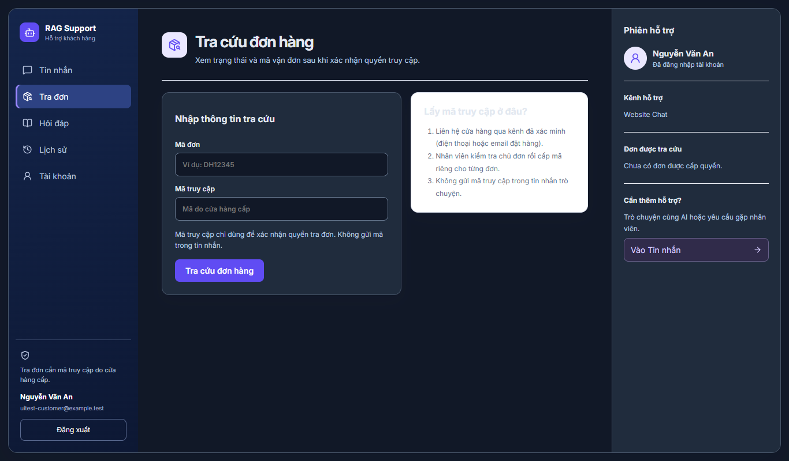
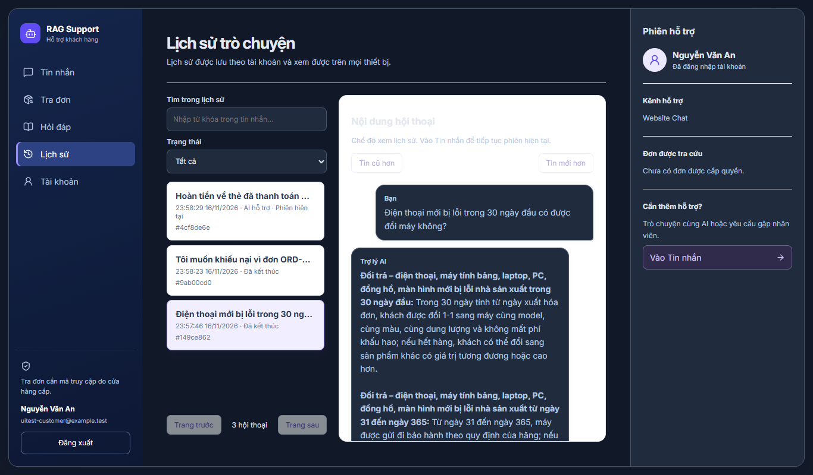
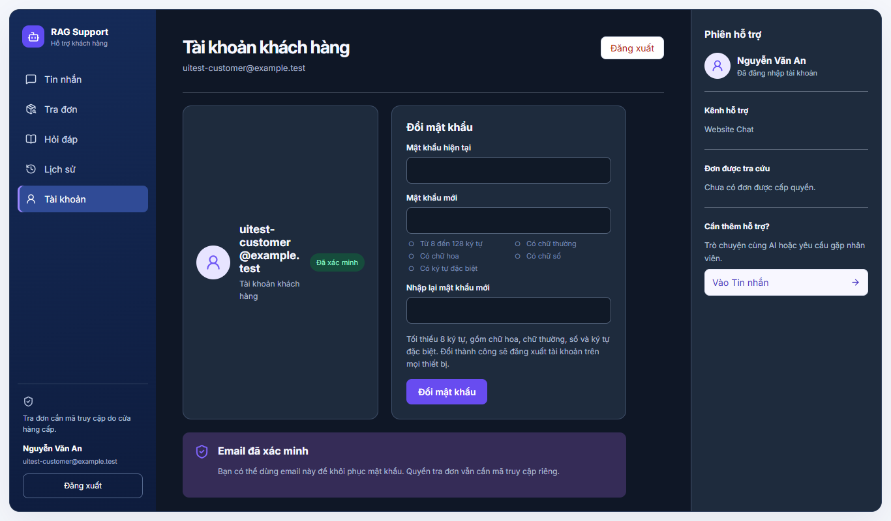
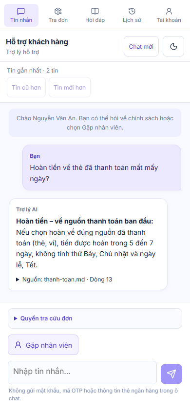
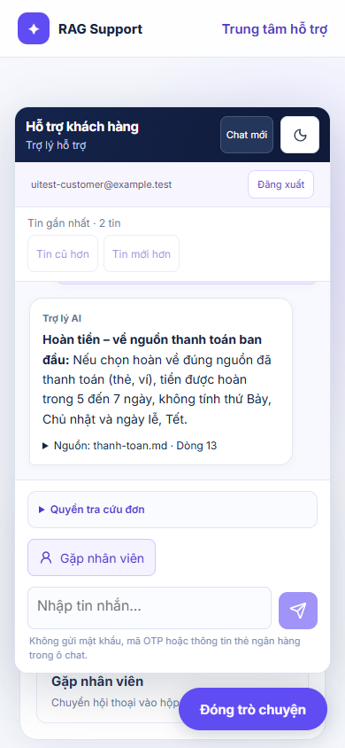
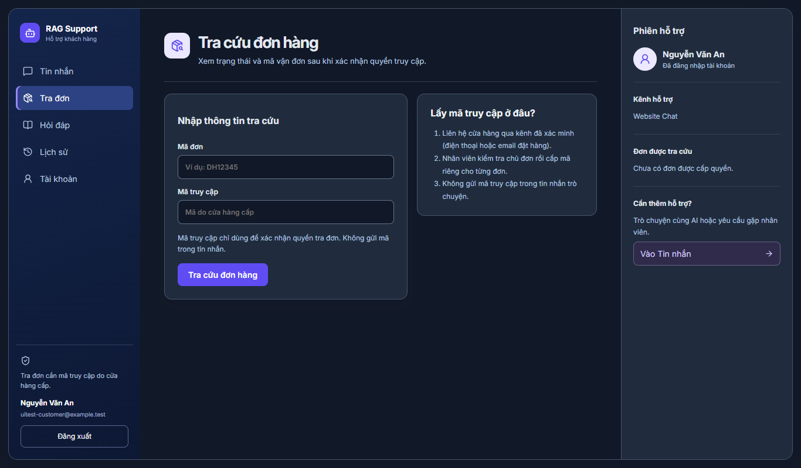
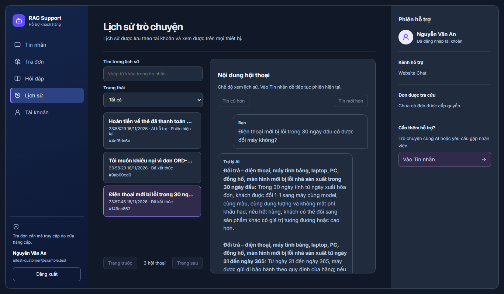
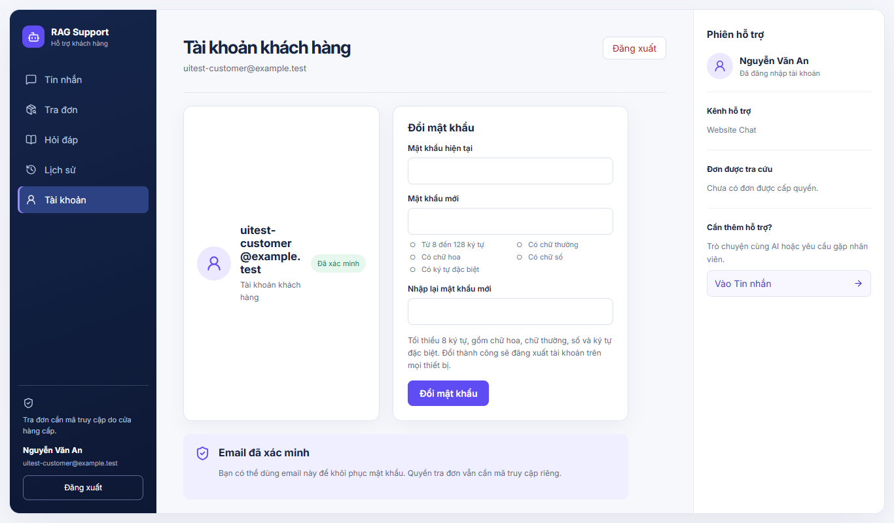
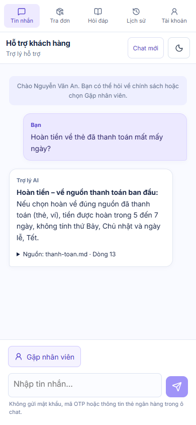
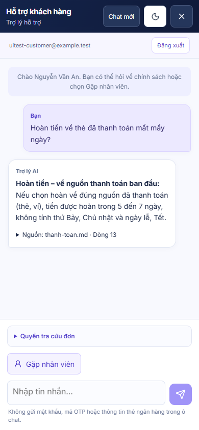

# Rà soát giao diện v1.1.0 (17/11/2026)

## Cách kiểm tra

- **Môi trường:** bản `v1.1.0` chạy riêng trên cổng 8001 với DB, vector và kho tài liệu tạm. Không dùng `.env`, nên không gửi email thật và không đụng bot Telegram.
- **Dữ liệu demo:** 12 file chính sách FPT Shop, 5 khách, 6 hội thoại do AI thật trả lời, 1 khiếu nại đã giải quyết, 2 hội thoại đang chờ nhân viên và 2 đơn hàng.
- **Phạm vi chụp:** 80 màn hình, gồm 9 màn khách hàng (cả widget nhúng) và 11 màn nhân viên. Mỗi màn chụp ở cả giao diện sáng và tối, trên desktop 1366 px và mobile 390 px. Trình duyệt dùng Edge (Chromium).
- **Kiểm tra tự động trên từng màn:**
  - Độ tương phản chữ theo WCAG 2.1: chữ thường cần 4,5:1, chữ lớn cần 3:1.
  - Tràn ngang.
  - Vùng chạm nhỏ hơn 24 px trên mobile.
  - Lỗi console.
- **Xem bằng mắt:** từng ảnh, để đánh giá màu sắc và độ dễ dùng.

**Kết quả chung:** không màn hình nào bị tràn ngang. Giao diện tối phía nhân viên ổn. Bố cục gọn và khoảng cách đều.

Các vấn đề bên dưới chia làm bốn nhóm: **lỗi cần sửa**, **màu sắc**, **khó dùng**, **nhất quán**.

## 1. Lỗi cần sửa

| # | Màn hình | Vấn đề | Đề xuất |
|---|---|---|---|
| L1 | Khách · Tra đơn (tối) | Thẻ "Lấy mã truy cập ở đâu?" vẫn nền trắng, tiêu đề màu sáng nên gần như không đọc được (tương phản 1,23:1) | Thêm màu nền và chữ cho chế độ tối |
| L2 | Khách · Lịch sử (tối) | Khung nội dung hội thoại vẫn nền trắng, tiêu đề "Nội dung hội thoại" và dòng mô tả gần như vô hình (1,68:1). Thẻ trong danh sách vẫn trắng, nút phân trang thành khối xám | Như trên |
| L3 | Khách · Tài khoản (sáng) | Trang tự chuyển sang giao diện tối dù người dùng đang ở giao diện sáng (class `accountTheme`). Chuyển trang thấy giật màu, nút "Đăng xuất" thành khối trắng trên nền tối | Bỏ ép giao diện tối, dùng theo cài đặt chung |
| L4 | Nhân viên · Đăng nhập, tạo tài khoản nhân viên | `pattern="[a-zA-Z0-9_.-]+"` không hợp lệ với trình duyệt hiện nay (dấu `-` cuối nhóm phải viết `\-`). Trình duyệt báo lỗi console và **bỏ qua kiểm tra**; backend vẫn chặn | Sửa thành `[a-zA-Z0-9_.\-]+` |
| L5 | Khách · Đăng ký | Dòng mô tả ghi "Đăng nhập để lưu lịch sử…" ngay trên tab Đăng ký. Ghi chú "Email chưa được xác minh… Lịch sử khách vãng lai không tự ghép…" và "Xác minh email trong mục Tài khoản" đã lỗi thời, vì không còn chế độ khách vãng lai và xác minh giờ là bắt buộc khi đăng ký | Viết lại nội dung theo luồng hiện tại |
| L6 | Nhân viên · Hội thoại, ticket | Tóm tắt ticket hiện nhãn thô `customer: …` và `ai: …` bằng tiếng Anh | Đổi thành "Khách:" và "AI:" |
| L7 | Tất cả | Thiếu favicon (404), tab trình duyệt hiện biểu tượng mặc định | Thêm `favicon.svg` |

## 2. Màu sắc

**Đánh giá chung:** bảng màu hiện đại và sạch. Nền xám rất nhạt, thẻ trắng bo góc, màu nhấn rõ, màu trạng thái dễ phân biệt:

| Trạng thái | Màu |
|---|---|
| Trong hạn, Đã giao | Xanh lá |
| Cao, Chờ nhân viên | Cam |
| Đang mở | Xanh dương |

Có ba điểm cần chỉnh.

**a) Hai màu thương hiệu và ba logo khác nhau**

| | Cổng khách hàng | Không gian nhân viên |
|---|---|---|
| Màu chính | Tím `#6550f5` | Xanh dương `#2563eb` |
| Thanh bên | Xanh navy | Xám nhạt |
| Logo | Tai nghe (trang đăng nhập), robot (trong cổng) | Bong bóng chat |

Nhìn qua dễ tưởng là hai sản phẩm khác nhau. Đề xuất: chọn **một** màu chính và **một** logo. Nếu muốn phân biệt khách và nhân viên, chỉ cần đổi sắc độ, vẫn giữ cùng tông.

**b) Chữ xám nhỏ thiếu tương phản (giao diện sáng)**

| Chỗ | Tương phản | Yêu cầu |
|---|---|---|
| Danh sách điều kiện mật khẩu (11 px) | 3,39 | 4,5 |
| Ô tìm kiếm Hỏi đáp (placeholder) | 3,21 | 4,5 |
| "12 / 12 tài liệu", "Đã lập chỉ mục · 17 đoạn" | 3,62–3,97 | 4,5 |
| Nhãn ưu tiên "Cao" (9 px, cam trên nền cam nhạt) | 4,10 | 4,5 |
| "Đã đăng nhập tài khoản", "Tin gần nhất · 2 tin" | 4,26–4,44 | 4,5 |
| Nhãn "Nền tảng trợ lý AI…" (tím trên tím nhạt) | 4,37 | 4,5 |

Đề xuất: đổi chữ phụ từ khoảng `#7c8bb2` / `#73809a` sang `#5b6780` hoặc đậm hơn. Cỡ chữ tối thiểu 11 px (nhãn "Cao" hiện chỉ 9 px).

**c) Giao diện tối**
- Phía nhân viên tốt.
- Phía khách có các lỗi L1–L3.
- Link "Quên mật khẩu?" là tím đậm trên nền tối, chỉ đạt 2,07:1, cần dùng tím sáng hơn (ví dụ `#a99bff`).
- Nhãn nhỏ ở thanh bên nhân viên chỉ đạt 3,39:1.

## 3. Chỗ khó dùng

| # | Màn hình | Nhận xét | Đề xuất |
|---|---|---|---|
| K1 | Khách · Tin nhắn (mobile) | Vùng tin nhắn chưa tới nửa màn hình. Phần còn lại là đầu trang, thanh "Tin gần nhất · Tin cũ hơn · Tin mới hơn", "Quyền tra cứu đơn", "Gặp nhân viên", ô nhập và dòng nhắc | Chỉ hiện thanh phân trang khi thật sự có tin cũ hơn. Bỏ khối "Quyền tra cứu đơn" khỏi ô chat vì đã có trang Tra đơn. Gộp nút Gặp nhân viên lên đầu trang |
| K2 | Widget nhúng (mobile) | Widget không chiếm toàn màn hình. Vùng tin nhắn còn nhỏ hơn, nút "Đóng trò chuyện" đè lên nội dung trang | Trên mobile, mở widget toàn màn hình, có nút đóng ở đầu |
| K3 | Khách · Hỏi đáp | Ô "Đặt câu hỏi về chính sách…" trông như ô nhập nhưng thực ra là nút. Bấm vào chỉ chuyển sang chat, không mang theo nội dung đã gõ | Đổi thành ô nhập thật, Enter thì điền sẵn câu hỏi sang chat |
| K4 | Khách · mọi trang | Cột "Phiên hỗ trợ" bên phải gần như không đổi (Website Chat, "Vào Tin nhắn" ngay cả khi đang ở trang Tin nhắn) mà chiếm khoảng 300 px | Ẩn cột này ở trang Tin nhắn, hoặc dùng để hiện trạng thái thật (đang chờ nhân viên, ticket) |
| K5 | Khách · Tra đơn | Quyền tra đơn đã nhập sẽ mất sau khi bấm "Chat mới" (quyền gắn với hội thoại), cột phải lại ghi "Chưa có đơn được cấp quyền". Khách không hiểu vì sao mất | Ghi rõ "Quyền tra đơn chỉ áp dụng trong cuộc trò chuyện hiện tại", hoặc giữ quyền theo tài khoản trong thời hạn 15 phút |
| K6 | Khách · Tài khoản | Hai nút "Đăng xuất" (đầu trang và thanh bên). Email trong thẻ hồ sơ bị ngắt thành 4 dòng, thẻ còn nhiều khoảng trống | Giữ một nút đăng xuất. Cho email xuống dòng theo `@` hoặc rút gọn có tooltip |
| K7 | Nhân viên · Hội thoại | "Tin cũ hơn / Tin mới hơn" chỉ là chữ xám 10 px, khó thấy và khó bấm. Đầu hội thoại trên mobile chật, tên và trạng thái bị xuống dòng | Dùng nút có viền giống các nút khác. Trên mobile rút gọn đầu trang (ẩn kênh, chỉ giữ trạng thái) |
| K8 | Nhân viên · Khách hàng, Hội thoại | Hiện mã UUID dài (`408d8b7e-b781-…`) dưới tên khách và trong hồ sơ | Ẩn, hoặc chỉ hiện 8 ký tự đầu kèm nút sao chép |
| K9 | Nhân viên · Khách hàng, Đơn hàng | Ô tìm kiếm nhỏ, đặt trong một hộp riêng, khác kiểu với ô tìm ở Hộp thư và Kho tri thức | Dùng chung một kiểu ô tìm kiếm |
| K10 | Nhân viên · Cài đặt | Đổi mật khẩu nhân viên chưa có danh sách điều kiện tự tick như phía khách | Dùng lại `PasswordRules` (điều kiện 12–128 ký tự) |
| K11 | Mobile · điều hướng | Thanh menu nhân viên cuộn ngang, mục cuối bị cắt ("Đơ…") mà không có dấu hiệu còn mục khác. Link chân trang "Dành cho nhân viên ↗" cao 12 px; tiêu đề "Nguồn: …" trong trích dẫn cao 18 px, nhỏ hơn mức 24 px | Thêm bóng mờ ở mép thanh cuộn. Tăng vùng bấm lên ít nhất 24 px, nên 44 px |
| K12 | Nhân viên · Kho tri thức | Tên tài liệu là tên file (`tra-gop.md`). Nút "Xóa" cùng kiểu với các nút thường | Hiện tiêu đề tài liệu. Tô đỏ nút Xóa |

## 4. Nhất quán ngôn ngữ, thuật ngữ và định dạng

**Trộn tiếng Anh vào giao diện tiếng Việt:**
- Các nhãn đầu trang "SUPPORT WORKSPACE", "CUSTOMER OPERATIONS", "WORKSPACE SETTINGS".
- Người gửi ghi "RAG AI".
- Nhãn `customer:` / `ai:` trong tóm tắt ticket (xem L6).

**Cùng một trạng thái mang nhiều tên:**

| Trạng thái | Các tên đang dùng |
|---|---|
| Đang chờ nhân viên | "Chờ nhân viên" (Hộp thư), "Chờ tiếp nhận" (Tổng quan), ticket lại ghi "Đang mở" |
| AI đang trả lời | "Đang mở", "AI hỗ trợ", "AI đang hỗ trợ", "Trợ lý hỗ trợ" |

Nên chốt một bảng thuật ngữ và dùng thống nhất ở cả phía khách lẫn phía nhân viên.

**Định dạng ngày giờ không thống nhất:**
- Các kiểu đang dùng: "16-11", "2026-11-16", "23:58:29 16/11/2026", "17/11/2026".
- Lịch sử hiện cả giây, không cần thiết.
- Biểu đồ Phân tích tính theo **UTC**, nên hội thoại lúc 6 giờ sáng giờ Việt Nam bị tính vào ngày hôm trước.
- Đề xuất: dùng `dd/mm/yyyy HH:mm` và múi giờ Việt Nam.

**Đơn vị:** "0,1 phút" nên hiển thị thành "6 giây".

## Thứ tự sửa đề xuất

1. **Lỗi hiển thị và nội dung:** L1–L3 (giao diện tối và trang Tài khoản), L4, L5. Đây là các lỗi dễ bị hội đồng thấy khi demo.
2. **Tương phản:** chữ xám nhỏ, link tối, nhãn "Cao" (mục 2b, 2c). Chủ yếu chỉ đổi biến màu.
3. **Mobile:** K1, K2, K11.
4. **Nhất quán:** thuật ngữ, tiếng Anh, ngày giờ, UTC (mục 4), cùng L6, K8.
5. **Thương hiệu:** thống nhất màu chính và logo (mục 2a). Việc này ảnh hưởng nhiều file nhất nên để sau cùng.

## Đã sửa: nhóm 1 (17/11/2026)

| Mục | Thay đổi | Kiểm tra lại |
|---|---|---|
| L1, L2 | Thêm màu giao diện tối cho thẻ hướng dẫn Tra đơn, khung và danh sách Lịch sử, nút phân trang; sửa luôn ô tìm và các thẻ ở Hỏi đáp (cũng còn trắng) và các đường kẻ quá sáng | Lỗi tương phản trên Tra đơn, Hỏi đáp, Lịch sử (tối) về 0 ở cả 1366 và 390 px |
| L3 | Trang Tài khoản không còn ép giao diện tối: giữ bố cục, màu theo giao diện chung; thêm màu tối cho thẻ hồ sơ và nút Đăng xuất | Trang sáng khi giao diện sáng, tối khi giao diện tối |
| L4 | `pattern` tên đăng nhập nhân viên thành `[a-zA-Z0-9_.\-]+` (đăng nhập và tạo tài khoản) | Hết lỗi console ở cả 4 lượt chạy |
| L5 | Tab Đăng ký có mô tả riêng; bỏ các ghi chú về khách vãng lai và "xác minh trong mục Tài khoản" | Xem ảnh chụp |

## Đã sửa: nhóm 2, tương phản (17/11/2026)

- **Giao diện sáng:** 18 màu chữ phụ được làm đậm vừa đủ để đạt ít nhất 4,6:1 trên nền tối nhất mà màu đó xuất hiện (ví dụ điều kiện mật khẩu 3,39 → 4,71; ô tìm Hỏi đáp 3,21 → 4,64; "12 / 12 tài liệu" 3,62 → 4,67). Sắc độ gần như giữ nguyên, chỉ đậm hơn một chút.
- **Giao diện tối:** link "Quên mật khẩu?" đổi sang tím sáng `#b6a7ff`; nhãn bộ lọc Hộp thư và thanh menu mobile phía nhân viên đổi sang `#a3b1c6`.
- **Nhãn ưu tiên "Cao":** cỡ chữ 9 → 10 px (11 px làm nhãn rớt dòng trong danh sách hội thoại), màu đậm hơn.
- **Trang minh họa widget:** chữ mô tả đậm hơn.

Kết quả chạy lại 80 màn hình: **0 lỗi tương phản** (trước đó 283 chỗ thuộc 24 cặp màu). Giới hạn của phép đo: không tính chữ trên nền gradient hoặc ảnh, và không tính nút đang bị khóa.

## Đã sửa: nhóm 3, mobile (17/11/2026)

| Mục | Thay đổi | Kiểm tra lại (390 × 844) |
|---|---|---|
| K1 | Thanh "Tin cũ hơn / Tin mới hơn" chỉ hiện khi có tin cũ hơn để xem. Bỏ khối "Quyền tra cứu đơn" khỏi ô chat của cổng khách hàng vì đã có trang Tra đơn; widget nhúng vẫn giữ vì chỉ có màn chat | Vùng tin nhắn từ 48% lên 65% chiều cao màn hình |
| K2 | Widget nhúng trên màn hình hẹp (≤ 600 px) mở toàn màn hình; nút nổi ẩn đi trong lúc mở. Thêm nút ✕ ở đầu khung (cả desktop) để đóng | Khung chiếm đúng 390 × 844; bấm ✕ thì đóng và nút "Hỗ trợ" hiện lại; desktop vẫn là khung nổi 400 px |
| K11 | Thanh menu nhân viên trên mobile mờ dần ở mép phải để báo còn mục khác. Tăng vùng bấm: link chân trang đăng nhập, tiêu đề "Nguồn: …", link trang minh họa đều cao ít nhất 24 px | Không còn vùng chạm nào dưới 24 px trên 40 màn hình mobile |

Nút "Gặp nhân viên" vẫn nằm trên ô nhập, không chuyển lên đầu trang như đề xuất ban đầu: đầu trang trên mobile không đủ chỗ cho thêm một nút có chữ.

## Đã sửa: nhóm 4, nhất quán (17/11/2026)

**Bảng thuật ngữ dùng chung** (`frontend/src/shared.js`, cho cả phía khách và phía nhân viên):

| Trạng thái hội thoại | Tên hiển thị | Tên cũ đã bỏ |
|---|---|---|
| `open` | AI đang hỗ trợ | Đang mở, AI hỗ trợ, Trợ lý hỗ trợ |
| `handoff_requested` | Chờ nhân viên | Chờ tiếp nhận, Đang chờ nhân viên |
| `assigned` | Nhân viên đang hỗ trợ | Đã tiếp nhận, Nhân viên hỗ trợ, Nhân viên phụ trách, Nhân viên đã tiếp nhận |
| `resolved` | Đã giải quyết | Hội thoại đã giải quyết |
| `closed` | Đã đóng | Đã kết thúc, Hội thoại đã đóng |

Ticket là việc của nhân viên nên có tên riêng: Chờ tiếp nhận, Đang xử lý, Đã giải quyết, Đã đóng. Trước đây ticket ghi "Đang mở" trong khi hội thoại ghi "Chờ nhân viên".

| Mục | Thay đổi |
|---|---|
| Tiếng Anh | Nhãn đầu trang thành "KHÔNG GIAN HỖ TRỢ", "KHÁCH HÀNG VÀ ĐƠN HÀNG", "THIẾT LẬP". Người gửi "RAG AI" thành "Trợ lý AI". Kênh "website" thành "Website" ở trang Phân tích |
| L6 | Tóm tắt ticket ghi "Khách:" và "AI:" (backend, cho ticket mới); ticket cũ còn `customer:` / `ai:` được đổi khi hiển thị |
| Ngày giờ | Một định dạng `dd/mm/yyyy HH:mm` theo giờ Việt Nam ở mọi nơi; danh sách gọn dùng `HH:mm` (hôm nay) hoặc `dd/mm`. Bỏ giây ở Lịch sử |
| Phân tích theo UTC | Backend tính khoảng thống kê và "Hội thoại theo ngày" theo ngày Việt Nam (UTC+7); API trả `timezone: Asia/Ho_Chi_Minh`. Có test cho hội thoại lúc 00:00 giờ Việt Nam |
| Đơn vị | Thời gian phản hồi dưới 1 phút hiện bằng giây ("6 giây" thay cho "0,1 phút"); từ 60 phút hiện giờ và phút |
| K8 | Mã khách hàng dạng UUID chỉ hiện 8 ký tự đầu ở danh sách Khách hàng và hồ sơ trong Hộp thư; di chuột để xem đủ. Trang chi tiết khách hàng vẫn hiện mã đầy đủ |

Kiểm tra: 248 test backend đạt (thêm test ngày Việt Nam và nhãn tóm tắt); kiểm tra giao diện riêng nhóm 4 đạt 19/19; chạy lại 80 màn hình không có lỗi mới.

Chưa sửa: L7 (favicon), nhóm 5 (thống nhất màu và logo) và các mục khó dùng còn lại (K3–K7, K9, K10, K12).

## Ghi chú ngoài giao diện

Trong lượt tạo dữ liệu demo, câu nối tiếp "Còn laptop thì sao?" bị từ chối. Đây là dao động của model, tương tự mục C1 trong checklist nghiệm thu.
