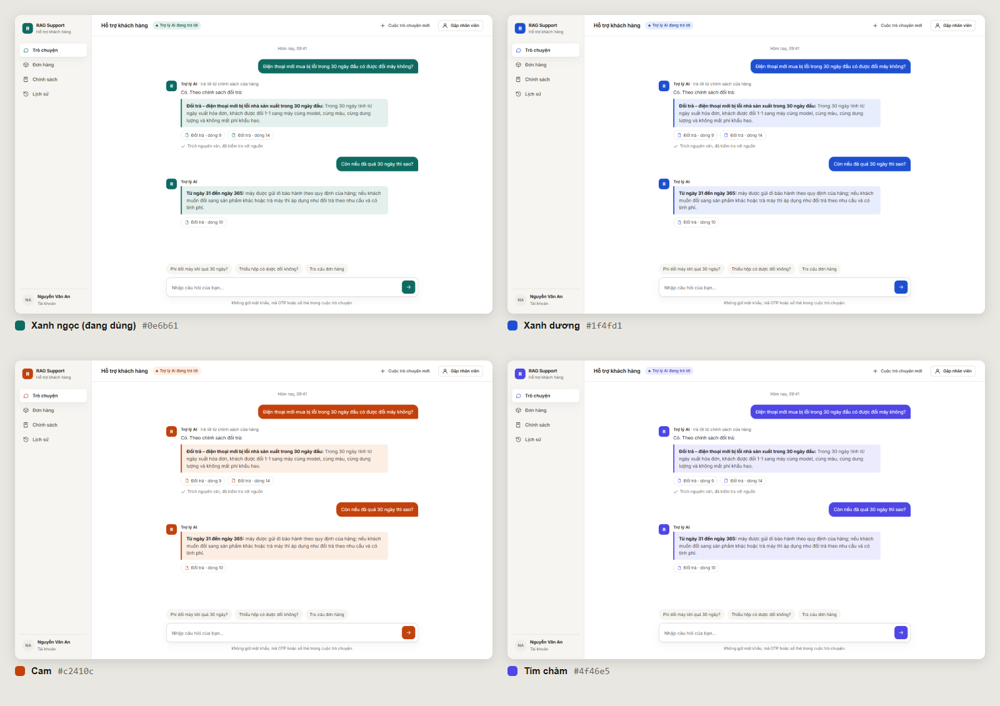
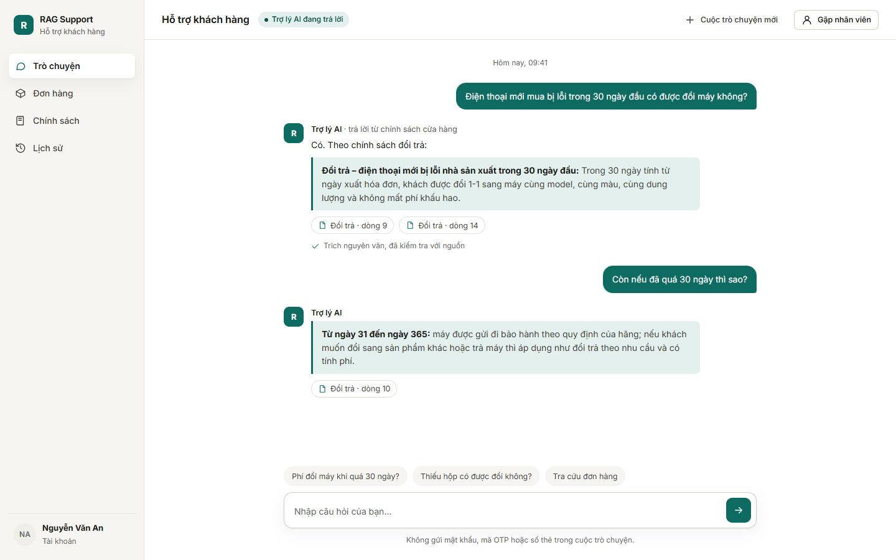
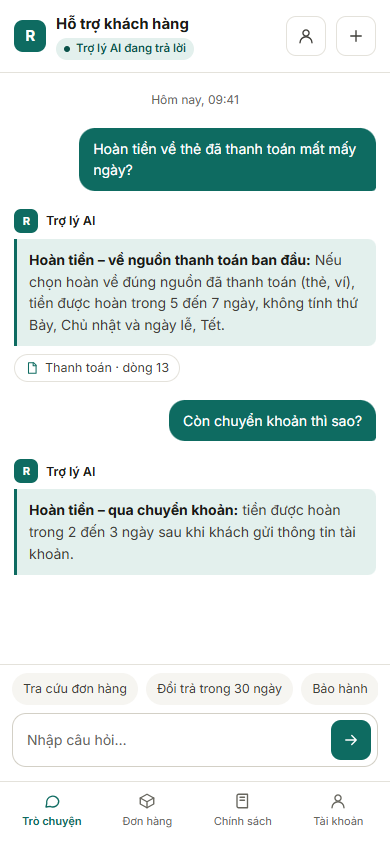
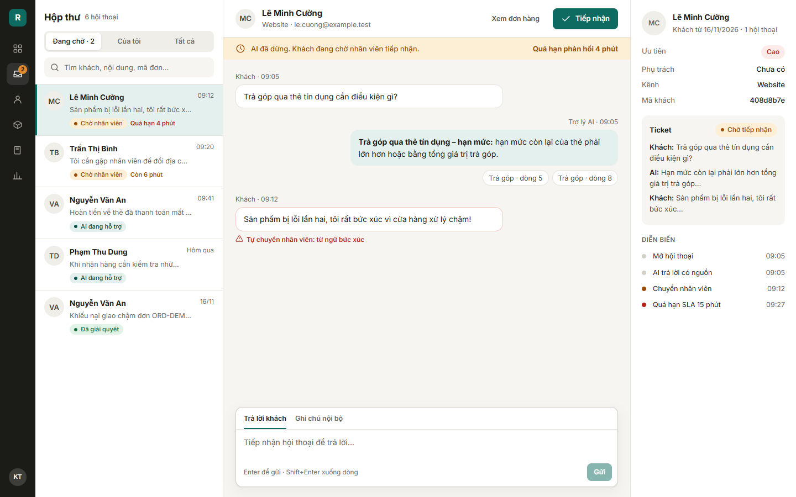
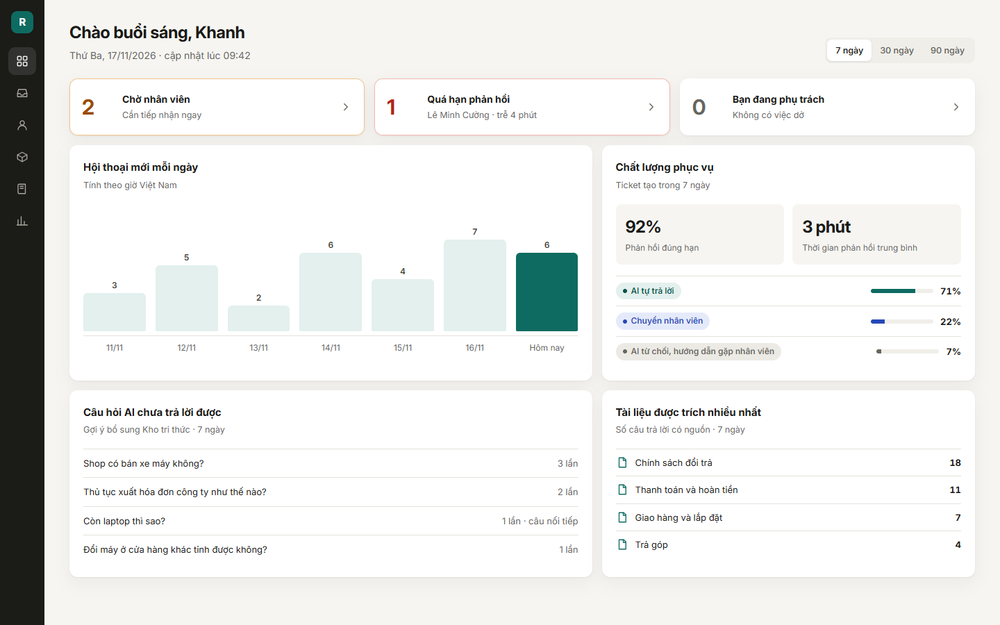
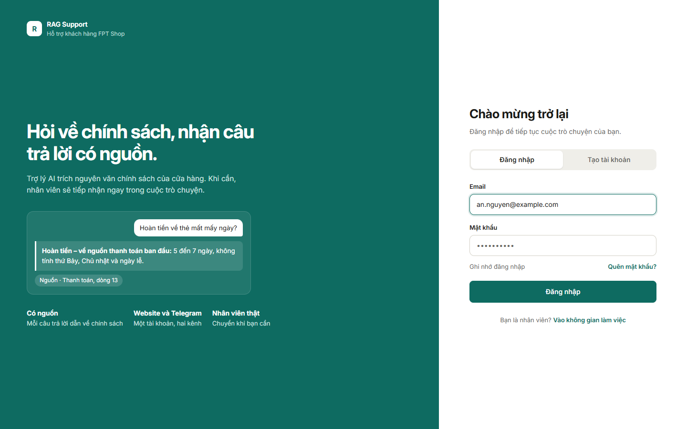
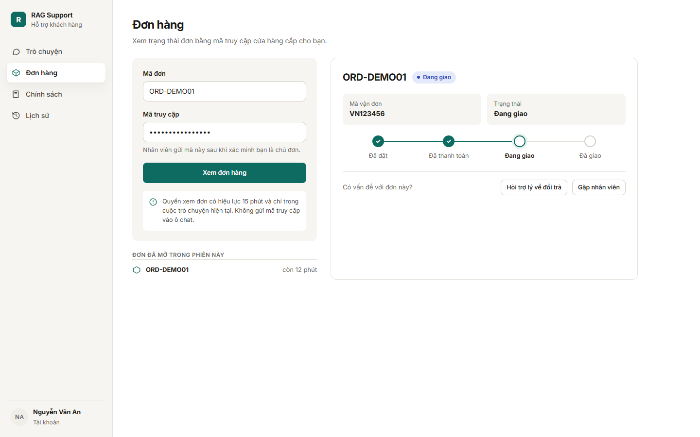
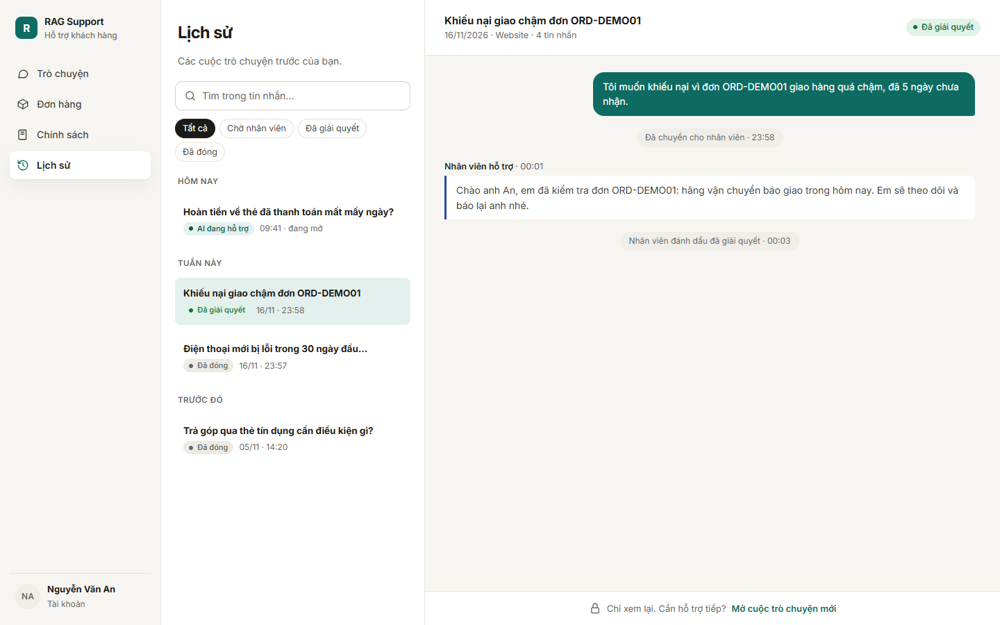
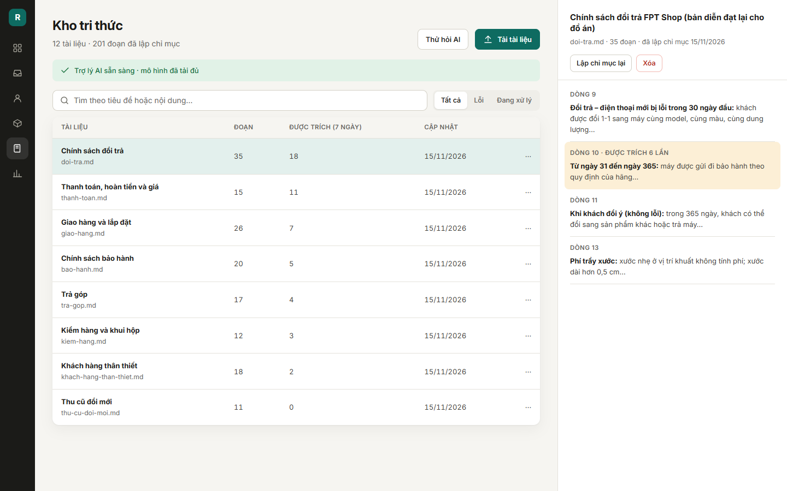
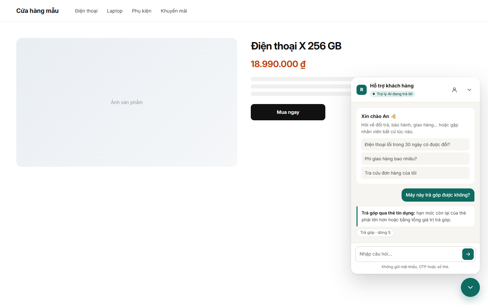

# Đề xuất thiết kế lại giao diện (bản ý tưởng, 18/11/2026)

Bản mockup tĩnh để nhóm xem hướng thiết kế. Đã triển khai vào ứng dụng qua PR #23–#26 (tag v1.3.0) và hoàn thiện ở các bản sau; ứng dụng thật có thể khác mockup ở chi tiết. Mỗi màn có file HTML (mở trực tiếp bằng trình duyệt) và ảnh PNG cùng tên. Số liệu trong ảnh là minh họa.

## Vì sao giao diện hiện tại trông chưa ổn

- Thanh bên xanh navy đậm và màu tím dùng khắp nơi, nhìn nặng và giống nhiều sản phẩm AI khác.
- Cổng khách hàng có ba cột; cột "Phiên hỗ trợ" bên phải chiếm chỗ nhưng ít thông tin.
- Quá nhiều thẻ có viền và bóng lồng nhau; chữ phụ xám nhỏ nhiều.
- Hình minh họa robot ở trang đăng nhập làm loãng thông điệp chính.

## Nguyên tắc

1. **Nội dung là trung tâm.** Khung chat rộng tối đa 760 px ở giữa, bỏ cột phải. Trạng thái hội thoại là một nhãn màu cạnh tiêu đề.
2. **Thể hiện đúng điểm mạnh của đề tài: trả lời có nguồn.** Câu trả lời của AI hiện như đoạn trích (viền trái màu nhấn), nguồn là các nhãn nhỏ "Đổi trả · dòng 9", kèm dòng "Trích nguyên văn, đã kiểm tra với nguồn".
3. **Một màu nhấn, ít viền.** Nền trắng ngà ấm, chữ gần đen, màu nhấn xanh ngọc đậm. Màu chỉ dùng cho hành động chính và trạng thái.
4. **Trạng thái có màu cố định ở mọi nơi.** Xanh ngọc = AI đang hỗ trợ, cam = chờ nhân viên, xanh dương = nhân viên đang hỗ trợ, xanh lá = đã giải quyết, xám = đã đóng, đỏ = quá hạn.
5. **Nhân viên thấy việc cần làm trước.** Hộp thư mặc định lọc "Đang chờ", mỗi dòng có hạn SLA; hội thoại có dải cảnh báo, lý do chuyển nhân viên và diễn biến theo thời gian. Tổng quan mở đầu bằng ba việc cần xử lý và có danh sách câu hỏi AI chưa trả lời được để bổ sung Kho tri thức.

## Màu nhấn: các phương án

Cùng màn trò chuyện với 4 màu nhấn (ảnh từng phương án trong thư mục `mau-nhan/`). Đổi màu chỉ cần sửa ba biến `--accent`, `--accent-soft`, `--accent-strong`.

- **Xanh ngọc — đã chọn (18/11/2026):** khác biệt với các sản phẩm AI phổ biến, hợp với "tin cậy, có kiểm chứng"; không trùng màu trạng thái nào.
- **Xanh dương:** quen thuộc, an toàn; nhưng trùng màu trạng thái "Nhân viên đang hỗ trợ", phải đổi trạng thái đó sang màu khác.
- **Cam:** gần màu thương hiệu bán lẻ; nhưng gần màu "Chờ nhân viên" và dễ bị đọc như cảnh báo.
- **Tím chàm:** gần màu tím hiện tại, ít thay đổi nhất nhưng cũng ít khác biệt nhất.

## Bảng màu

| Vai trò | Màu |
|---|---|
| Nền | `#f6f5f1` |
| Bề mặt | `#ffffff` |
| Chữ chính / phụ | `#1b1b18` / `#67665e` |
| Màu nhấn | `#0e6b61` (nền nhạt `#e3f0ed`) |
| Chờ nhân viên | `#9a4b06` trên `#fcefd6` |
| Nhân viên đang hỗ trợ | `#2747b8` trên `#e5eafb` |
| Đã giải quyết | `#17703c` trên `#e1f2e7` |
| Quá hạn, xóa | `#b42318` trên `#fdebe9` |

Font Inter (đã có trong dự án), bo góc 8–12 px, bóng rất nhẹ.

## Các màn hình

| # | Màn hình | Điểm chính |
|---|---|---|
| 1 |  Khách · trò chuyện (desktop) | Bỏ cột phải; nút "Gặp nhân viên" và "Cuộc trò chuyện mới" trên đầu; câu gợi ý ngay trên ô nhập |
| 2 |  Khách · trò chuyện (mobile) | Thanh tab dưới cùng; nút gặp nhân viên là biểu tượng ở đầu trang; vùng tin nhắn chiếm phần lớn màn hình |
| 3 |  Nhân viên · hộp thư | Thanh biểu tượng tối hẹp; danh sách mặc định "Đang chờ"; dải cảnh báo SLA; trả lời và ghi chú nội bộ là hai tab của cùng ô soạn; cột phải có tóm tắt ticket và diễn biến |
| 4 |  Nhân viên · tổng quan | Ba việc cần xử lý; biểu đồ theo ngày; tỷ lệ AI tự trả lời / chuyển nhân viên / từ chối; câu hỏi AI chưa trả lời được; tài liệu được trích nhiều |
| 5 |  Đăng nhập | Bỏ hình robot; một câu thông điệp và ví dụ câu trả lời có nguồn thật |
| 6 |  Khách · tra đơn | Form bên trái, kết quả bên phải với các bước trạng thái; ghi rõ quyền xem đơn 15 phút; nút hỏi trợ lý hoặc gặp nhân viên ngay dưới đơn |
| 7 |  Khách · lịch sử | Nhóm theo Hôm nay / Tuần này / Trước đó; lọc bằng nhãn; sự kiện "đã chuyển nhân viên", "đã giải quyết" hiện trong dòng thời gian; chế độ chỉ xem có nút mở cuộc trò chuyện mới |
| 8 |  Nhân viên · kho tri thức | Bảng tài liệu theo tiêu đề, số đoạn, số lần được trích; xem nội dung ở cột phải, đoạn được trích nhiều được tô màu; Xóa màu đỏ |
| 9 |  Widget nhúng trên trang bán hàng | Khung nổi bo góc, chào theo tên với câu gợi ý; câu trả lời có nguồn gọn trong khung hẹp; nút tròn thu gọn |

## Nếu làm thật

- Phần lớn là CSS và bố cục React; luồng dữ liệu và API giữ nguyên.
- Cần thêm ở backend: tỷ lệ AI tự trả lời / chuyển nhân viên / từ chối, danh sách câu hỏi bị từ chối và số lần trích theo tài liệu và theo đoạn (cho Tổng quan và Kho tri thức); lý do chuyển nhân viên và diễn biến hội thoại (cho Hộp thư và Lịch sử).
- Màn Tra đơn chỉ dùng dữ liệu đang có (trạng thái, mã vận đơn); các bước trạng thái suy ra từ trạng thái hiện tại, không cần thêm dữ liệu.
- Nên làm theo thứ tự: bảng màu và thành phần dùng chung → khung chat khách hàng → hộp thư → tổng quan → các trang còn lại; mỗi bước chạy lại bộ kiểm tra 80 màn hình.
