# Nền tảng trợ lý AI hỗ trợ khách hàng đa kênh dựa trên kiến trúc RAG

Báo cáo tiến độ và hồ sơ tuần 04 và 05 cập nhật ngày 15 tháng 10 năm 2026

Nhóm 2B phát triển hệ thống CSKH cho cửa hàng bán lẻ trực tuyến giả lập, dưới sự hướng dẫn của giảng viên Trần Đình Nghĩa. Phần xác thực nhân viên, tiếp nhận và trả lời trong Unified Inbox đã được kiểm chứng trên Windows với SQLite. RAG đã chạy mô hình Ollama local và Qdrant lưu bền, có giao diện quản lý tài liệu và câu trả lời kèm nguồn. Hệ thống chưa hoàn thành MVP đa kênh hoặc đánh giá chất lượng RAG toàn diện.

## Chương 1 Mở đầu

Khách hàng cần được hỗ trợ về chính sách và trạng thái đơn hàng, trong khi nhân viên phải xử lý nhiều câu hỏi lặp lại. Hệ thống dự kiến dùng RAG để truy xuất tài liệu nội bộ, công cụ nghiệp vụ để tra cứu đơn và chuyển người thật khi phát hiện yêu cầu hỗ trợ trực tiếp.

Phạm vi gồm Website Chat Widget và một kênh xã hội thật, Knowledge Base PDF/DOCX, hội thoại và ticket/SLA, trả lời có nguồn, tra cứu đơn hàng giả lập và handoff. Telegram đã có adapter polling và kiểm thử local, còn chờ kiểm chứng bằng bot thật để nghiệm thu kênh thứ hai. Mục tiêu chất lượng là giảm trả lời thiếu căn cứ và từ chối khi thiếu bằng chứng; chưa khẳng định không có hallucination.

## Chương 2 Cơ sở lý thuyết và tổng quan

RAG kết hợp truy hồi thông tin với quá trình tạo câu trả lời. Embedding ngữ nghĩa và cơ sở dữ liệu vector cần được đánh giá bằng tập câu hỏi có nguồn. Agentic RAG bổ sung quyết định dùng công cụ hoặc chuyển nhân viên dựa trên trạng thái và yêu cầu nghiệp vụ.

Human-in-the-loop trong hệ thống này yêu cầu phân biệt AI đang xử lý, chờ nhân viên và nhân viên đã nhận. Việc chuyển giao phải đồng bộ ở backend, tránh để giao diện chỉ hiển thị AI dừng trong khi API vẫn sinh câu trả lời. Phần khảo cứu tài liệu học thuật và so sánh hệ thống liên quan cần được bổ sung ở mốc hoàn thiện cơ sở lý thuyết.

## Chương 3 Phân tích yêu cầu hệ thống

### 3.1 Phạm vi và phương pháp khảo sát

Đơn vị giả lập là một cửa hàng bán lẻ trực tuyến quy mô nhỏ, tiếp nhận câu hỏi về chính sách, giao hàng, đơn hàng và đổi trả. Khách liên hệ qua website hoặc Telegram; nhân viên CSKH xử lý yêu cầu, quản trị viên quản lý tài khoản và tài liệu. Kiểm tra hàng, duyệt đổi trả, hủy đơn, hoàn tiền và làm việc với đơn vị vận chuyển diễn ra ngoài nền tảng của đồ án. Hệ thống chỉ hỗ trợ tra cứu, lưu trao đổi và chuyển yêu cầu cho người có trách nhiệm.

Khảo sát bàn gồm ba nguồn: quy trình đổi trả công khai của FPT Shop [S1], tài liệu kỹ thuật và mã nguồn của đồ án [S5], cùng tiêu chuẩn BPMN và tài liệu bảo mật/tích hợp [S2–S4]. Quy trình FPT Shop chỉ được tham khảo ở cấu trúc tiếp nhận, kiểm tra điều kiện, thông báo phương án và sự đồng ý của khách; không sao chép thời hạn, phí hoặc chính sách sản phẩm vào cửa hàng giả lập. Không khẳng định cửa hàng giả lập là FPT Shop hoặc đã được doanh nghiệp xác nhận.

| Loại thông tin | Căn cứ | Cách sử dụng |
|---|---|---|
| Quy trình đổi trả công khai | S1, mục III Quy trình đổi trả | Tham khảo bước kiểm tra và phê duyệt bởi con người |
| Hành vi hệ thống hiện có | S5, API, dịch vụ và kiểm thử trong repo | Xác định chức năng, quyền và giới hạn đã triển khai |
| Hiện trạng trước khi áp dụng hệ thống | Kịch bản giả lập được người dùng cho phép | Giả định phân tích; cần đối chiếu khi có cửa hàng thực tế |
| Độ trễ và tải local | S6, dữ liệu đo có phạm vi riêng | Bằng chứng kỹ thuật local; không suy thành năng lực doanh nghiệp |
| Khối lượng khách và tổn thất kinh doanh | Chưa có dữ liệu | Không đặt số liệu hoặc tỷ lệ giả làm kết quả khảo sát |

### 3.2 Quy trình hiện trạng giả lập

Trước khi sử dụng nền tảng, nhân viên mở từng kênh để đọc tin, tra chính sách trong các file riêng và tra đơn trong sổ/bảng quản lý giả lập. Danh sách việc cần theo dõi và người phụ trách được ghi thủ công. Đây là mô hình tham chiếu để phân tích nhu cầu, không phải mô tả quan sát tại một doanh nghiệp cụ thể.

| Bước | Người xử lý | Đầu vào và thao tác | Đầu ra và ngoại lệ |
|---|---|---|---|
| AS01 Tiếp nhận | Khách, nhân viên CSKH | Khách gửi câu hỏi; nhân viên đọc tin tại từng kênh, ghi thời điểm và nội dung | Có yêu cầu cần xử lý; tin thiếu thông tin được hỏi lại |
| AS02 Phân loại | Nhân viên CSKH | Phân biệt hỏi chính sách, tra đơn, khiếu nại hoặc yêu cầu đổi/hủy | Chọn nguồn tra cứu; yêu cầu mơ hồ chưa được kết luận |
| AS03 Hỏi chính sách | Nhân viên CSKH | Mở tài liệu tương ứng với sản phẩm, thời điểm và điều kiện áp dụng | Trả lời theo tài liệu; tài liệu thiếu hoặc mâu thuẫn chuyển quản trị viên xác nhận |
| AS04 Tra đơn | Nhân viên CSKH, quản trị viên | Thu mã đơn; xác minh người yêu cầu qua thông tin liên hệ tin cậy đã có của chủ đơn | Chỉ cung cấp dữ liệu được phép; biết mã đơn hoặc tự khai email chưa đủ để cấp quyền |
| AS05 Khiếu nại và đổi trả | Nhân viên CSKH, người có thẩm quyền ngoài hệ thống | Thu thông tin mua hàng, lý do và tình trạng hàng; đối chiếu chính sách, yêu cầu kiểm tra nếu cần | Thông báo phương án và điều kiện; không hứa hoàn tiền/đổi hàng trước khi được duyệt |
| AS06 Bàn giao | Nhân viên CSKH | Chuyển nội dung, bằng chứng và việc đang chờ cho người xử lý | Có người phụ trách; nếu chưa nhận phải giữ yêu cầu ở danh sách chờ |
| AS07 Theo dõi và kết thúc | Nhân viên phụ trách, khách | Phản hồi, xác nhận kết quả, ghi việc còn chờ và lý do kết thúc | Giữ lịch sử; khách hỏi tiếp sau giải quyết cần mở lượt xử lý mới |

Tại AS05, mô hình tham khảo S1 yêu cầu kiểm tra tình trạng sản phẩm và điều kiện áp dụng trước khi thông báo phương án. Một số trường hợp phải có kết luận từ trung tâm bảo hành; phí phát sinh được thông báo trước khi thực hiện. Trong đồ án, các hoạt động này được nhân viên xử lý ngoài hệ thống, còn chatbot chỉ giải thích chính sách có nguồn và ghi nhận yêu cầu. Thời hạn đổi trả của cửa hàng giả lập phải lấy từ tài liệu đã được quản trị viên cung cấp, không tự suy theo chính sách của nhà bán lẻ khác.

### 3.3 Nút thắt và rủi ro của hiện trạng

Các vấn đề dưới đây là rủi ro dự kiến của kịch bản giả lập, chưa được đo bằng nhật ký hoặc phỏng vấn. Mỗi vấn đề gắn với một biện pháp và một cách xác minh để tránh trình bày suy đoán thành kết quả khảo sát.

| Mã | Điểm nghẽn hoặc rủi ro | Hậu quả dự kiến | Biện pháp mục tiêu và cách xác minh |
|---|---|---|---|
| BN01 | Mở nhiều kênh và ghi việc thủ công | Bỏ sót tin hoặc trả lời lặp | Inbox tập trung; đối chiếu số tin gốc với số tin đã lưu trong kịch bản thử |
| BN02 | Chính sách nằm trong nhiều file hoặc phiên bản | Trả lời theo tài liệu cũ, mất điều kiện áp dụng | Kho tri thức có phiên bản và citation; thử cập nhật nguồn trong lúc AI đang xử lý |
| BN03 | Tra đơn theo tên hoặc mã khách tự khai | Lộ dữ liệu của người khác | Quyền xem từng đơn sau xác minh; thử sai phiên, hết hạn và thu hồi |
| BN04 | Không có thao tác nhận việc độc quyền | Hai nhân viên xử lý cùng yêu cầu hoặc không ai nhận | Gán người phụ trách có điều kiện; thử hai người tiếp nhận đồng thời |
| BN05 | Theo dõi thời gian bằng ghi chú riêng | Không biết yêu cầu nào quá hạn | SLA phản hồi đầu; đối chiếu thời điểm tạo ticket và phản hồi đầu |
| BN06 | Mất mạng khi gửi hoặc tải lại trang | Khách gửi lại, trùng tin hoặc mất bản nháp | UUID và giữ bản nháp; thử mất phản hồi rồi gửi lại cùng ID |
| BN07 | Không ghi lý do và trạng thái kết thúc | Khó bàn giao hoặc đánh giá kết quả | Ghi chú nội bộ và lịch sử ticket; thử khách nhắn lại sau giải quyết |

Khi khảo sát thật, cần thu thập thời điểm nhận/phản hồi của một tập yêu cầu có sự đồng ý sử dụng, số lần đổi người xử lý, tỷ lệ yêu cầu thiếu thông tin và các phiên bản chính sách đang dùng. Không ghi tên khách, số điện thoại hoặc nội dung riêng tư vào báo cáo công khai. Số mẫu, khoảng thời gian và người xác nhận phải được ghi cùng kết quả; hiện các dữ liệu này chưa có.

### 3.4 Tác nhân và ranh giới trách nhiệm

| Tác nhân | Trách nhiệm | Giới hạn |
|---|---|---|
| Khách hàng | Gửi yêu cầu, đọc nguồn, cung cấp thông tin xác minh, yêu cầu người thật | Không đọc API nội bộ, ghi chú hoặc đơn chưa được cấp quyền |
| Nhân viên CSKH | Đọc Inbox, nhận việc, trả lời, ghi kết quả, xử lý lỗi giao tin | Chỉ trả lời/hoàn tất hội thoại do mình phụ trách |
| Quản trị viên | Cấp tài khoản, quản lý nguồn, hồ sơ/đơn giả lập, xác minh và cấp quyền đơn | Quyền quản trị không bỏ qua điều kiện phụ trách khi trả lời ticket |
| Ứng dụng FastAPI | Xác thực, phân quyền, lưu tin, điều phối, kiểm tra trạng thái và chống trùng | Quyết định của model không thay kiểm tra quyền tại backend |
| Ollama và Qdrant local | Embedding, truy hồi, chọn bằng chứng và kiểm định | Dịch vụ nội bộ; không có quyền tự sửa đơn hoặc cấp danh tính |
| Telegram Bot API | Nhận update và truyền phản hồi trong chat riêng | Dịch vụ bên ngoài; gửi thành công không chứng minh khách đã đọc |
| SMTP | Truyền thư xác minh và khôi phục mật khẩu | HTTP 202 chỉ là tiếp nhận yêu cầu, chưa chứng minh thư đã giao |
| Người duyệt | Đọc nguồn, duyệt nhãn và đánh giá câu trả lời | Điểm regression tự động không thay đánh giá độc lập |

### 3.5 Quy tắc nghiệp vụ

| Mã | Quy tắc |
|---|---|
| BR01 | Danh tính do phiên hoặc Telegram cung cấp; tên/email tự khai không xác minh quyền sở hữu đơn. Email đã xác minh cũng không tự ghép đơn hàng. |
| BR02 | Tra đơn chỉ đọc trạng thái và mã vận đơn được phép. Hủy đơn, đổi trả, hoàn tiền chuyển người thật; không tự thực hiện giao dịch. |
| BR03 | Chính sách phải có bằng chứng và giữ điều kiện áp dụng. Thiếu, mâu thuẫn hoặc không đủ căn cứ thì hỏi lại hoặc từ chối, không tạo câu trả lời khẳng định. |
| BR04 | Chuyển nhân viên dừng AI. Tin khách mới khi đang chờ/đã nhận vẫn được lưu; không tạo ticket trùng cho cùng lượt hỗ trợ. |
| BR05 | Tiếp nhận phải độc quyền. Chỉ người phụ trách được trả lời, giải quyết hoặc đóng, kể cả admin. |
| BR06 | Hoàn tất phải có ghi chú nội bộ và đúng ticket/tin khách cuối đã xem; thay đổi đồng thời trả xung đột để đọc lại. |
| BR07 | Nhắn sau resolved tạo lượt ticket mới, bỏ phân công cũ và tiếp tục chờ người thật. Widget closed phải tạo phiên/hội thoại mới; Telegram nhận tin mới sau closed tạo hội thoại mới. |
| BR08 | Retry cùng UUID/nội dung không tạo tin mới. Gửi Telegram uncertain không tự thử lại; nhân viên phụ trách xác nhận nguy cơ trùng trước khi gửi lại. |
| BR09 | Quyền widget giới hạn một đơn, một phiên và 15 phút từ lúc cấp; kiểm tra lại quyền khi tra. Mã này không dùng cho Telegram. |
| BR10 | SLA demo tính 24/7 từ tạo ticket tới phản hồi đầu: urgent 5, high 15, normal 60, low 240 phút. Website dùng thời điểm lưu tin nhân viên; Telegram dùng lúc API xác nhận gửi. Đây không phải SLA giải quyết. |
| BR11 | Chỉ đưa tài liệu sẵn sàng, đúng phiên bản vào truy hồi. Xóa hoặc đổi nguồn trong lúc model chạy phải chặn đáp án dựa trên phiên bản cũ. |
| BR12 | Đổi trả theo mô hình tham khảo cần kiểm tra chứng từ/thông tin mua hàng, tình trạng hàng và chính sách áp dụng; người có thẩm quyền thông báo phương án trước khi thực hiện. Việc kiểm tra và giao dịch nằm ngoài nền tảng. |

### 3.6 Yêu cầu chức năng

Mức ưu tiên P1 là yêu cầu bắt buộc của phạm vi đồ án; P2 là hỗ trợ vận hành/đánh giá. Trạng thái “có local” chỉ xác nhận đã có mã và bằng chứng kiểm chứng cục bộ trong S5, không xác nhận nghiệm thu thực tế. Các luồng nghiệm thu sau dùng dữ liệu tạm, không sửa dữ liệu khách hoặc gửi tin thật khi chưa cấu hình kênh.

| Mã | Yêu cầu và ưu tiên | Điều kiện và kết quả mong đợi | Ngoại lệ và tiêu chí kiểm chứng |
|---|---|---|---|
| FR01 | Xác thực nhân viên, P1; có local | Tài khoản hoạt động đăng nhập; admin cấp tài khoản; đổi mật khẩu thu hồi phiên | Chưa đăng nhập/sai quyền bị chặn; mật khẩu cũ không cấp phiên sau khi đổi |
| FR02 | Tài khoản và phiên khách, P1; có local | Cho phép vãng lai, đăng ký, đăng nhập, khôi phục lịch sử theo tài khoản | Hai tài khoản không đọc lịch sử nhau; hết phiên báo lỗi, không tự đổi danh tính |
| FR03 | Tiếp nhận đa kênh, P1; Website có local, Telegram chờ bot thật | Lưu tin cùng hội thoại/kênh; update Telegram chống trùng theo bot và update ID | Retry không tăng số tin; nhóm/tệp Telegram không đi luồng hỏi đáp văn bản thông thường |
| FR04 | Hỏi chính sách có nguồn, P1; có local, chất lượng chờ duyệt | Hội thoại open, nguồn sẵn sàng; trả bằng chứng có vị trí hoặc thông báo thiếu căn cứ | Lỗi model giữ tin khách; handoff/tin mới/nguồn đổi chặn đáp án cũ; nội dung đúng ngữ nghĩa cần người duyệt |
| FR05 | Quản lý kho tri thức, P1; có local | Admin tải PDF/DOCX/TXT/Markdown tối đa 10 MB, lập chỉ mục lại/xóa; staff xem nguồn | File lỗi không được báo sẵn sàng; PDF scan chưa OCR; tài liệu xóa không còn được truy hồi |
| FR06 | Tra đơn theo quyền, P1; có local trên dữ liệu giả lập | Widget đã được cấp quyền đúng đơn/phiên; chỉ trả trạng thái và vận đơn | Sai phiên, hết hạn, thu hồi hoặc đổi chủ chặn kết quả; không gửi mã bí mật vào model |
| FR07 | Chuyển nhân viên, P1; có local | Khách yêu cầu hoặc hệ thống phát hiện cần người thật; tạo/tái dùng ticket và dừng AI | Retry không trùng ticket; AI đang chờ không được trả sau handoff |
| FR08 | Tiếp nhận và trả lời, P1; có local | Nhân viên nhận hàng chờ; người phụ trách gửi phản hồi | Hai người nhận cùng lúc chỉ một người thành công; người khác không gửi/hoàn tất được |
| FR09 | Giải quyết, đóng và mở lượt mới, P1; có local | Người phụ trách gửi ghi chú, ticket và tin cuối; kết thúc đúng lượt | Tin khách mới trước hoàn tất gây 409; retry hoàn tất cũ không đóng lượt mới |
| FR10 | Inbox, tìm kiếm và SLA, P1; có local | Lọc/phân trang hội thoại, lịch sử, trạng thái đọc và bản nháp; hiển thị SLA phản hồi đầu | Giữ đúng khách/bản nháp khi đổi trang; mẫu số SLA không tính ticket chưa phản hồi |
| FR11 | Theo dõi giao tin Telegram, P1; có local, chờ kênh thật | Hiển thị pending, sending, sent, failed, uncertain, skipped; người phụ trách retry hoặc skip | Uncertain cần xác nhận; lỗi chặn tin sau cùng người nhận; không gửi ghi chú/trace nội bộ |
| FR12 | Quản lý hồ sơ, đơn và báo cáo, P2; có local | Staff xem, admin tạo/sửa dữ liệu giả lập; thống kê theo kỳ | Kiểm tra expected để chặn ghi đè; không đổi chủ đơn hoặc coi thống kê SLA là chất lượng AI |
| FR13 | Xác minh email và khôi phục mật khẩu, P2; có local, chờ SMTP thật | SMTP TLS, token đúng mục đích/hạn; reset thu hồi mọi phiên/token của tài khoản | Liên kết hết hạn/đã dùng bị chặn; phản hồi yêu cầu không tiết lộ email tồn tại; chưa bảo đảm giao thư bền |
| FR14 | Đánh giá và vận hành, P2; có công cụ local | Phiếu người duyệt, probe sẵn sàng, backup/restore vào thư mục mới | Chưa có nhãn duyệt thì tỷ lệ để null; restore kiểm tra hash và thu hồi phiên/token; không ghi đè dữ liệu |

#### 3.6.1 Luồng hỏi đáp và chuyển giao

Điều kiện đầu là phiên hợp lệ và tin đúng giới hạn. Hệ thống kiểm tra UUID, lưu tin trước lời gọi model, xác định trạng thái và loại yêu cầu. Hội thoại open có thể đi hỏi chính sách hoặc tra đơn; yêu cầu gặp nhân viên/khiếu nại cần chuyển giao đi hàng chờ. Hội thoại đang chờ hoặc assigned chỉ lưu tin và chuyển cho nhân viên, không gọi AI.

Kết quả RAG chỉ được lưu sau kiểm tra lại trạng thái, tin khách cuối và phiên bản nguồn. Thiếu bằng chứng dẫn tới từ chối hoặc hỏi làm rõ; lỗi dịch vụ giữ tin khách và báo lỗi, không giả làm câu trả lời thành công. Trả lời cũ bị bỏ khi điều kiện đã đổi. BPMN01 mô tả nhánh hỏi chính sách, còn BPMN02 và BPMN03 mô tả tra đơn và xử lý bởi nhân viên.

#### 3.6.2 Luồng tra đơn

Admin xác minh người nhận qua kênh tin cậy đã có rồi cấp mã cho đúng đơn. Khách nhập mã tại biểu mẫu riêng, hệ thống ràng buộc vào phiên và thời hạn. Khi nhận yêu cầu tra cứu, backend kiểm tra quyền còn hiệu lực và chủ đơn hiện tại; model không được cấp quyền bằng nội dung chat. Nhiều mã đơn cần hỏi chọn một mã. Không đủ quyền, yêu cầu hủy/đổi trả hoặc kênh Telegram chưa có cơ chế cấp quyền thì chuyển người thật, không tiết lộ đơn tồn tại hay dữ liệu chủ đơn.

#### 3.6.3 Luồng xử lý và kết thúc ticket

Nhân viên tiếp nhận có điều kiện, đọc tin và phản hồi. Với Website, tin đã lưu có thể được khách lấy bằng polling; với Telegram, tin chờ worker gửi và trạng thái giao được theo dõi riêng. Khi cần hoàn tất, người phụ trách gửi ghi chú cùng ticket và ID tin khách cuối đã xem. Xung đột yêu cầu đọc lại trước khi chốt. Giải quyết/đóng lưu người, thời điểm và snapshot SLA; không sửa kết quả lượt cũ khi khách mở lượt mới.

### 3.7 Yêu cầu phi chức năng

Các ngưỡng hiệu năng và phục hồi dưới đây là mục tiêu đề xuất cho nghiệm thu đồ án, chưa phải cam kết vận hành đã đạt. Chốt lại với GVHD khi xác định máy triển khai và tải thực tế. Độ trễ tính từ lúc gửi HTTP đến nhận đủ phản hồi; p95 tính riêng từng nhóm API, không gộp API đọc dữ liệu với API gọi model.

| Mã | Yêu cầu | Mục tiêu và cách kiểm chứng | Trạng thái |
|---|---|---|---|
| NFR01 | Bảo mật và riêng tư | 100% ca kiểm thử quyền từ chối truy cập sai vai trò/phiên/đơn; cookie HttpOnly/SameSite Strict, Secure và HTTPS khi triển khai; không lộ mật khẩu/token/ghi chú trong API khách | Có cơ chế local; HTTPS và rà soát triển khai còn chờ |
| NFR02 | Toàn vẹn khi đồng thời | Retry cùng UUID tạo đúng một tin; hai người nhận chỉ một người thành công; cập nhật stale gây xung đột; handoff chặn AI muộn trong mọi ca thử định trước | Có kiểm thử local; cần lặp trên môi trường triển khai |
| NFR03 | Độ trễ API không gọi model | Đề xuất p95 ≤ 1 giây cho đọc danh sách/chi tiết và ≤ 2 giây cho ghi tin staff, với 10 client, 500 hội thoại, trang Inbox 25; lỗi bất ngờ ≤ 1% trong lượt 15 phút | Có baseline local cũ; cần đo lại workload hiện tại |
| NFR04 | Độ trễ hỏi chính sách | Đề xuất p95 ≤ 15 giây ở lượt tuần tự tối thiểu 60 câu có nguồn/thiếu nguồn trên cấu hình model đã chốt và máy GPU ghi rõ; ghi riêng thời gian chờ/gọi model và lỗi | Có số đo regression; chưa nghiệm thu theo kịch bản này |
| NFR05 | Chịu tải và mở rộng | Đề xuất 10 client HTTP đồng thời trong 15 phút không mất/trùng tin; tải RAG đồng thời phải đo riêng, không suy 10 client HTTP thành 10 lượt generation; tăng worker chỉ sau thiết kế queue/lease và giới hạn dùng chung | Hiện một API worker với SQLite/Qdrant embedded; chưa nghiệm thu tải bền |
| NFR06 | Phục hồi dữ liệu | Đề xuất backup offline hằng ngày, RPO ≤ 24 giờ và RTO ≤ 60 phút trong buổi diễn tập; đối chiếu hash nguồn, số tin/ticket và việc thu hồi phiên sau restore | Có công cụ local; lịch backup và mục tiêu RPO/RTO chưa kiểm chứng |
| NFR07 | Độ bền kênh ngoài | Lỗi Telegram phải phân biệt failed/uncertain, không tự gửi lại uncertain; khởi động lại không trùng update/ticket; SMTP TLS và lỗi không lộ bí mật | Có mock/local; bot/hộp thư thật và hàng gửi SMTP bền còn chờ |
| NFR08 | Khả dụng giao diện | Đề xuất dùng được ở 320–1536 px, không tràn ngang trang; mọi thao tác chính bằng bàn phím, focus rõ, trạng thái tải/lỗi/rỗng và giữ bản nháp khi mất mạng | Có QA trình duyệt; điện thoại thật và trình đọc màn hình còn chờ |
| NFR09 | Quan sát và khả năng bảo trì | Ghi lỗi theo ID tin/yêu cầu, chỉ báo sẵn sàng có quyền staff; migration v1–v10 chạy lặp giữ dữ liệu; tài liệu quy trình có mã yêu cầu và phiên bản | Có local; chưa có audit quản trị đầy đủ hoặc giám sát production |
| NFR10 | Chất lượng và truy xuất nguồn | Đề xuất tối thiểu 60 câu độc lập được người duyệt chốt nhãn trước đo; tỷ lệ đáp án đúng ≥ 85%, từ chối đúng ≥ 90%, citation hỗ trợ đủ ≥ 95%; lỗi provider tính riêng, không bỏ khỏi báo cáo | Ngưỡng đề xuất chưa được duyệt; regression hiện có không thay bộ độc lập |

RPO là lượng dữ liệu có thể mất tính theo thời gian kể từ bản sao gần nhất; RTO là thời gian khôi phục để dịch vụ dùng được. Đáp án đúng được tính trên câu có đủ thông tin trả lời và bao gồm từ chối sai trong các ca không đạt. Từ chối đúng tính trên câu được duyệt là không đủ căn cứ; citation hỗ trợ đủ tính trên câu có đáp án nội dung được người duyệt đọc cả nguồn và điều kiện. Mỗi chỉ số phải có mẫu số, trường hợp lỗi/chưa chấm và cấu hình đầu vào; chưa có mẫu thì để null.

### 3.8 Phạm vi nghiệm thu và truy vết

| Vấn đề | Yêu cầu liên quan | Mô hình và bằng chứng |
|---|---|---|
| BN01, BN06 | FR03, FR10, FR11; NFR02, NFR07 | BFD03, BPMN01/BPMN03; kiểm thử widget/Telegram và API |
| BN02 | FR04, FR05; NFR10 | BFD02, BPMN01/BPMN04; kiểm thử nguồn đổi và phiếu người duyệt |
| BN03 | FR01, FR02, FR06; NFR01 | BFD01, BPMN02; kiểm thử quyền đơn và tài khoản |
| BN04, BN07 | FR07–FR09; NFR02 | BFD04, BPMN03; kiểm thử nhận việc, xung đột, lượt mới |
| BN05 | FR10, FR12; BR10 | BFD05, BPMN03; kiểm thử snapshot SLA và mẫu số báo cáo |
| Vận hành và mở rộng | FR13, FR14; NFR03–NFR09 | BFD06; đo HTTP/RAG riêng, diễn tập restore và kiểm chứng SMTP |

Hồ sơ tuần 04 hoàn thành phần phân tích và mô hình trong phạm vi giả lập. Những việc chưa xác nhận gồm khảo sát doanh nghiệp thật, duyệt ngưỡng NFR, nhãn/đáp án độc lập, bot Telegram thật, SMTP thật và tải bền tại máy triển khai. Các việc này được ghi nhận riêng; không gắn nhãn đã hoàn thành chỉ vì tài liệu hoặc mã nguồn đã tồn tại.

### 3.9 Nguồn tham chiếu

[S1] FPT Shop, Chính sách đổi trả, mục III Quy trình đổi trả. Truy cập ngày 15/10/2026: https://fptshop.com.vn/ho-tro/chinh-sach-doi-san-pham. Tham khảo quy trình kiểm tra và thông báo phương án; không sử dụng điều kiện/phí của FPT Shop làm chính sách cửa hàng giả lập.

[S2] Object Management Group, Business Process Model and Notation phiên bản 2.0.2: https://www.omg.org/spec/BPMN/2.0.2. Schema BPMN 2.0: https://www.omg.org/spec/BPMN/20100501/BPMN20.xsd. Truy cập/schema kiểm tra ngày 15/10/2026.

[S3] Telegram, Bot API, các mục getUpdates, getWebhookInfo và sendMessage: https://core.telegram.org/bots/api. Truy cập ngày 15/10/2026; tham khảo ranh giới nhận/gửi và dịch vụ bên ngoài.

[S4] OWASP, Authorization Cheat Sheet: https://cheatsheetseries.owasp.org/cheatsheets/Authorization_Cheat_Sheet.html. Truy cập ngày 15/10/2026; tham khảo kiểm tra quyền trên mọi request và nguyên tắc quyền tối thiểu.

[S5] Hồ sơ dự án: docs/API.md, docs/CUSTOMER_AUTH.md, docs/ORDER_ACCESS.md, docs/TELEGRAM.md, docs/OPERATIONS.md; app/services/handoff_service.py, ticket_service.py, sla_service.py; app/api/inbox.py và các kiểm thử tương ứng. Đối chiếu ngày 15/10/2026.

[S6] Bằng chứng đo kỹ thuật: evals/load/README.md và các raw results; evals/bt20, evals/rag-context, evals/rag-policy. Lượt đo tải ngày 21/09/2026 và regression RAG tháng 10 có workload/phạm vi riêng; không lấy throughput cũ làm kết quả đo của phiên bản hiện tại.

### 3.10 Use Case toàn hệ thống và phân hệ

#### 3.10.1 Phạm vi và quy ước UML

Ranh giới hệ thống bao gồm frontend Website, API FastAPI, xử lý nghiệp vụ, SQLite, kho file, Qdrant embedded, Ollama local và adapter Telegram. Khách hàng, nhân viên, quản trị viên, người duyệt và người vận hành là tác nhân con người. Telegram Bot API và SMTP là tác nhân hệ thống bên ngoài. Controller, cơ sở dữ liệu, model và kho vector là thành phần bên trong, không vẽ thành người dùng của hệ thống.

Quản trị viên là vai trò chuyên biệt của nhân viên: được sử dụng các chức năng nhân viên và có thêm quyền quản lý. Mũi tên generalization có tam giác rỗng hướng từ quản trị viên tới nhân viên. Quan hệ này không miễn điều kiện phụ trách hội thoại: cả admin cũng phải là người nhận việc trước khi trả lời hoặc hoàn tất. Người phụ trách là trạng thái phân công của nhân viên, không phải loại tài khoản mới.

Association là đường liền nối tác nhân với mục tiêu họ tham gia; không biểu diễn thứ tự thực hiện. Bộ này không dùng include hoặc extend vì các mục tiêu được đặc tả độc lập. Đăng nhập, có quyền và có phiên hợp lệ là tiền điều kiện, không phải hành vi phải chạy lại ở mọi Use Case. Kiểm tra UUID, gọi embedding, truy vấn SQL và khóa ghi là bước nội bộ, không tách thành Use Case người dùng. Chuyển người thật là mục tiêu riêng UC06, còn điều kiện dẫn tới chuyển giao được mô tả trong luồng thay thế của UC04/UC13; không dùng extend để thay một nhánh if của chương trình.

ID UC01–UC12 giữ tương ứng với hồ sơ thiết kế cũ; UC13–UC20 bổ sung tra đơn, quản lý giao tin và các chức năng hỗ trợ hiện có. Các mục tiêu quản lý như UC05 có lựa chọn tải mới, lập chỉ mục lại hoặc xóa, nhưng mỗi lượt chỉ thực hiện một thao tác được cấp quyền. Không suy association thành quyền gọi mọi endpoint.

#### 3.10.2 Phân rã theo mô đun

Bốn mô đun nghiệp vụ chính bám đề cương: Unified Inbox, Kho tri thức, Hỏi đáp RAG kết hợp tra đơn và Chuyển giao nhân viên. Hai nhóm hỗ trợ là truy cập/danh tính và quản lý/đánh giá/vận hành. Phân rã này là trách nhiệm logic trong một ứng dụng, chưa phải sáu microservice được triển khai riêng.

| Mô đun | Use Case | Thành phần và ranh giới |
|---|---|---|
| M01 Unified Inbox và vòng đời ticket | UC07–UC11, UC14 | Inbox React, inbox.py, ticket_service.py, sla_service.py; xử lý quyền phụ trách, hoàn tất và snapshot SLA |
| M02 Kho tri thức | UC05, UC18 | documents.py, chunks.py, document_service.py, vector_store.py; sở hữu phiên bản nguồn, file và chỉ mục |
| M03 Hỏi đáp và tra đơn | UC04, UC13 | widget.py, message_service.py, answer_service.py, tool_service.py, order_service.py; model không cấp quyền dữ liệu |
| M04 Chuyển giao nhân viên | UC06 | handoff_service.py được Website và Telegram gọi chung; dừng AI và tạo/tái dùng ticket |
| S01 Truy cập và danh tính | UC01–UC03, UC15, UC19 | auth.py, customer_auth.py, widget.py, workspace.py; cookie/CSRF, phiên, token email và quyền từng đơn |
| S02 Quản lý đánh giá và vận hành | UC12, UC16, UC17, UC20 | workspace.py, readiness.py, công cụ eval/backup; số liệu kinh doanh giả lập tách khỏi điểm chất lượng RAG |

UI chỉ gửi ý định và dữ liệu đầu vào; API xác thực, kiểm tra quyền và trả lỗi; service xử lý nghiệp vụ; dữ liệu lưu qua SQLAlchemy hoặc adapter vector/file. Thực tế một số nghiệp vụ tiếp nhận, phản hồi, hoàn tất và cấp quyền vẫn có SQL trực tiếp trong Controller. Vì vậy kiến trúc đã tách nhiều trách nhiệm nhưng chưa đạt việc toàn bộ Controller chỉ điều phối service. Sequence giữ đúng vị trí xử lý hiện tại; nếu tách service sau này phải giữ các transaction và điều kiện quyền tương đương.

#### 3.10.3 Danh mục mục tiêu và truy vết

| ID và mục tiêu | Tác nhân chính | Yêu cầu tuần 04 |
|---|---|---|
| UC01 Cấp tài khoản nhân viên | Admin | FR01, NFR01 |
| UC02 Đăng nhập và kết thúc phiên nhân viên | Nhân viên, admin | FR01, NFR01 |
| UC03 Sử dụng hội thoại Website riêng | Khách | FR02, FR03, NFR01 |
| UC04 Hỏi chính sách có nguồn | Khách; Telegram truyền tin | FR04, BR03, BR11, NFR10 |
| UC05 Quản lý kho tri thức | Admin | FR05, BR11 |
| UC06 Yêu cầu hỗ trợ từ nhân viên | Khách, nhân viên; Telegram truyền tin | FR07, BR04 |
| UC07 Tiếp nhận yêu cầu đang chờ | Nhân viên | FR08, BR05, NFR02 |
| UC08 Phản hồi khách đang phụ trách | Nhân viên; Telegram truyền tin | FR08, FR11, BR08 |
| UC09 Hoàn tất lượt hỗ trợ | Nhân viên | FR09, BR06, BR10 |
| UC10 Tiếp tục hỗ trợ sau giải quyết | Khách; Telegram truyền tin | FR09, BR07 |
| UC11 Theo dõi Inbox và SLA | Nhân viên | FR10, FR12, BR10 |
| UC12 Duyệt chất lượng câu trả lời | Người duyệt | FR14, NFR10 |
| UC13 Tra cứu đơn được phép | Khách; Telegram truyền tin theo phạm vi hiện có | FR06, BR01, BR02, BR09 |
| UC14 Xử lý phản hồi Telegram gửi lỗi | Nhân viên | FR11, BR08, NFR07 |
| UC15 Quản lý tài khoản khách | Khách; SMTP truyền thư | FR02, FR13, NFR01 |
| UC16 Xem hồ sơ đơn và báo cáo | Nhân viên | FR12, NFR01 |
| UC17 Sao lưu và khôi phục dữ liệu | Người vận hành | FR14, NFR06 |
| UC18 Đọc nguồn và hỏi thử nội bộ | Nhân viên | FR04, FR05, NFR10 |
| UC19 Cấp hoặc thu hồi quyền tra đơn | Admin | FR06, BR01, BR09 |
| UC20 Quản lý dữ liệu bán lẻ giả lập | Admin | FR12, NFR02 |

UC13 phân biệt quyền truy cập với dữ liệu khách tự khai. Hàm lookup_order cho phép khi chủ đơn khớp customer_id do server xác định, hoặc OrderAccess còn hiệu lực của đúng hội thoại/phiên và chủ đơn hiện tại. Cấp mã và nhập mã qua biểu mẫu chỉ có ở Website; không dùng mã này cho Telegram và không ghép khách theo tên/email. Trường hợp Telegram chưa có quan hệ chủ đơn tin cậy phải chuyển nhân viên. Những API tra đơn dành cho staff cũng không phải API công khai cho khách.

Các sơ đồ dưới đây gồm Use Case tổng quát và sáu phân hệ. Một tác nhân có thể xuất hiện ở nhiều hình để đọc rõ trách nhiệm; vẫn là cùng một vai trò trong hệ thống. Phần UML dựa trên OMG UML 2.5.1 [S7].

### 3.11 Đặc tả Use Case nghiệp vụ chính

Mỗi đặc tả nêu tác nhân, kích hoạt, tiền điều kiện, hậu điều kiện, luồng chính và luồng thay thế/ngoại lệ. Các tiêu chí cuối dùng để rà soát thiết kế và chọn ca nghiệm thu; không khẳng định đã chạy nghiệm thu mới. Tiền điều kiện không được dùng để bỏ kiểm tra quyền hoặc trạng thái lại ở backend.

#### 3.11.1 UC04 Hỏi chính sách có nguồn

| Trường | Đặc tả |
|---|---|
| Mục tiêu | nhận câu trả lời có bằng chứng đúng điều kiện áp dụng. |
| Actor chính | khách; actor hỗ trợ: Telegram khi dùng kênh đó. |
| Kích hoạt | khách gửi câu hỏi chính sách. |
| Tiền điều kiện | danh tính/phiên hợp lệ, hội thoại open, nội dung đúng giới hạn; Website có chỗ xử lý AI khả dụng. |
| Hậu điều kiện thành công | tin khách và phản hồi hợp lệ được lưu, phản hồi có vị trí nguồn. |
| Bảo đảm tối thiểu | khi xử lý đã lưu đầu vào rồi mới lỗi, tin khách vẫn còn; lỗi trước tiếp nhận không được báo là đã gửi. |
| Luồng chính | Các bước đánh số trình bày ngay sau bảng. |
| Luồng thay thế và ngoại lệ | Các nhánh A/E trình bày sau luồng chính. |

Luồng chính:
1. Khách gửi nội dung và UUID ổn định; API kiểm tra phiên, CSRF, giới hạn tốc độ và dữ liệu.
2. Hệ thống kiểm tra trùng trong hội thoại, lưu tin và cập nhật tin khách cuối, rồi commit trước khi gọi model.
3. Hệ thống lấy lịch sử giới hạn của đúng hội thoại; truy hồi các phiên bản tài liệu đang indexed bằng embedding và Qdrant.
4. Pipeline chọn ID bằng chứng, dựng câu trả lời và kiểm định; có thể sửa lựa chọn tối đa một lần rồi kiểm định lại.
5. Hệ thống kiểm tra lại trạng thái, tin khách cuối và nguồn dưới khóa phối hợp với thay đổi tài liệu; chỉ lưu đáp án khi các điều kiện vẫn đúng.
6. Website trả snapshot đã lọc thông tin nội bộ; Telegram đưa phản hồi vào hàng gửi. Khách đọc đáp án hoặc yêu cầu hỗ trợ tiếp.

Luồng thay thế và ngoại lệ: A1 thiếu/mâu thuẫn nguồn thì từ chối; câu thiếu chủ thể/điều kiện cần thiết thì hỏi rõ, không tự tạo chính sách. A2 cùng UUID và nội dung trả kết quả đã nhận; UUID đổi nội dung gây 409. A3 Website AI bận gây 429 trước lưu tin; UI giữ nháp và UUID. E1 lỗi model sau lưu tin báo lỗi và giữ đầu vào; Telegram có thể chuyển hàng chờ theo adapter. E2 handoff, tin mới hoặc nguồn đổi trong lúc model chạy thì bỏ đáp án cũ. Tiêu chí rà soát: không lộ ghi chú/trace, không lưu AI lỗi thời; nguồn khớp chữ chưa đủ chứng minh đúng ngữ nghĩa. Truy vết: FR04, BR03/BR11; SD01, BPMN01.

#### 3.11.2 UC13 Tra cứu đơn được phép

| Trường | Đặc tả |
|---|---|
| Mục tiêu | Tra cứu đơn được phép |
| Actor chính | khách. |
| Kích hoạt | hỏi trạng thái/mã vận đơn. |
| Tiền điều kiện | danh tính do server xác định, hội thoại open; quyền sở hữu tin cậy hoặc quyền từng đơn còn hiệu lực. |
| Hậu điều kiện thành công | chỉ trạng thái và mã vận đơn được phép được trả; không sửa giao dịch. |
| Bảo đảm tối thiểu | không tiết lộ đơn tồn tại hay dữ liệu của người khác khi không đủ quyền. |
| Luồng chính | Các bước đánh số trình bày ngay sau bảng. |
| Luồng thay thế và ngoại lệ | Các nhánh A/E trình bày sau luồng chính. |

Luồng chính:
1. Nếu cần cấp mã Website, admin thực hiện UC19 sau xác minh ngoài hệ thống; khách nhập mã tại biểu mẫu riêng, không gửi mã vào chat/model.
2. API kiểm tra mã hash, phạm vi đơn, chủ đơn, hạn và phiên; cập nhật ràng buộc hội thoại có điều kiện rồi commit.
3. Khách hỏi về một đơn; hệ thống lưu tin trước model, lấy mã từ tin hiện tại hoặc tham chiếu rõ ràng trong lịch sử khách của cùng hội thoại.
4. Model chọn lookup_order trong JSON Schema giới hạn; backend kiểm tra tên công cụ và đúng mã đã xác định.
5. Backend khóa ghi hội thoại, kiểm tra tin cuối/trạng thái và quyền hiện tại; order_service đọc dữ liệu nội bộ theo chủ đơn hoặc OrderAccess hợp lệ.
6. Hệ thống trả thông tin được phép; model không tự cấp quyền hoặc tạo dữ liệu đơn.

Luồng thay thế và ngoại lệ: A1 nhiều mã yêu cầu chọn một; mã mới không hợp lệ không được âm thầm dùng mã cũ. A2 chọn rag thì chuyển luồng hỏi chính sách; chọn handoff, muốn hủy/đổi/hoàn tiền thì UC06. A3 không có quyền/không tìm thấy chuyển nhân viên với thông báo chung. E1 mã hết hạn, thu hồi, khác phiên hoặc đổi chủ thì chặn; email đã xác minh không tự cấp quyền đơn. E2 JSON ngoài schema/lỗi provider không thực thi công cụ; tin khách giữ nguyên. Tiêu chí: thử sai phiên, hết hạn và handoff đồng thời; không có thao tác trừ kho/thanh toán. Truy vết: FR06, BR01/BR02/BR09; SD02, BPMN02.

#### 3.11.3 UC06 Yêu cầu hỗ trợ từ nhân viên

| Trường | Đặc tả |
|---|---|
| Mục tiêu | Yêu cầu hỗ trợ từ nhân viên |
| Actor chính | khách hoặc nhân viên nội bộ. |
| Kích hoạt | chọn Gặp nhân viên, /human, khiếu nại cần chuyển giao hoặc yêu cầu từ staff. |
| Tiền điều kiện | hội thoại còn dùng được và actor được phép truy cập. |
| Hậu điều kiện | hội thoại chờ tiếp nhận hoặc tiếp tục do người đã phụ trách xử lý; ticket hoạt động không bị nhân bản. |
| Bảo đảm tối thiểu | giữ lịch sử và không trả AI mới sau khi bàn giao đã commit. |
| Luồng chính | Các bước đánh số trình bày ngay sau bảng. |
| Luồng thay thế và ngoại lệ | Các nhánh A/E trình bày sau luồng chính. |

Luồng chính:
1. Khách gửi yêu cầu có UUID, hoặc staff yêu cầu hỗ trợ qua API được phân quyền.
2. Backend khóa ghi hội thoại, đọc lại trạng thái và kiểm tra trùng.
3. Hệ thống chuyển open sang handoff_requested; tạo ticket nếu chưa có ticket open/assigned.
4. Ticket lưu trích tối đa tám tin gần nhất làm thông tin bàn giao, không coi đây là tóm tắt ngữ nghĩa bằng LLM.
5. Hệ thống commit và hiển thị hàng chờ; các tin mới tiếp tục được lưu để nhân viên đọc.

Luồng thay thế và ngoại lệ: A1 đã chờ/assigned thì tái dùng lượt hoạt động, không gọi AI. A2 resolved nhắn tiếp dùng UC10. E1 closed ở phiên cũ bị chặn; Telegram tin mới tạo hội thoại mới. E2 request lặp cùng UUID không tạo ticket trùng; mã dùng cho nội dung khác gây xung đột. Tiêu chí: handoff trong lúc SD01 gọi model phải chặn lưu đáp án cũ. Truy vết: FR07, BR04; SD01/SD03/SD04, BPMN01/BPMN03.

#### 3.11.4 UC07 Tiếp nhận yêu cầu đang chờ

| Trường | Đặc tả |
|---|---|
| Mục tiêu | Tiếp nhận yêu cầu đang chờ |
| Actor chính | nhân viên, bao gồm admin trong vai trò nhân viên. |
| Kích hoạt | chọn Tiếp nhận. |
| Tiền điều kiện | phiên staff hoạt động; hội thoại handoff_requested, chưa có người phụ trách. |
| Hậu điều kiện | đúng một người phụ trách, hội thoại/ticket sang assigned. |
| Bảo đảm tối thiểu | người thua tranh chấp không ghi đè người đã nhận. |
| Luồng chính | Các bước đánh số trình bày ngay sau bảng. |
| Luồng thay thế và ngoại lệ | Các nhánh A/E trình bày sau luồng chính. |

Luồng chính:
1. Nhân viên đọc danh sách hàng chờ và gửi yêu cầu nhận hội thoại.
2. API xác thực staff, kiểm tra CSRF và tìm hội thoại.
3. UPDATE có điều kiện kiểm tra trạng thái chờ và assigned_agent_id IS NULL.
4. Chỉ khi rowcount bằng 1, hệ thống đổi ticket open sang assigned trong cùng transaction rồi commit.
5. UI hiển thị người phụ trách và quyền trả lời.

Luồng thay thế và ngoại lệ: A1 hai người nhận cùng lúc, chỉ một UPDATE thành công; người còn lại nhận 409 và đọc lại. E1 hội thoại không có trả 404; hết phiên/sai vai trò bị chặn. E2 lỗi ghi DB rollback cả phân công và ticket. Tiêu chí: không mô tả RLock trong Python là khóa phân tán; điều kiện SQL mới là kiểm soát tranh chấp nhận việc. Truy vết: FR08, BR05, NFR02; SD03, BPMN03.

#### 3.11.5 UC08 Phản hồi khách đang phụ trách

| Trường | Đặc tả |
|---|---|
| Mục tiêu | Phản hồi khách đang phụ trách |
| Actor chính | nhân viên phụ trách; Telegram là actor truyền tin khi dùng kênh đó. |
| Kích hoạt | gửi nội dung trả lời. |
| Tiền điều kiện | hội thoại assigned, assigned_agent_id khớp phiên đăng nhập; nội dung hợp lệ. |
| Hậu điều kiện | một tin staff được lưu; Website có thể đọc qua polling, Telegram theo dõi giao riêng. |
| Bảo đảm tối thiểu | không báo sent chỉ vì DB đã lưu và không mất bản nháp khi request chưa được xác nhận. |
| Luồng chính | Các bước đánh số trình bày ngay sau bảng. |
| Luồng thay thế và ngoại lệ | Các nhánh A/E trình bày sau luồng chính. |

Luồng chính:
1. Nhân viên gửi nội dung cùng client_message_id ổn định.
2. API thực hiện UPDATE có điều kiện kiểm tra người phụ trách và trạng thái.
3. Hệ thống tìm UUID agent trong hội thoại; nếu mới thì lưu tin, nếu cùng người/nội dung thì tái dùng tin.
4. Transaction commit trước giao tin ra dịch vụ ngoài.
5. Website nhận tin qua snapshot; Telegram worker tạo pending theo message_id, gửi và cập nhật sent khi Bot API xác nhận.

Luồng thay thế và ngoại lệ: A1 UUID giống và nội dung giống trả tin cũ; UUID khác nội dung hoặc khác người gây 409. E1 không phụ trách/không assigned bị chặn kể cả admin. E2 Telegram failed/uncertain giữ lịch sử và dùng UC14; không tự thử lại uncertain. Tiêu chí: API hiện cho phép staff thiếu UUID; bảo đảm chống trùng nêu trên áp dụng khi UI gửi UUID ổn định. SLA Telegram tính lúc xác nhận gửi, không phải lúc nhân viên bấm nút. Truy vết: FR08/FR11, BR05/BR08/BR10; SD03/SD04.

#### 3.11.6 UC09 Hoàn tất lượt hỗ trợ

| Trường | Đặc tả |
|---|---|
| Mục tiêu | Hoàn tất lượt hỗ trợ |
| Actor chính | nhân viên phụ trách. |
| Kích hoạt | chọn Giải quyết hoặc Đóng. |
| Tiền điều kiện | có ghi chú, ticket thuộc hội thoại và tin khách cuối đã đọc; lượt đang assigned. |
| Hậu điều kiện | ticket/hội thoại có kết quả, người/thời điểm hoàn tất và snapshot SLA; có tin hệ thống thông báo kết quả. |
| Bảo đảm tối thiểu | không chốt lượt mới bằng request cũ. |
| Luồng chính | Các bước đánh số trình bày ngay sau bảng. |
| Luồng thay thế và ngoại lệ | Các nhánh A/E trình bày sau luồng chính. |

Luồng chính:
1. UI gửi status resolved/closed, ticket_id, last_customer_message_id và ghi chú.
2. API khóa ghi, đọc lại hội thoại và ticket.
3. Backend kiểm tra người phụ trách, lượt hoạt động và tin khách cuối không thay đổi.
4. ticket_service tính và đóng băng phản hồi đầu/SLA, ghi người và thời điểm; API cập nhật hội thoại, thêm tin hệ thống.
5. Commit tất cả thay đổi trong cùng transaction rồi UI làm mới.

Luồng thay thế và ngoại lệ: A1 cùng ticket/kết quả/người/ghi chú đã hoàn tất trả duplicate, không chốt lượt đang mở sau đó. A2 khách nhắn tiếp sau resolved theo UC10; closed Website bắt đầu hội thoại mới, Telegram tin mới tạo hội thoại mới. E1 tin mới trước chốt, đổi phân công hoặc ticket khác gây 409/404 và yêu cầu đọc lại. E2 thiếu ghi chú hoặc status lạ gây lỗi dữ liệu. Tiêu chí: snapshot lượt cũ bất biến theo luồng ứng dụng, không tuyên bố toàn DB không thể sửa bằng công cụ ngoài. Truy vết: FR09, BR06/BR07/BR10; SD03.

#### 3.11.7 UC05 Quản lý kho tri thức

| Trường | Đặc tả |
|---|---|
| Mục tiêu | Quản lý kho tri thức |
| Actor chính | admin. |
| Kích hoạt | tải nguồn, lập chỉ mục lại hoặc xóa. |
| Tiền điều kiện | phiên admin, CSRF hợp lệ và kho không bị một thao tác khác giữ document_lock. |
| Hậu điều kiện tải thành công | file, các đoạn và vector của một index_version được lưu; status indexed. |
| Hậu điều kiện xóa thành công | nguồn, đoạn và vector được dọn. |
| Bảo đảm tối thiểu | nguồn lỗi/xóa dở không được truy hồi như nguồn sẵn sàng. |
| Luồng chính | Các bước đánh số trình bày ngay sau bảng. |
| Luồng thay thế và ngoại lệ | Các nhánh A/E trình bày sau luồng chính. |

Luồng chính cho tải mới:
1. Admin gửi file; API đọc tối đa 10 MB cộng một byte để phát hiện quá giới hạn.
2. document_service kiểm tra tên/loại/kích thước và SHA-256; lấy khóa thay đổi kho trong cùng tiến trình.
3. Hệ thống lưu file và bản ghi processing, commit; đọc chữ, chia đoạn có vị trí nguồn và tạo phiên bản mới.
4. Hệ thống ghi đoạn SQL rồi commit, dọn vector cũ, gọi embedding theo lô và upsert Qdrant.
5. Chỉ sau khi các lô hoàn tất, bản ghi chuyển indexed với index_version/embedding_model rồi commit.
6. Admin đọc số đoạn/trạng thái; staff dùng UC18 để đọc nguồn hoặc hỏi thử.

Luồng thay thế và ngoại lệ: A1 reindex chuyển processing, bỏ phiên bản cũ khỏi nguồn truy hồi và thực hiện lại bước 3–5. A2 xóa đặt deleting/index_version=null và commit trước dọn file/vector/SQL; xóa dở vẫn bị ẩn và có thể thử xóa lại. E1 nội dung trùng hoặc kho đang bận trả 409. E2 file lỗi, PDF scan chưa OCR, quá giới hạn trích xuất/đoạn hoặc provider lỗi chuyển failed; không trả indexed giả. E3 SQL, file và Qdrant không có transaction phân tán; trạng thái nguồn là cơ chế ngăn truy hồi dữ liệu dở, không bảo đảm rollback liên kho tuyệt đối. Truy vết: FR05, BR11; SD05, BPMN04.

#### 3.11.8 UC14 Xử lý phản hồi Telegram gửi lỗi

| Trường | Đặc tả |
|---|---|
| Mục tiêu | Xử lý phản hồi Telegram gửi lỗi |
| Actor chính | nhân viên phụ trách; actor hỗ trợ: Telegram Bot API. |
| Kích hoạt | đọc failed/uncertain trong Inbox. |
| Tiền điều kiện | tin thuộc hội thoại Telegram đang do nhân viên phụ trách, delivery ở failed/uncertain. |
| Hậu điều kiện | retry đưa đúng delivery sang pending, hoặc skip sang skipped và giữ lịch sử. |
| Bảo đảm tối thiểu | uncertain không tự gửi lại; việc retry có thể tạo bản sao trên Telegram nếu lần trước đã giao. |
| Luồng chính | Các bước đánh số trình bày ngay sau bảng. |
| Luồng thay thế và ngoại lệ | Các nhánh A/E trình bày sau luồng chính. |

Luồng chính:
1. Nhân viên đọc loại lỗi và nội dung tin gốc.
2. Với failed, chọn gửi lại; với uncertain, đọc cảnh báo rồi xác nhận nguy cơ trùng trước khi gửi lại.
3. API kiểm tra phiên, quyền phụ trách và trạng thái delivery.
4. API chuyển delivery về pending, xóa lỗi rồi commit; không tạo Message mới.
5. Worker gửi tin theo thứ tự của người nhận và ghi kết quả; pending không có nghĩa đã giao.

Luồng thay thế và ngoại lệ: A1 nhân viên chọn skip để giữ bản ghi và cho tin sau tiếp tục. E1 thiếu confirm_uncertain trả 409. E2 sai người phụ trách trả 403, delivery không đủ điều kiện trả 409. E3 tiến trình khởi động lại biến sending dở thành uncertain và giữ để con người quyết định. Tiêu chí: thứ tự áp dụng theo TelegramPeer, không chặn mọi khách vì một người nhận lỗi; Bot API không cung cấp idempotency key cho sendMessage trong thiết kế này. Truy vết: FR11, BR08, NFR07; SD04.

#### 3.11.9 UC19 Cấp hoặc thu hồi quyền tra đơn

| Trường | Đặc tả |
|---|---|
| Mục tiêu | Cấp hoặc thu hồi quyền tra đơn |
| Actor chính | admin. |
| Kích hoạt | cần cấp quyền Website sau xác minh người yêu cầu hoặc cần thu hồi quyền. |
| Tiền điều kiện | phiên admin và đơn tồn tại; có kiểm chứng qua thông tin liên hệ tin cậy ngoài ứng dụng. Phiên Website của khách phải hợp lệ khi nhập mã, chưa được ràng buộc ở bước cấp. |
| Hậu điều kiện | một quyền có phạm vi đơn/chủ đơn và hạn 15 phút được cấp, hoặc quyền hiện tại bị thu hồi. |
| Bảo đảm tối thiểu | tên/email khách tự khai và checkbox xác nhận không phải bằng chứng danh tính. |
| Luồng chính | Các bước đánh số trình bày ngay sau bảng. |
| Luồng thay thế và ngoại lệ | Các nhánh A/E trình bày sau luồng chính. |

Luồng chính:
1. Admin xác minh người nhận qua kênh tin cậy đã có của chủ đơn; hệ thống không tự gọi OTP hoặc đối chiếu danh tính ngoài.
2. Admin yêu cầu cấp quyền trong giao diện quản lý; backend xác thực quyền admin và kiểm tra đơn.
3. Backend tạo mã bí mật, lưu hash và ràng buộc chủ đơn/hạn; mã cũ bị thay thế theo phạm vi quyền hiện có.
4. Admin nhận mã và giao qua kênh tin cậy ngoài ứng dụng; mã không xuất hiện trong báo cáo hoặc prompt.
5. Khách nhập mã theo UC13. Khi cần thu hồi, admin xóa quyền; các lượt tra tiếp theo phải kiểm tra lại.

Luồng thay thế và ngoại lệ: A1 xác minh thất bại chỉ chuyển nhân viên, không cấp mã. E1 đơn không tồn tại hoặc cập nhật đồng thời bị chặn theo API; quyền hết hạn/sai chủ/sai phiên không dùng được. Tiêu chí: kiểm tra thời hạn từ lúc cấp, không gia hạn lại khi khách nhập; không dùng cho Telegram. Truy vết: FR06, BR01/BR09; SD02.

#### 3.11.10 UC10 Tiếp tục hỗ trợ sau giải quyết

| Trường | Đặc tả |
|---|---|
| Mục tiêu | Tiếp tục hỗ trợ sau giải quyết |
| Actor chính | khách. |
| Kích hoạt | nhắn tiếp vào hội thoại resolved. |
| Tiền điều kiện | phiên/kênh còn hợp lệ; hội thoại resolved. |
| Hậu điều kiện | tin mới và ticket mới được lưu, bỏ người phụ trách cũ và chuyển hàng chờ; lịch sử/snapshot ticket trước giữ nguyên. |
| Bảo đảm tối thiểu | không tự bật AI trở lại hoặc sửa kết quả lượt đã hoàn tất. |
| Luồng chính | Các bước đánh số trình bày ngay sau bảng. |
| Luồng thay thế và ngoại lệ | Các nhánh A/E trình bày sau luồng chính. |

Luồng chính:
1. Khách gửi tin với UUID/update ID; hệ thống kiểm tra trùng và khóa hội thoại.
2. Hệ thống lưu tin, cập nhật tin khách cuối, xóa phân công cũ và chuyển sang handoff_requested.
3. Hệ thống không tái dùng ticket resolved; tạo ticket hoạt động mới với trích lịch sử.
4. Commit rồi hiển thị hàng chờ để UC07 tiếp nhận lại.

Luồng thay thế và ngoại lệ: A1 retry cùng tin trả bản ghi cũ, không mở lượt thứ hai. E1 hội thoại closed không theo luồng này: Website dùng phiên/hội thoại mới, Telegram adapter tạo hội thoại mới. E2 request finish cũ vẫn chỉ tham chiếu ticket cũ và không được chốt ticket mới. Truy vết: FR09, BR07, NFR02; SD03/SD04.

### 3.12 Bộ hình Use Case

Hình 3.1 là toàn hệ thống; Hình 3.2–3.7 lần lượt là bốn phân hệ chính và hai nhóm hỗ trợ. Association thể hiện tác nhân tham gia, còn điều kiện quyền cụ thể nằm trong đặc tả. Không coi tất cả tác nhân nối cùng ellipse là có cùng quyền thao tác.

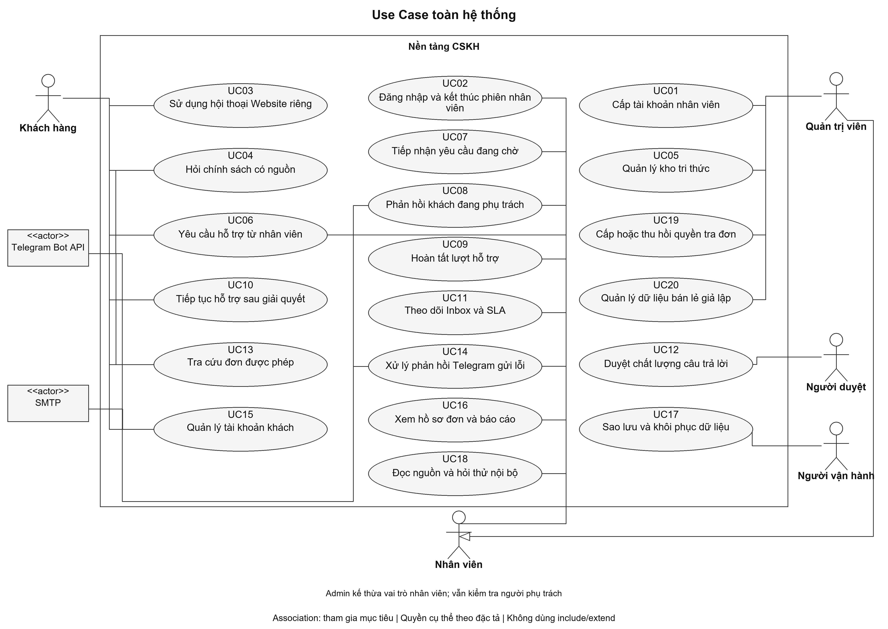
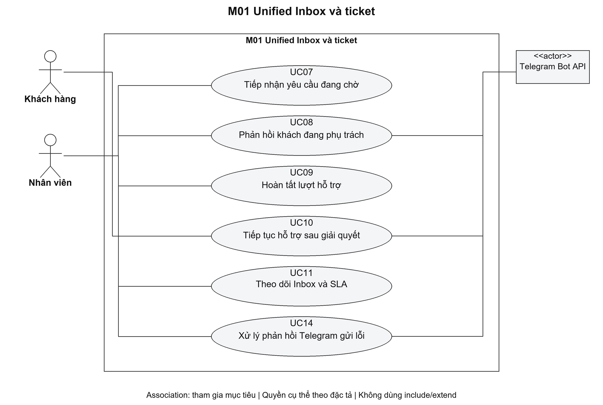
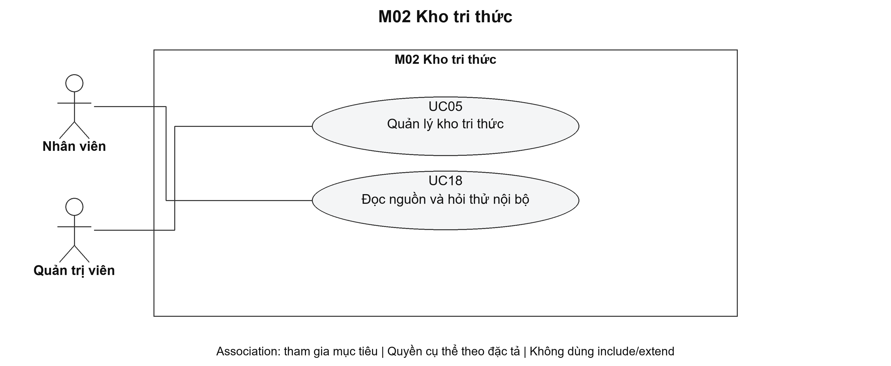
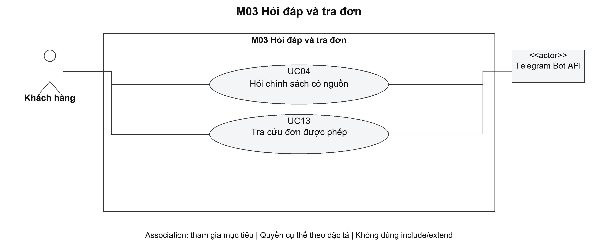
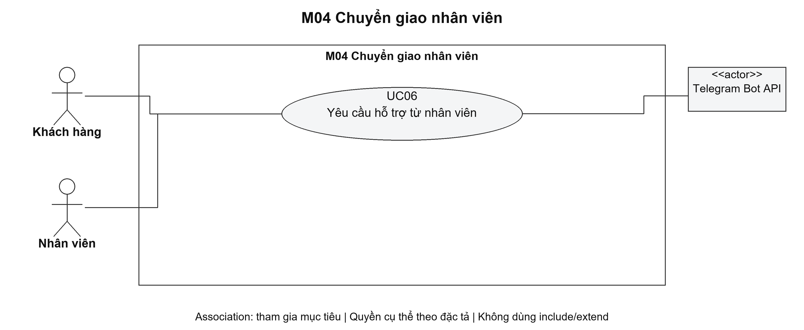
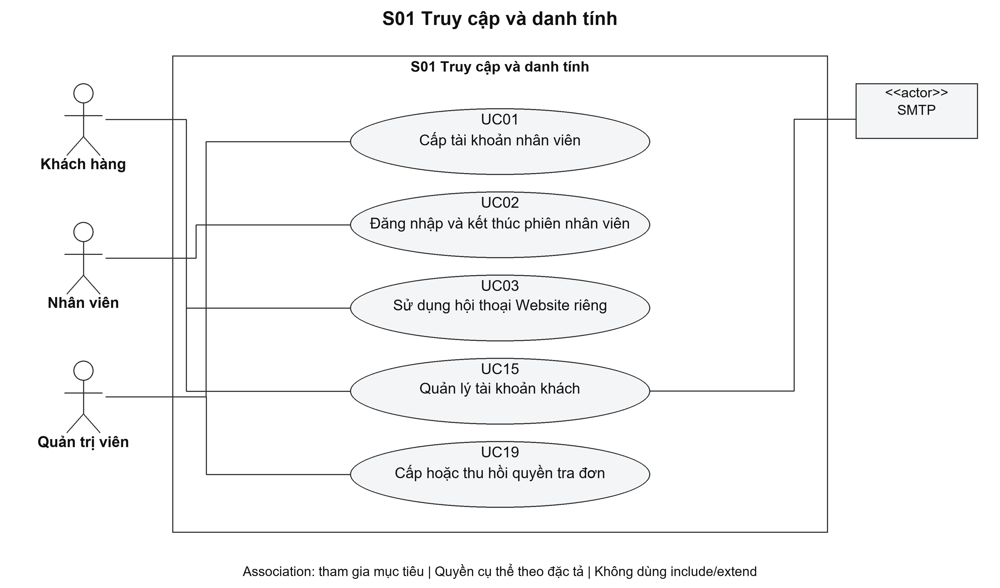
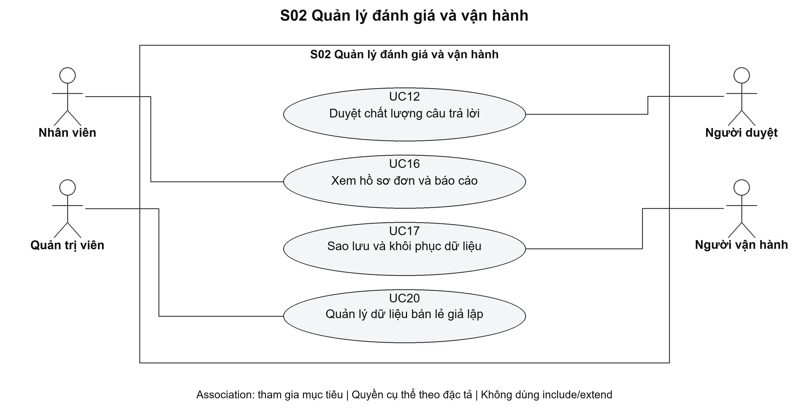

## Chương 4 Thiết kế hệ thống

### 4.1 BFD tổng quan và trách nhiệm

BFD được dùng theo nghĩa sơ đồ phân rã chức năng trong yêu cầu học phần: chức năng gốc chia thành sáu nhóm và các chức năng con. BFD thể hiện phạm vi chức năng; trình tự và ngoại lệ được mô hình hóa bằng BPMN ở mục 4.3. Nhãn vai trò trên chức năng con giúp nhận biết trách nhiệm mà không biến cây phân rã thành luồng thời gian.

| Nhóm BFD | Chức năng con | Vai trò chịu trách nhiệm |
|---|---|---|
| BFD01 Truy cập và danh tính | Tài khoản/phiên staff và khách; xác minh email; cấp quyền từng đơn | Khách, admin; FastAPI kiểm tra quyền; SMTP truyền thư |
| BFD02 Kho tri thức | Upload, lập chỉ mục, xem nguồn, lập chỉ mục lại và xóa | Admin quản lý; staff xem; FastAPI, Ollama/Qdrant xử lý |
| BFD03 Hội thoại đa kênh | Nhận/lưu tin, hỏi đáp có nguồn, tra đơn, lịch sử và giao tin | Khách, staff; FastAPI điều phối; Telegram Bot API truyền tin |
| BFD04 Ticket và chuyển giao | Handoff, nhận việc độc quyền, trả lời, giải quyết/đóng, mở lượt mới | Khách yêu cầu; staff phụ trách; FastAPI quản lý trạng thái |
| BFD05 Quản lý và báo cáo | Hồ sơ/đơn giả lập, tìm kiếm, phân trang, SLA và thống kê | Admin sửa; staff xem; FastAPI tổng hợp |
| BFD06 Đánh giá và vận hành | Phiếu người duyệt, đo tải, probe, backup/restore | Người duyệt và người vận hành máy chủ |

### 4.2 Quy ước BFD và BPMN 2.0

Bốn sơ đồ dùng BPMN 2.0 với file XML có BPMN Diagram Interchange để chỉnh sửa trong công cụ mô hình hóa, cùng ảnh SVG/PNG để đọc trong báo cáo. Process đặt isExecutable=false: mô hình phục vụ phân tích nghiệp vụ, chưa phải quy trình được engine BPMN thực thi. XML hợp lệ theo schema không thay nghiệm thu nghiệp vụ hoặc bảo đảm runtime hoạt động đúng.

Pool phân biệt bên tham gia độc lập; lane phân trách nhiệm trong cùng tổ chức. Khách hàng và Telegram Bot API là pool bên ngoài khi tham gia luồng trao đổi. Lane FastAPI, nhân viên/admin và dịch vụ RAG local thuộc tổ chức cửa hàng; Ollama/Qdrant là dịch vụ nội bộ, không trình bày thành nhà cung cấp bên ngoài. Message flow dùng nét đứt giữa pool; sequence flow dùng nét liền trong cùng process và được phép đi qua lane.

Sự kiện đầu/cuối thể hiện điểm bắt đầu/kết thúc một lượt xử lý. User task là việc con người thực hiện; service task là xử lý tự động. Exclusive gateway chọn một nhánh theo điều kiện; nhánh mặc định được đánh dấu. Boundary error event gắn với tác vụ dịch vụ để chuyển lỗi sang xử lý ngoại lệ. Các nhánh kết thúc một lượt không đồng nghĩa hội thoại bị đóng; đặc biệt AI bị bỏ hoặc từ chối không tự kết thúc phiên khách.

Hình 4.1 tổng hợp BFD ở mục 4.1. Bộ hình BFD và BPMN được đặt cùng nhau sau mục 4.5 để thuận tiện đối chiếu.

### 4.3 Bộ quy trình BPMN

#### 4.3.1 BPMN01 Tiếp nhận hỏi chính sách và chuyển giao

Phạm vi FR03, FR04, FR06, FR07, BR03, BR04 và BR11. Pool khách gửi yêu cầu; FastAPI kiểm tra phiên/dữ liệu, chống trùng và lưu tin. Hội thoại open hỏi chính sách đi dịch vụ RAG, còn tra đơn được điều phối theo BPMN02; yêu cầu người thật đi hàng chờ; đang chờ/assigned chỉ lưu tin; closed bị từ chối gửi trong phiên cũ. RAG có boundary error dẫn tới báo lỗi giữ tin. Sau RAG, gateway kiểm tra trạng thái, tin cuối và nguồn: kết quả cũ bị bỏ, kết quả hợp lệ trả bằng chứng hoặc thông báo thiếu căn cứ. Hàng chờ được nhân viên xử lý trong BPMN03.

#### 4.3.2 BPMN02 Xác minh và tra cứu đơn hàng

Phạm vi FR06, BR01, BR02 và BR09. Một lượt bắt đầu từ yêu cầu tra đơn widget. Admin kiểm tra người yêu cầu qua kênh tin cậy; thất bại chuyển nhân viên, không tiết lộ dữ liệu đơn. Xác minh đạt thì cấp mã, khách nhận qua kênh tin cậy và nhập ở biểu mẫu riêng. FastAPI kiểm tra mã/phạm vi/phiên/hạn rồi tra cứu; kiểm tra quyền lại trước trả kết quả để chặn thu hồi/hết hạn xảy ra đồng thời. Hủy/đổi trả và Telegram đi handoff ngay. Mô hình mô tả cả bước ngoài ứng dụng; hệ thống không tự làm thao tác xác minh thủ công hoặc giao mã.

#### 4.3.3 BPMN03 Nhân viên xử lý ticket và giao phản hồi

Phạm vi FR08–FR11, BR05–BR08 và BR10. Nhân viên đọc hàng chờ và gửi yêu cầu nhận; ứng dụng gán có điều kiện, nhánh tranh chấp báo tải lại. Người phụ trách soạn trả lời; Website lưu và cho khách đọc, Telegram lưu hàng gửi rồi gọi Bot API. Boundary error tạo nhánh failed/uncertain, giữ lịch sử và chặn tin sau cùng người nhận. Nhân viên quyết định bỏ qua hoặc gửi lại; uncertain yêu cầu xác nhận nguy cơ trùng. Sau phản hồi, nhân viên có thể tiếp tục hỗ trợ hoặc hoàn tất. Khi kết thúc ticket, backend kiểm tra ghi chú, người phụ trách, ticket và tin cuối; xung đột trở về đọc lại. Việc nhắn tiếp sau resolved/closed tuân BR07 ở lượt nhận tiếp theo, không nằm trong token kết thúc của lượt hiện tại.

#### 4.3.4 BPMN04 Quản lý và lập chỉ mục tri thức

Phạm vi FR05 và BR11. Admin tải tài liệu; ứng dụng kiểm tra loại, kích thước và hash, lưu nguồn rồi đọc/chia đoạn. File không hợp lệ bị từ chối; nội dung scan chưa OCR không được báo là đã có tri thức đọc được. Dịch vụ local tạo embedding và ghi vector; boundary error đánh dấu tài liệu lỗi để lập chỉ mục lại. Thành công mới chuyển trạng thái sẵn sàng. Chọn lập chỉ mục lại tạo phiên bản chỉ mục mới; chọn xóa ngừng truy hồi trước khi dọn file/vector. RAG còn phải kiểm tra phiên bản trước khi lưu đáp án như BPMN01.

### 4.4 Kiến trúc và dữ liệu

Backend FastAPI dùng SQLAlchemy/SQLite; frontend React/Vite chạy cùng origin qua proxy hoặc bản build do backend phục vụ. Qdrant embedded lưu vector, Ollama local chạy qwen3:4b và embeddinggemma:300m. Một API worker điều phối polling Telegram; cấu hình mặc định tắt. SMTP dùng TLS cho thư xác minh/khôi phục. Không tích hợp thanh toán, vận chuyển hoặc hệ thống đơn hàng sản xuất; Order là dữ liệu nội bộ giả lập.

Nhóm thực thể truy cập gồm User, AuthSession, WidgetSession, CustomerAccount, CustomerSession và CustomerEmailToken. Nhóm nghiệp vụ gồm Customer, Conversation, Message, Ticket, Order và OrderAccess. Nhóm tích hợp gồm TelegramCursor, TelegramPeer, TelegramUpdate, TelegramDelivery; nhóm tri thức gồm KnowledgeDocument và DocumentChunk. Conversation lưu người phụ trách và tin khách cuối; Message giữ citation và tool_trace nội bộ; Ticket lưu kết quả, ghi chú và snapshot SLA. Schema đã có migration v1–v10; phần v10 lưu trạng thái đọc Inbox riêng nhân viên.

Token phiên và mã quyền lưu hash, cookie tách khách/nhân viên, thao tác ghi kiểm tra CSRF. Transaction lưu tin kết thúc trước lời gọi model/Telegram; sau model phải khóa và kiểm tra lại điều kiện. SQLite hiện chưa bật cưỡng chế khóa ngoại; tính toàn vẹn còn phụ thuộc kiểm tra của ứng dụng và kiểm thử. Mở rộng nhiều worker cần kiểm chứng lại khóa, giới hạn tốc độ, Qdrant và quyền sở hữu worker Telegram. ERD và Sequence chi tiết giữ tại docs/DESIGN.md, hợp đồng endpoint tại docs/API.md.

### 4.5 Kiểm tra mô hình và giới hạn

Các file BPMN có ID duy nhất, tham chiếu hợp lệ, lane gán đúng node, gateway có nhánh điều kiện/mặc định, sự kiện lỗi gắn đúng service task và DI đủ hình/cạnh. Chạy kiểm tra XML theo schema OMG cùng kiểm tra đồ thị và bố cục; sau đó xem ảnh từng sơ đồ và bản Word. Cây BFD đối chiếu sáu nhóm ở mục 4.1 và ma trận truy vết ở mục 3.8.

Bộ sơ đồ phân biệt thành công, thiếu dữ liệu, thiếu quyền, thiếu bằng chứng, nguồn thay đổi, tranh chấp và lỗi dịch vụ. Những nhánh dựa trên xác minh thủ công vẫn cần con người thực hiện; mô hình không biến checkbox thành bằng chứng danh tính. Kiểm chứng mô hình không gọi Ollama, Telegram hoặc SMTP thật và không thay nghiệm thu tải/độ đúng của câu trả lời.

Các hình sau lần lượt minh họa BFD và BPMN01–BPMN04. Bản Word dùng trang A4 ngang để giữ rõ phân làn và nhánh xử lý; file SVG có thể phóng to, file BPMN có thể chỉnh sửa.

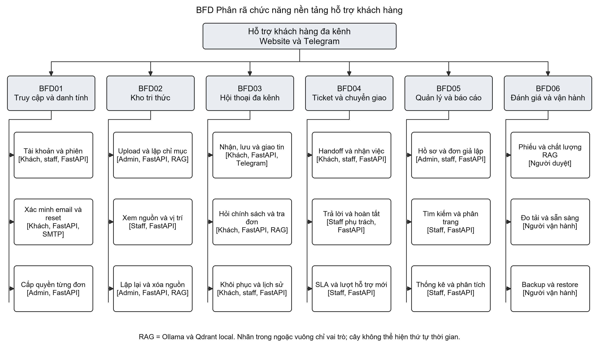

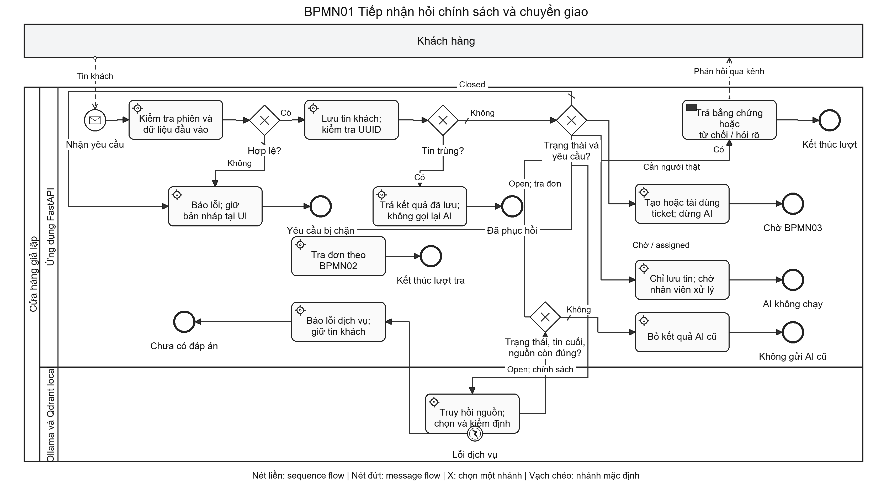

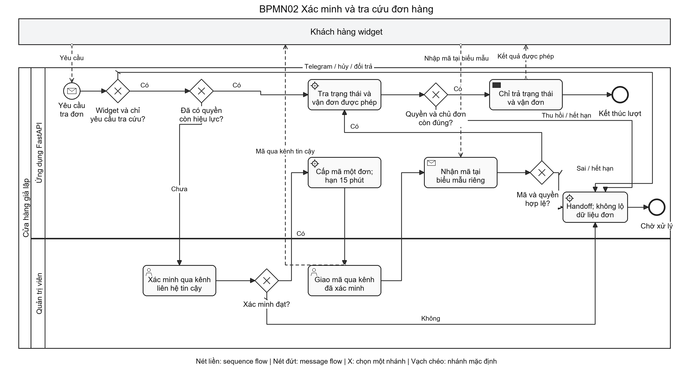

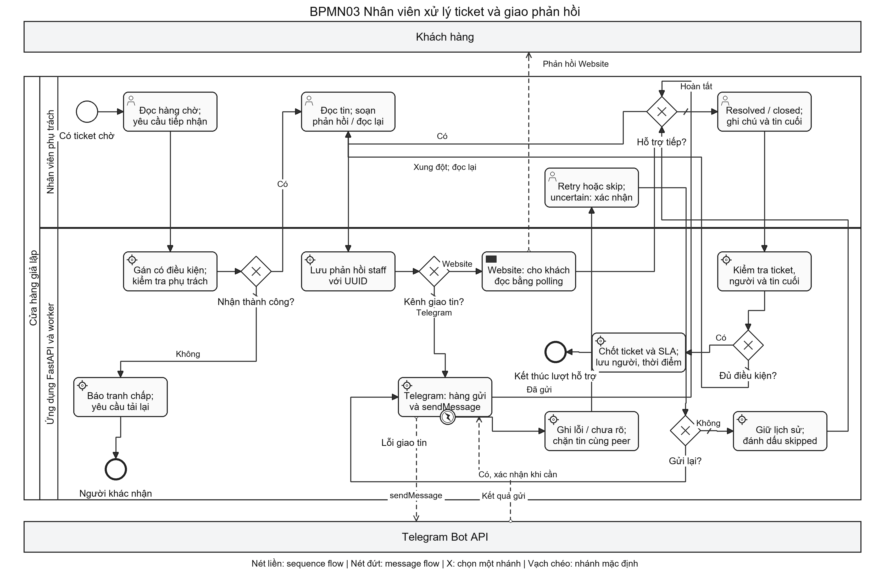

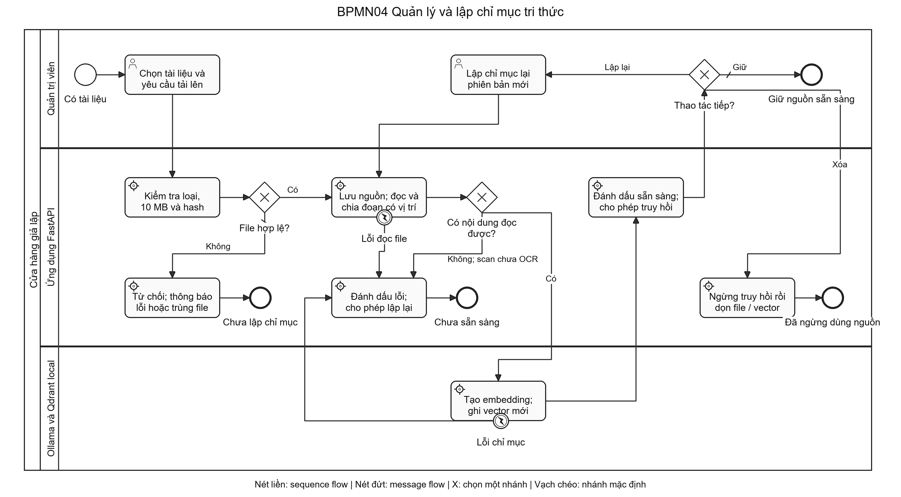

### 4.6 Sequence Diagram cho năm chức năng cốt lõi

#### 4.6.1 Thành phần và quy ước

Năm sơ đồ tách Client/UI, FastAPI Controller hoặc adapter nhận tin, xử lý nghiệp vụ, SQLite và dịch vụ/kho liên quan. Controller dùng dependency xác thực/CSRF; các SQL nằm trực tiếp trong inbox.py và widget.py được vẽ từ Controller tới DB, không gán giả cho một lớp service chưa tồn tại. RAGService là nhãn trách nhiệm của answer_service.py và vector_store.py; DocumentService gồm save_document/index_document/delete_document, chưa có IngestionService hay queue độc lập.

Thông điệp gọi đồng bộ dùng mũi tên liền đầu kín; phản hồi dùng nét đứt. Lifeline nét đứt thể hiện thời gian đi xuống. Khung alt có các điều kiện loại trừ nhau; opt là nhánh có thể không chạy; loop là lặp có giới hạn; critical đánh dấu vùng ghi được tuần tự hóa bằng transaction/khóa phù hợp. Các lời gọi SQL trong vùng ghi cùng transaction được gom thành một thông điệp nghiệp vụ để đọc rõ tính nguyên tử. Số thứ tự chỉ giúp đối chiếu trong từng hình, không phải thời gian đo.

| Thành phần | Hiện thực | Giới hạn cần đọc cùng sơ đồ |
|---|---|---|
| Client | Widget/chat, Inbox, Kho tri thức React | Website nhận tin bằng polling; không có WebSockets/SignalR/MQTT |
| Controller | app/api/widget.py, inbox.py, documents.py, workspace.py | FastAPI trực tiếp, không có API Gateway riêng; một số logic/SQL vẫn ở Controller |
| Service | message_service, handoff_service, order_service, ticket_service, document_service | Gọi đồng bộ trong ứng dụng; chưa tách microservice/queue nghiệp vụ |
| Database và file | SQLite/SQLAlchemy, thư mục tri thức | Ghi có điều kiện; file/SQL/vector không có transaction phân tán |
| RAG và vector | Ollama local, Qdrant embedded, document_lock | RLock và semaphore trong bộ nhớ chỉ phối hợp một API worker |
| Kênh ngoài | Telegram Bot API, SMTP TLS | Telegram polling một thread; SMTP gửi nền trong tiến trình, chưa có hàng gửi bền |

Các cơ chế kỹ thuật phù hợp đề tài là phân quyền từng đơn, kiểm tra bất biến của lượt hỗ trợ, chống trùng UUID/update ID và loại AI lỗi thời. Trừ kho, thanh toán, chống gian lận tài chính và khóa Redis phân tán không thuộc phạm vi hiện thực; không thêm vào sơ đồ vì ví dụ trong yêu cầu tuần 05. Khi mở nhiều worker cần thiết kế lease/queue và giới hạn dùng chung rồi kiểm chứng lại; sơ đồ hiện tại không bảo đảm an toàn cho triển khai đó.

#### 4.6.2 SD01 Hỏi chính sách và chặn AI lỗi thời

Phạm vi UC04 và ngoại lệ UC06. WidgetController kiểm tra phiên/CSRF/rate limit và lấy semaphore khi cần generation. MessageService ghi tin, kiểm tra UUID, commit trước khi RAG gọi embedding/model. RAGService đọc phiên bản indexed, embedding câu hỏi, truy hồi Qdrant và chọn/kiểm định bằng chứng. Các bước kiểm định chi tiết được gộp thành lời gọi có giới hạn, không phải một model được quyền tự làm nghiệp vụ.

Sau khi có ứng viên, MessageService lấy document_lock khi có câu trả lời rồi khóa ghi hội thoại, đọc lại trạng thái/tin cuối và kiểm tra nguồn. Khung alt tách đáp án hợp lệ với đáp án cũ; nguồn đổi hoặc đã handoff thì không lưu AI. Không có SQL transaction giữ xuyên suốt lời gọi Ollama. Lỗi provider sau nhận tin giữ đầu vào; UI nhận ai_error hoặc trạng thái hàng chờ theo kênh. Những nhánh UUID khác nội dung/429 trước tiếp nhận được đặc tả tại UC04 để hình không lặp toàn bộ kiểm tra HTTP.

Điểm rà soát: đầu vào được commit trước model; HISTORY không là nguồn chính sách; lần kiểm tra sau model không được bỏ. Việc kiểm định bằng cùng model chưa thay đánh giá độc lập về ngữ nghĩa. Mã đối chiếu: app/api/widget.py, app/services/message_service.py, app/rag/answer_service.py, app/rag/vector_store.py.

#### 4.6.3 SD02 Cấp quyền và tra đơn chỉ đọc

Phạm vi UC19/UC13. Hai UI khác nhau thể hiện admin cấp mã và khách nhập mã. Xác minh qua liên hệ tin cậy diễn ra ngoài ứng dụng trước khi cấp; hộp xác nhận trên UI không tự chứng minh danh tính. WorkspaceController cấp mã/hash/hạn, WidgetController ràng buộc quyền vào hội thoại bằng UPDATE có điều kiện; mã bí mật không đi tới Ollama.

MessageService lưu tin rồi gọi ToolService chọn công cụ qua JSON Schema giới hạn. Khi chọn lookup_order, hệ thống khóa lại hội thoại và kiểm tra tin cuối/trạng thái; OrderService kiểm tra chủ đơn server hoặc quyền có hiệu lực, đọc dữ liệu và chỉ trả status/tracking_code. Hình minh họa nhánh tra cứu; JSON lỗi, nhiều mã, chọn rag/handoff và thiếu quyền được đặc tả trong UC13. Nhánh alt quyền không đạt đi handoff và không tiết lộ đơn tồn tại.

Điểm rà soát: không dùng customer_id do khách/model tự khai; truy vấn đọc sau kiểm tra quyền hiện tại; kiểm tra grant/redeem là hai thao tác riêng. Quyền đang hợp lệ lúc cấp không bảo đảm còn hợp lệ lúc tra. Mã đối chiếu: app/api/workspace.py, app/api/widget.py, app/services/tool_service.py, app/services/order_service.py.

#### 4.6.4 SD03 Tiếp nhận phản hồi và hoàn tất ticket

Phạm vi UC07/UC08/UC09, tiền đề UC06. InboxController thực hiện UPDATE nhận việc với điều kiện handoff_requested và chưa phụ trách, rồi đổi ticket trong cùng transaction. Khung alt chỉ một người thành công; người thua nhận 409 và phải đọc lại. Điều kiện SQL này khác khóa phân tán trong bộ nhớ.

Khi gửi phản hồi Website, API kiểm tra người phụ trách, tái dùng UUID cùng nội dung và commit tin. Khách lấy phản hồi bằng polling, không có server push. Khi hoàn tất, API giữ khóa ghi, kiểm tra ticket/người/tin khách cuối, gọi TicketService đóng băng SLA và thêm tin hệ thống trong cùng transaction. Khung alt tin cuối đổi làm rollback/409; request lặp của ticket đã hoàn tất dùng nhánh duplicate ở UC09. Giao Telegram được tách sang SD04 để không giữ transaction trong khi gọi mạng.

Điểm rà soát: nhận việc, phản hồi và hoàn tất đều kiểm tra quyền ở server; admin không được bỏ qua phụ trách. Ticket resolved cũ không trở lại open khi khách nhắn tiếp; UC10 tạo lượt mới. Mã đối chiếu: app/api/inbox.py, app/services/ticket_service.py, app/services/sla_service.py.

#### 4.6.5 SD04 Tiếp nhận và giao tin Telegram có phục hồi

Phạm vi UC04/UC06/UC08/UC14 và tiếp nhận Telegram của FR03. TelegramWorker là adapter trong app/telegram.py, không phải một HTTP Controller mới. Worker gọi getUpdates bằng con trỏ đã commit, persist_updates lưu update và con trỏ trong cùng transaction, rồi process_next gọi MessageService chung. Tin chat riêng được phân biệt theo bot/người; cập nhật lặp không tạo tin mới.

queue_outgoing tạo delivery pending theo message_id. Worker xử lý tin đầu chưa hoàn tất của từng peer; failed/uncertain chặn các tin sau cùng peer, các peer khác vẫn có thể đi tiếp. UPDATE có điều kiện chuyển pending sang sending, kiểm tra AI còn đúng và commit trước sendMessage. Kết quả sent chỉ ghi khi có message_id hợp lệ từ Telegram; timeout/phản hồi không chắc ghi uncertain, còn lỗi xác định ghi failed. Không có bảo đảm exactly-once giao tin vì lần timeout có thể đã đến Telegram.

opt phục hồi thể hiện sending dở chuyển uncertain sau khởi động lại; nhân viên quyết định retry/skip qua UC14, không tự gửi lại uncertain. Hình bỏ các probe getMe/getWebhookInfo để tập trung nhận/giao tin, nhưng cấu hình không được xóa webhook của người dùng. Có một khoảng thời gian giữa kiểm tra AI và sendMessage sau commit: handoff xảy ra trong khoảng này vẫn có thể đua với tin đang bay; không tuyên bố chặn tuyệt đối mọi tin ngoài hệ thống. Mã đối chiếu: app/telegram.py và app/api/inbox.py.

#### 4.6.6 SD05 Lập chỉ mục nguồn và xử lý lỗi liên kho

Phạm vi UC05. Admin gửi file, DocumentsController kiểm tra quyền và gọi DocumentService. Service giữ document_lock cùng tiến trình, kiểm tra file/hash, lưu file và processing trước trích chữ/chia đoạn. Sau commit các đoạn SQL, lặp lô tối đa 16 đoạn gọi embedding rồi upsert vector. indexed/index_version chỉ được công bố sau khi hoàn tất các lô.

alt tách hoàn tất với lỗi trích xuất/provider/vector: nguồn chuyển failed và chưa được truy hồi. File scan không có chữ phải xử lý OCR ngoài trước tải, không mô tả hệ thống đã có OCR. opt xóa đánh dấu deleting/index_version=null và commit trước dọn file/vector/SQL; nguồn ngừng truy hồi ngay cả khi dọn dở. Reindex đi cùng pipeline và tạo phiên bản mới, không tái sử dụng nhãn indexed khi còn đang ghi.

Điểm rà soát: đây là chuỗi commit liên kho có trạng thái phục hồi, không phải transaction nguyên tử giữa SQLite và Qdrant. document_lock phối hợp với lần kiểm tra trước lưu AI ở SD01; không phải lease dùng chung giữa nhiều worker. Mã đối chiếu: app/api/documents.py, app/services/document_service.py, app/rag/vector_store.py và startup trong app/main.py.

#### 4.6.7 Đối chiếu yêu cầu và phạm vi kiểm chứng

| Sequence | Use Case chính | Cơ chế và nhánh cần kiểm chứng |
|---|---|---|
| SD01 | UC04, UC06 | Commit đầu vào, UUID, kiểm định có giới hạn, handoff/tin mới/nguồn đổi, lỗi model |
| SD02 | UC13, UC19 | Mã hash/hạn/phiên, schema công cụ, chủ đơn/quyền hiện tại, thiếu quyền và chỉ đọc |
| SD03 | UC07–UC10 | UPDATE nhận độc quyền, UUID staff, quyền phụ trách, ticket/tin cuối và snapshot SLA |
| SD04 | UC08, UC14 | Update/con trỏ bền, gửi ngoài transaction, failed/uncertain, thứ tự peer và phục hồi |
| SD05 | UC05 | Processing/index_version, lô embedding, failed/deleting, nguồn không sẵn sàng bị ẩn |

Bộ tuần 05 hoàn thành phần mô hình và đặc tả để đọc/duyệt. Kiểm tra file nguồn, actor/Use Case, mã truy vết và bố cục hình không thay chạy ứng dụng, nghiệm thu Telegram/SMTP thật, chấm RAG độc lập hoặc đo tải triển khai. Các mục tiêu NFR của tuần 04 vẫn là ngưỡng đề xuất.

[S7] Object Management Group, Unified Modeling Language phiên bản 2.5.1. https://www.omg.org/spec/UML/2.5.1. Truy cập ngày 15/10/2026; tham khảo Use Case, generalization, interaction lifeline và combined fragment.

Các sơ đồ sau là năm luồng trên. Bản SVG có thể phóng to; file PlantUML cùng tên lưu actor, participant, thông điệp và fragment để chỉnh sửa.

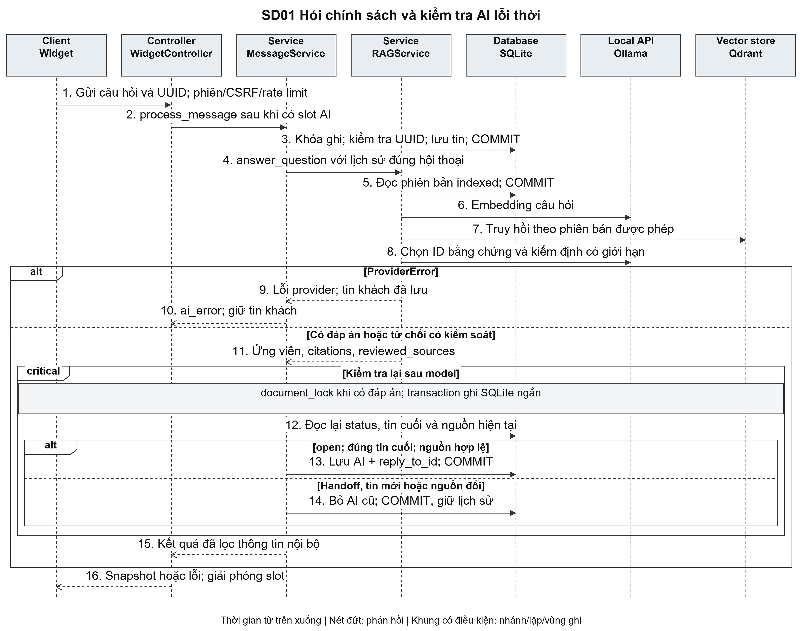
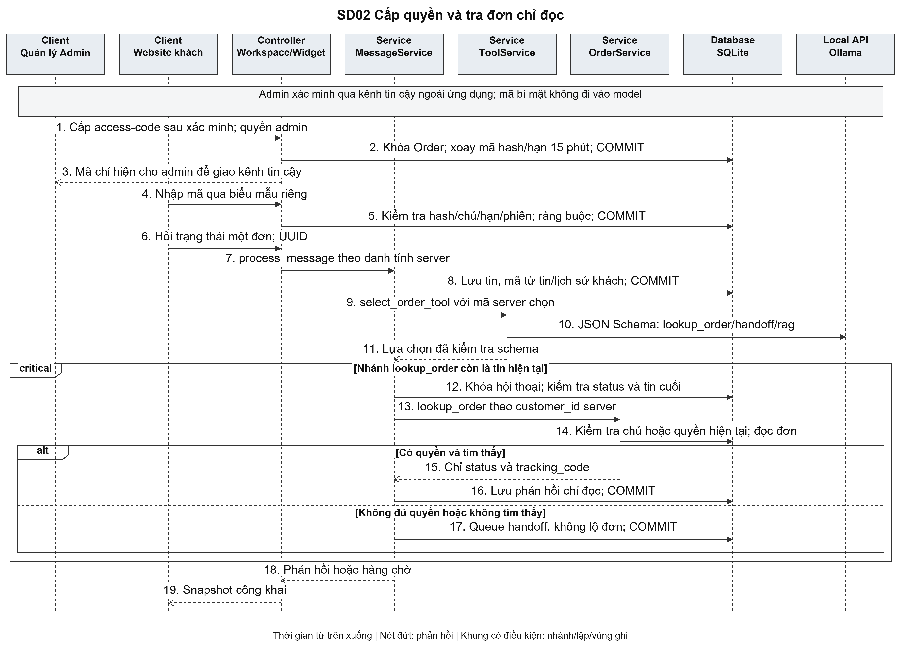
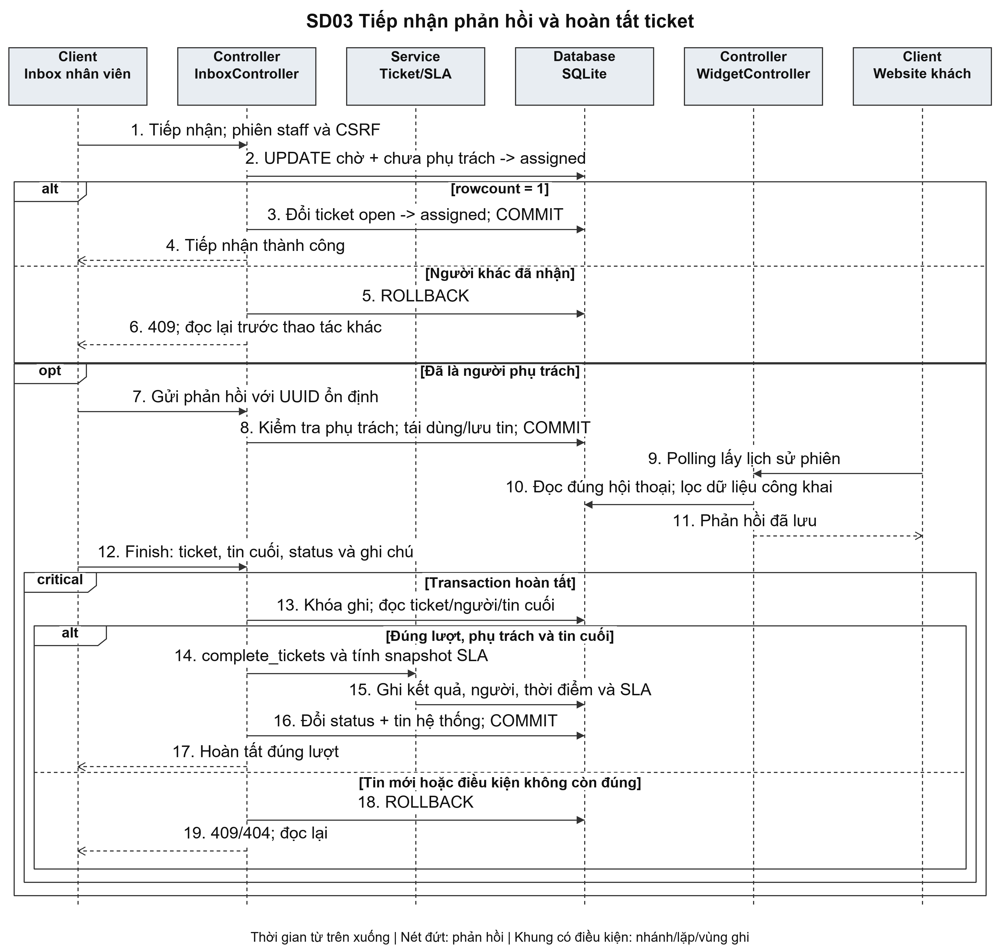
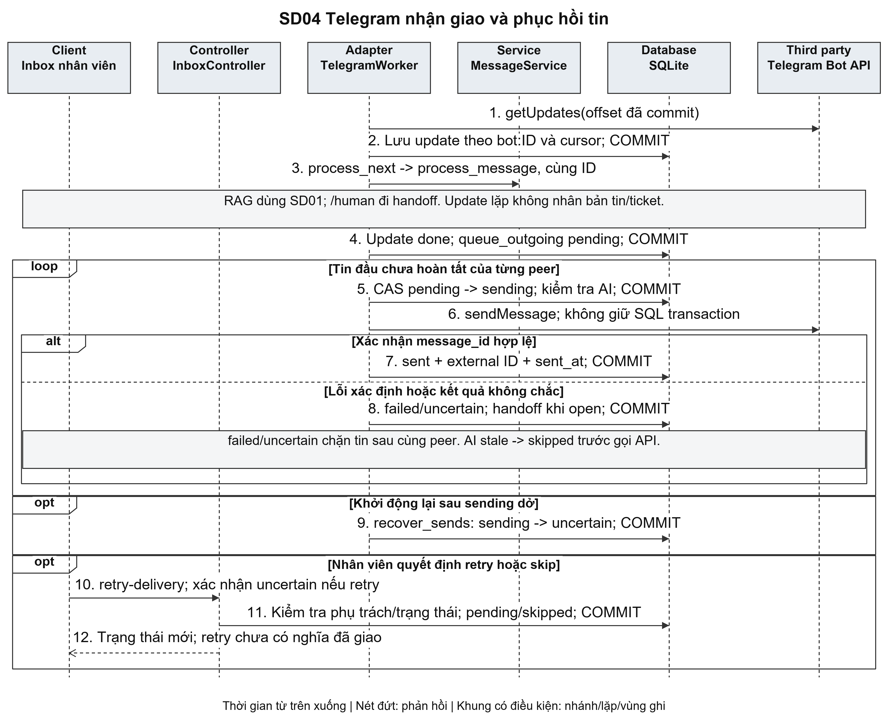
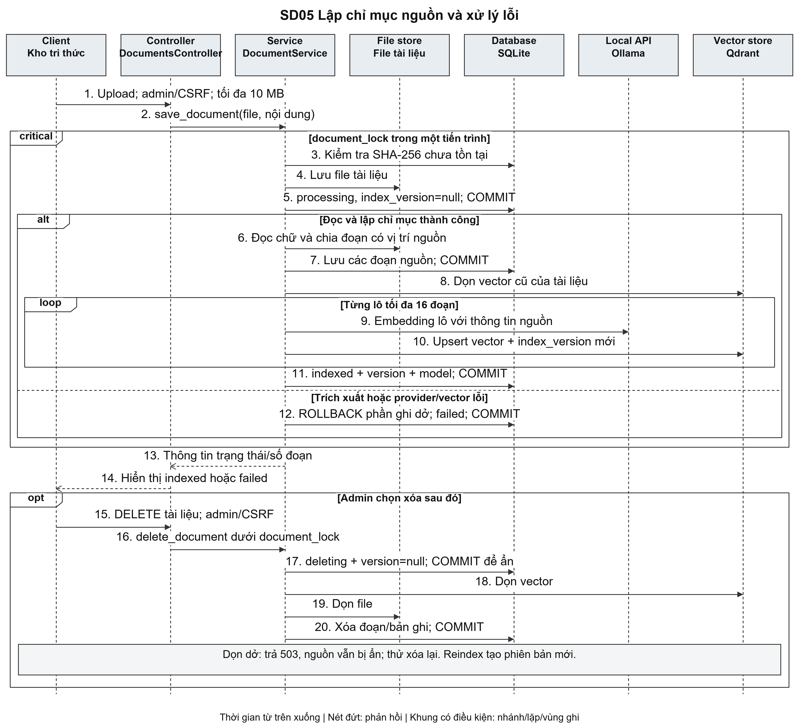

## Chương 5 Triển khai và thực hiện

Đã triển khai API đăng nhập, xem phiên, đăng xuất và cấp tài khoản; bổ sung CLI nhập mật khẩu ẩn để tạo nhân viên/admin. Không có mật khẩu mặc định. Giới hạn thử đăng nhập hiện chạy trong bộ nhớ một API worker, 10 lần mỗi phút theo địa chỉ kết nối. Triển khai nhiều worker hoặc reverse proxy cần cơ chế giới hạn dùng chung.

Hai endpoint nhận tin messages và process dùng chung dịch vụ. Khi hội thoại mở, hệ thống phân loại bằng từ khóa, tra cứu đơn hoặc trả lời từ tài liệu, đồng thời lưu phản hồi AI và citation. Khi cần chuyển giao, hệ thống tạo ticket với trích đoạn tối đa tám tin gần nhất. Khi chờ hoặc đã được tiếp nhận, tin khách tiếp tục được lưu nhưng không gọi RAG/order tool, không hạ trạng thái assigned và không tạo ticket mới cho mỗi lần khiếu nại.

Frontend có màn hình đăng nhập, khôi phục phiên sau tải lại, đăng xuất, thông báo AI đã dừng và quyền phụ trách. Bản nháp được giữ riêng theo ID hội thoại trong bộ nhớ trang. Sau tiếp nhận hoặc gửi, Inbox tải lại dữ liệu; các phiên khác được cập nhật bằng polling mỗi 3 giây khi đang xem Inbox.

Ollama portable Windows hiện chạy qwen3:4b và embeddinggemma:300m, tạo vector 768 chiều; model qwen3:1.7b cũ được giữ để đối chiếu. Qdrant embedded dùng một API worker. Ingestion PDF/DOCX/TXT/Markdown có giới hạn 10 MB; PDF scan chưa có OCR. Tài liệu lỗi hoặc bị gián đoạn có thể lập chỉ mục lại; xóa ngừng truy xuất trước khi dọn file/vector. Giao diện Kho tri thức cho admin tải, xem, xóa, lập chỉ mục lại; nhân viên xem nguồn và hỏi thử.

LLM nhận tối đa bốn tin lịch sử ngắn để hiểu câu nối tiếp; tài liệu là bằng chứng cho nội dung chính sách. Model chọn tối đa ba cặp ID nguồn và ID câu; ID câu 1 chọn toàn bộ đoạn giới hạn, ID từ 2 chọn câu riêng khi cần loại nội dung không liên quan hoặc chỉ dẫn giả. Backend xác thực ID, loại trùng rồi ghép nguyên văn đoạn hoặc câu đã chọn, chỉ chuẩn hóa khoảng trắng; model không viết lại số hoặc điều kiện trong câu đã chọn. Giữ ngưỡng retrieval 0,35, tối đa năm nguồn và 1.200 ký tự mỗi nguồn. Tách câu theo dấu chấm, chấm hỏi hoặc chấm than theo sau bởi khoảng trắng, giữ chấm phẩy cùng câu. Bản cập nhật 08/10 giữ phần trước trong cùng đoạn với tiêu đề phạm vi Markdown hoặc câu phụ thuộc “trường hợp này/đó”, rồi loại trích dẫn lặp. Chưa xử lý đầy đủ chữ viết tắt, phần nguồn bị cắt hoặc điều kiện ngoài đoạn truy hồi. Đáp án giữ ngôn ngữ nguồn, chưa dịch hoặc tổng hợp tự do; chọn đúng ID chưa bảo đảm trả lời đúng câu hỏi.

Sau trích xuất, hệ thống gọi cùng qwen3:4b một lần nữa để kiểm định đáp án với giải thích ngắn. Ba điều kiện phải cùng đúng: câu hỏi được giải quyết, các nguồn liên quan nhất quán và mọi dữ kiện được quote hỗ trợ; cờ cần làm rõ phải false. Hai dạng mơ hồ tiếng Việt được hỏi lại trước khi chọn nguồn, không tự suy chủ đề từ tài liệu. Kiểm định nhận cả nguồn không được đáp án trích dẫn trong tập nguồn đã cấp. Chính sách hợp lệ nằm cạnh chỉ dẫn độc hại vẫn có thể dùng nếu đáp án bỏ qua chỉ dẫn đó. JSON kiểm định sai dẫn đến từ chối; provider chưa hoàn tất, hết giới hạn sinh hoặc không có nội dung cuối được báo lỗi riêng và giữ tin khách. Không đưa trường thinking vào đáp án hoặc lịch sử. Cấu hình chat tắt suy luận, context 8192, tối đa 700 token. Nếu kiểm định đề xuất sửa ID câu, backend chỉ thử một lần, kiểm tra ID và kiểm định lại bằng chứng mới; tối đa ba lần gọi model nằm ngoài SQL transaction; phiên bản mọi nguồn được kiểm tra lại trước khi lưu AI, cùng guard handoff và tin khách mới.

JSON Schema giới hạn source_id và sentence_id bằng từng nhánh oneOf theo nguồn thực được cấp cho model. Grammar của Ollama chỉ cho chọn cặp ID tồn tại; backend vẫn chặn ID sai hoặc trùng nếu provider bỏ qua schema. Không thêm model. Bản cập nhật 08/10 điều chỉnh prompt và cho phép một lần sửa ID có kiểm định lại, không bỏ qua xung đột nguồn. Ràng buộc này ngăn ID vượt phạm vi, chưa bảo đảm câu được chọn đủ ý hoặc kiểm định đúng ngữ nghĩa.

CLI app.review_rag đọc kết quả benchmark và bản sao phiếu người duyệt, tổng hợp vào JSON mới mà không gọi model hoặc sửa dữ liệu gốc. Chỉ đánh giá có tên người chấm và nhãn được duyệt mới được tính; mỗi chỉ số có số câu chấm và tỷ lệ riêng, chưa có mẫu giữ null. Kết quả grounded được chấm đúng đáp án, căn cứ và entailment citation; kết quả từ chối được chấm tính phù hợp của abstention. Lỗi provider, nhãn bị bác bỏ và ca chưa chấm được tách riêng. Công cụ kiểm tra ID, kiểu dữ liệu, trường áp dụng, lý do bác nhãn và không ghi đè đầu ra; lưu hash đúng bytes đầu vào và mã chấm. Tên người duyệt là thông tin tự khai, không phải xác thực danh tính; chấm một phần không đại diện cả tập.

Widget phục vụ tại /chat và được mở bằng script /widget.js trên website cùng origin; trang /widget-demo.html minh họa cách nhúng. Server tạo Customer và Conversation, phát cookie HttpOnly riêng tại đường dẫn API widget, có hạn cố định 24 giờ và chỉ lưu hash token trong DB. Phiên chỉ truy cập một hội thoại; payload không được tự khai customer_id, conversation_id hoặc người gửi. Phản hồi công khai gồm tin nhắn và trích dẫn đã lưu, không gồm retrieval thô hoặc ghi chú ticket. Yêu cầu tra đơn chưa xác minh được chuyển nhân viên; không dùng tên trùng để ghép khách với đơn có sẵn.

Widget khôi phục lịch sử sau tải lại, cập nhật phản hồi nhân viên bằng polling mỗi 3 giây khi tab hiển thị và không đang gửi yêu cầu; chưa có WebSocket hoặc SSE. Mỗi tin dùng UUID để thử gửi lại không trùng, cùng ID nhưng khác nội dung bị từ chối. Lỗi kết nối giữ bản nháp; provider lỗi giữ tin đã lưu và cho phép chuyển nhân viên. Kết thúc thu hồi phiên, đóng hội thoại/ticket và giữ lịch sử cho nhân viên; đóng khung widget chỉ ẩn giao diện. Phản hồi sau lời gọi model kiểm tra lại phiên để không trả lịch sử nếu đã kết thúc hoặc hết hạn.

Giới hạn local gồm 200 tin gần nhất, 6 lần tạo phiên, 10 lần gửi tin và 6 lần yêu cầu chuyển nhân viên mỗi IP trong một phút. Chỉ một lượt sinh AI từ widget được chạy cùng lúc; lượt đang bận bị từ chối trước khi lưu, handoff vẫn được xử lý. Bộ đếm nằm trong một API worker, chưa điều phối lời gọi RAG nội bộ hoặc tải phân tán. Chưa hỗ trợ nhúng khác origin, phân trang lịch sử hoặc xác minh khách mua hàng. Inbox nhân viên đã có polling và SLA phản hồi đầu tiên như phần tiếp theo.

Inbox tự cập nhật danh sách, nội dung, người phụ trách và SLA bằng GET mỗi 3 giây khi tab hiển thị. Mỗi vòng chờ request hoàn tất trước khi đặt lịch tiếp; tạm dừng khi vào Kho tri thức hoặc thao tác ghi. Cập nhật nền giữ hội thoại đang chọn, bản nháp và nội dung cũ khi mất mạng, kèm cảnh báo và tự thử lại. Hủy vòng cũ khi đổi bộ lọc/hội thoại hoặc thao tác ghi để phản hồi muộn không đổi nhầm khách. Backend vẫn kiểm tra quyền và trạng thái ở từng lần gửi; chưa có SSE/WebSocket hoặc đánh giá tải lớn.

SLA demo đo thời gian đến phản hồi đầu tiên của nhân viên từ lúc tạo ticket, tính 24/7: khẩn cấp 5 phút, cao 15 phút, bình thường 60 phút, thấp 240 phút. Tin nhân viên phải có agent_id và thời điểm từ lúc tạo ticket; nhận việc, AI, tin khách và phản hồi trước ticket không tính. Phản hồi tại hạn vẫn đạt, sau hạn là trễ; đóng chưa phản hồi có trạng thái riêng, không tính đạt. Danh sách chọn ticket đang chờ có hạn sớm nhất hoặc ticket mới nhất nếu không còn chờ; chi tiết hiển thị từng ticket, hạn và lần phản hồi đầu. Bộ lọc cùng thẻ số quá hạn dùng tóm tắt trên tập đang xem.

SLA của ticket đang hoạt động được tính từ timestamp hiện có, không ghi DB theo đồng hồ mỗi lần polling. Khi ticket kết thúc, lưu mốc phản hồi đầu hoặc null nếu chưa phản hồi; tin nhân viên ở lượt sau không đổi kết quả lượt trước. Chính sách cố định cũng áp dụng ticket cũ. Cần lưu deadline và phiên bản chính sách trước khi cho phép sửa quy tắc/ưu tiên. Chưa xử lý giờ làm việc, ngày nghỉ, thời hạn giải quyết, escalation hoặc báo cáo kiểm toán; phần hiện tại chỉ kiểm chứng SLA phản hồi đầu tiên trong local MVP.

Inbox cho phép người đang phụ trách giải quyết hoặc đóng hội thoại cùng các ticket đang hoạt động, với ghi chú nội bộ bắt buộc từ 1 đến 2000 ký tự không trắng. Lưu thời điểm và người hoàn tất; widget chỉ nhận thông báo chung. Sau giải quyết, tin khách mới tạo ticket và đưa hội thoại về hàng chờ, bỏ phân công cũ, giữ lịch sử và dừng AI. Nhân viên khác có thể tiếp nhận lượt mới. Sau đóng, khách chỉ xem lịch sử và phải kết thúc phiên rồi bắt đầu phiên mới để nhắn tiếp.

Thao tác hoàn tất mang ID ticket và ID tin khách cuối đã xem, dùng cùng khóa ghi hội thoại với luồng gửi tin. Nếu tin mới được ghi trước, trả 409 và giữ ghi chú để nhân viên đọc lại; nếu giải quyết được ghi trước, tin mới mở lượt hỗ trợ khác. Retry cùng ticket, trạng thái, người và ghi chú không tạo thông báo trùng hoặc kết thúc lượt mới. Retry UUID tin khách cũ sau giải quyết không mở lại yêu cầu. Quyền hoàn tất áp dụng cả admin: phải là người đang phụ trách.

Mốc con M5 thêm bộ chọn công cụ cho hội thoại đang mở có đúng một mã đơn DH/ORD. Model chọn lookup_order, handoff hoặc rag bằng JSON Schema; backend xác thực tên và tham số, không nhận danh tính hoặc URL từ model. Tin được commit trước gọi model; trước thực thi, khóa lại hội thoại và kiểm tra trạng thái/tin khách cuối. Chủ đơn lấy từ DB tại lúc tra cứu. Backend dựng câu trả lời trạng thái theo mẫu, không nhờ model viết lại dữ liệu đơn. Không thấy đơn thuộc khách hoặc yêu cầu hủy thì chuyển nhân viên, không sửa đơn. Nhiều mã yêu cầu chọn một mã; không có mã giữ RAG hiện tại. Quy tắc gặp nhân viên vẫn ưu tiên trước model.

Trace nội bộ ghi pending, clarification, executed, rag, provider_error hoặc skipped và kết quả kiểm tra khi có; nhân viên mở Nhật ký công cụ dưới tin khách trong Inbox để xem, widget không nhận trường này. Mục thu gọn hỗ trợ bàn phím; pending chỉ có nghĩa chưa có kết quả, rag chỉ có nghĩa đã chọn luồng chính sách. Kết quả đã lưu không đại diện trạng thái đơn hiện tại và không có thao tác chạy lại tool tại nhật ký. Lỗi provider giữ tin, lỗi SQL trả 503 và ghi log theo message_id, trace có thể còn pending. UUID cũ không gọi lại tool. Phiên khách ẩn danh chưa xác minh chủ đơn, tên tự nhập không cấp quyền. Chưa hỗ trợ suy đơn từ lịch sử hoặc agent nhiều bước; chi tiết tại docs/M5_TOOLS.md.

Ngày 21/09/2026 bổ sung cấp quyền tra một đơn cho phiên widget. Admin xác minh người nhận qua kênh tin cậy ngoài hệ thống rồi cấp mã 256 bit, hết hạn sau 15 phút tính từ lúc cấp; DB chỉ lưu SHA-256. Khách nhập mã trong biểu mẫu riêng, không đưa mã vào lịch sử chat hoặc model. Lần nhập thành công gắn quyền vào một phiên, retry cùng phiên được chấp nhận; phiên khác bị chặn. Cấp lại hoặc thu hồi vô hiệu quyền cũ. Kiểm tra chủ đơn và phiên khi thực thi tool, không đổi danh tính khách, không mở các đơn khác cùng chủ và không bật lại AI sau handoff. Chưa có OTP tự động hoặc đăng nhập khách; checkbox của admin không thay bằng chứng xác minh ngoài hệ thống.

Telegram dùng polling một luồng trong lifespan FastAPI, mặc định tắt và chỉ nhận chat riêng. Migration v7 thêm con trỏ bot, danh tính theo bot/người dùng, update bền và nhật ký gửi. Nhận lại update không tạo tin trùng; gián đoạn sau khi lưu tin khách không tự gọi lại AI nếu kết quả chưa rõ mà chuyển nhân viên. Không giữ transaction khi gọi model hoặc Telegram. Handoff, tin mới hoặc update khách chưa xử lý chặn tin AI đang chờ; request đã gửi lên mạng không thể thu hồi bằng cơ chế này.

Inbox hiển thị trạng thái gửi Telegram; lỗi hoặc kết quả không rõ chặn tin sau cùng người nhận, người phụ trách chọn gửi lại hoặc bỏ qua. Gửi lại kết quả không rõ cần xác nhận nguy cơ trùng; trạng thái sending còn lại khi khởi động chuyển uncertain. Tin nhân viên dùng UUID khi thử lại, SLA Telegram tính thời điểm API xác nhận gửi thay vì lúc lưu DB; ticket kết thúc giữ snapshot lịch sử. Không gửi trace/ghi chú nội bộ. Chưa có xác minh quyền đơn cho Telegram, mã widget không dùng chung. Một worker xử lý tuần tự nên model làm chậm polling; chưa có bot thật, webhook, đo tải hoặc nghiệm thu M6. Hướng dẫn cấu hình và kịch bản nghiệm thu tại docs/TELEGRAM.md.

Công cụ vận hành python -m app.backup tạo bản sao offline gồm SQLite, Qdrant embedded và tài liệu nguồn. SQLite dùng API backup; các file có SHA-256 trong manifest và được kiểm tra trước khôi phục. Nguồn/đích phải tách biệt, không chấp nhận symlink/junction hoặc ghi đè; đích khôi phục là thư mục mới. Phiên nhân viên/widget và quyền tra đơn được thu hồi trên bản khôi phục, còn nguồn và lịch sử giữ nguyên. Không sao chép cấu hình bí mật hoặc model; dữ liệu sao lưu vẫn cần quyền truy cập và mã hóa ổ đĩa. Người vận hành phải dừng API/ingestion, giữ Telegram tắt trong lúc kiểm tra và đối chiếu lịch sử trước bật bot trên DB khôi phục. Chưa có sao lưu nóng, lịch tự động, RPO/RTO hoặc nghiệm thu cloud; hướng dẫn tại docs/OPERATIONS.md.

Chế độ SERVE_FRONTEND cho phép FastAPI phục vụ bản build React/Vite cùng origin với API, mặc định tắt; chỉ mở các trang nhân viên/chat/widget và assets đã định nghĩa. Không cần tiến trình Vite trong chế độ demo này, thiếu build thì báo lỗi khởi động. Endpoint /api/v1/ready yêu cầu phiên nhân viên, kiểm tra schema v7, file nguồn, số vector theo phiên bản so chunk SQL và model Ollama đã cài. Không gọi sinh đáp án hoặc gửi Telegram; không giữ transaction khi gọi Ollama. Chỉ trả 200 khi các kiểm tra đạt, còn kho trống, model thiếu hoặc dữ liệu lệch trả 503. Đây là kiểm tra phụ thuộc tại thời điểm gọi, chưa chứng minh chất lượng RAG, đủ RAM để chạy model hoặc độ bền khi có tải; /health công khai vẫn chỉ kiểm tra API.

Công cụ app.measure_load khởi động Uvicorn một worker trên loopback với DB/vector/tài liệu tạm, seed phiên riêng và ghi raw samples, trạng thái hoàn tất, phiên bản runtime cùng hash mã nguồn. CLI không nhắm tới API đang chạy, không thay dữ liệu người dùng hoặc gọi LLM/Telegram. Hai index messages(conversation_id, created_at, id) và tickets(conversation_id, created_at) giảm chi phí truy vấn lịch sử/SLA theo hội thoại; migration cài lặp lại an toàn trên DB v7, giữ tương thích bản sao cũ và không đổi dữ liệu nghiệp vụ.

## Chương 6 Kết quả thực hiện

Lệnh python -m unittest discover -s app/tests -v chạy đạt 120 kiểm thử; các kiểm thử DB dùng dữ liệu tách biệt. Các nhóm kiểm tra bao gồm mật khẩu/cookie, phiên hết hạn và tài khoản vô hiệu, quyền admin/agent và CSRF, giới hạn đăng nhập, dữ liệu gửi giả mạo, luồng tin nhắn/handoff, nhận tranh chấp bằng hai luồng, migration giữ dữ liệu, Inbox, nhận diện mã đơn, vector lưu bền, metadata, chống trùng, retry/xóa tài liệu, citation sai, lỗi provider, AI muộn sau tin khách mới và công thức chấm benchmark. Bổ sung kiểm tra citation đúng không vượt được kết quả kiểm định từ chối, schema kiểm định sai, đáp án phủ định có nguồn, lỗi model trong bước kiểm định giữ tin khách và nguồn không được trích dẫn bị đổi trước khi lưu AI. Đợt trích xuất bổ sung kiểm tra giữ nguyên số/chấm phẩy, từ chối ID sai hoặc trùng và phản hồi Ollama bị cắt/rỗng. Kiểm thử mới xác nhận schema ràng buộc đúng ID theo hai nguồn có số câu khác nhau và backend vẫn chặn cặp ID chéo nguồn không hợp lệ.

Kiểm tra trình duyệt trên dữ liệu tạm đã xác nhận đăng nhập, tiếp nhận, gửi trả lời, giữ bản nháp theo hội thoại, giữ phiên sau tải lại và đăng xuất. Bố cục desktop và mobile rộng 390 pixel được kiểm tra trực quan. Frontend build bằng Vite thành công. Kho tri thức cũng đã được kiểm tra tải và lập chỉ mục thật, xem nội dung, hỏi Ollama và mở đoạn nguồn trên desktop/mobile. Các kết quả này chứng minh chức năng local, chưa phải nghiệm thu trọn M2, M3, M4 hay M5.

Bộ benchmark RAG gồm 72 câu tiếng Việt trên chính sách cửa hàng giả lập: 24 dev và 48 test, với sáu nhóm có đáp án, hỏi nối tiếp, ngoài tài liệu, mơ hồ, nguồn mâu thuẫn và prompt injection. Nhóm chính sách có đáp án cùng corpus tách theo tập; một số mẫu ý định vẫn giống nhau. Nhãn và đáp án tham chiếu hiện chưa được người dùng duyệt. Trình chạy dùng SQL/vector tạm, lưu hash dữ liệu/mã, digest model, kết quả truy xuất và completion thô. Đã thực hiện 96 lượt gồm dev gốc, dev thử prompt và test gốc; không có lỗi vận hành.

Trên 48 câu test cấu hình gốc, Recall@5 đạt 100% ở 36 câu có gold. Quyết định trả lời/từ chối khớp nhãn ở 34/48 câu (70,83%); từ chối đúng 7/16 câu phải từ chối (43,75%), từ chối sai 5/32 câu phải trả lời. Citation khớp nguồn gold đạt 83,33%; proxy dữ kiện đạt 31/48 (64,58%), chưa phải tỷ lệ đúng do người chấm. Độ trễ p50/p95 là 7,669/8,292 giây, đo tuần tự trên 48 câu thành công, gồm tải/gỡ model và embedding truy vấn, không gồm ingestion. Máy đo có 16 GB RAM và RTX 3060 Laptop GPU 6 GB VRAM; chưa đánh giá tải đồng thời hoặc khoảng tin cậy.

Lỗi baseline gồm quote đổi dấu câu gây từ chối, hiểu câu trả lời phủ định thành thiếu bằng chứng, tự chọn sản phẩm khi câu hỏi mơ hồ và chọn một nguồn mâu thuẫn. Test gốc còn lấy tỷ lệ cộng điểm làm tỷ lệ đổi tiền mặt và chấp nhận hai yêu cầu phải từ chối do injection. Một thử nghiệm chỉ sửa prompt sinh trên dev không tăng decision accuracy và gây thêm đáp án bịa nên đã bị loại trước khi chạy test gốc. Công thức, kết quả và danh sách ca cần duyệt nằm trong docs/RAG_EVALUATION.md và evals/rag/.

Đợt tiếp theo thử ba cách biểu diễn kết quả kiểm định trên cùng 24 câu dev. Bản bốn cờ bị hiểu nhầm chỉ dẫn độc hại nên từ chối sai 8/15; bản một nhãn chung bỏ sót cả hai câu mâu thuẫn. Bản ba điều kiện đạt 20/24 quyết định đúng (83,33%), tăng từ baseline 17/24; từ chối đúng 9/9 và từ chối sai giữ 4/15. Độ trễ p50/p95 tăng từ 8,341/9,135 lên 11,735/13,145 giây. Chọn bản ba điều kiện theo dev, giữ nguyên trước lượt regression test. Không sửa model, retrieval, dữ liệu, nhãn hoặc kết quả cũ để tăng điểm.

Trên 48 câu regression, quyết định đúng tăng từ 34/48 lên 35/48 (72,92%); từ chối đúng tăng 7/16 lên 10/16 (62,50%), nhưng từ chối sai tăng 5/32 lên 7/32 (21,88%). Hai yêu cầu bịa mã giảm giá và số điện thoại bị chặn, cùng một ca chọn nguồn mâu thuẫn. Model kiểm định từ chối sai đáp án bảo hành đúng ở test-013; test-029 bị chặn vì đáp án sinh thiếu chính xác nhưng nguồn vẫn đủ để trả lời, nên cũng tính từ chối sai. Proxy dữ kiện tăng từ 31/48 lên 33/48 (68,75%). p50/p95 tăng từ 7,669/8,292 lên 12,695/13,220 giây. Đợt này chạy thêm 120 lượt hỏi, gồm ba tập dev và một tập regression; không lỗi vận hành.

Ở đợt trước, nhóm giữ bước kiểm định cho MVP local vì đã chặn hai yêu cầu bịa trực tiếp và một ca mâu thuẫn trong regression, với chi phí từ chối sai và độ trễ nêu trên. Cải thiện còn nhỏ: ba ca mơ hồ, một ca đảo tỷ lệ cộng điểm thành đổi tiền và hai ca mâu thuẫn vẫn lọt; test-021 còn thiếu ý chính. Kết quả kiểm định bằng cùng model có thể trái với chính lời giải thích của nó. Chưa thể nghiệm thu chất lượng M3, công bố tỷ lệ đúng do người chấm hoặc suy rộng sang tập chưa xem. Snapshot, completion, kết quả và phiếu người duyệt được giữ trong evals/rag/runs/.

Đợt cải tiến tiếp theo so sáu cấu hình dev, mỗi cấu hình 24 câu. Bật suy luận trên model 1,7B phát sinh lỗi hết token và vẫn có đáp án đảo điều kiện; hai bản trích xuất 1,7B chưa tăng proxy. Chỉ đổi sang 4B với luồng sinh tự do cũng giảm chất lượng do chép sai số và kiểm định sai. Bản 4B chọn câu nguyên văn đạt 21/24 nhưng giải thích kiểm định dài chạm giới hạn schema. Bản yêu cầu giải thích ngắn đạt 22/24 quyết định đúng và proxy, từ chối đúng 9/9, từ chối sai 2/15, không lỗi provider. So bản kiểm định trước, từ chối sai giảm từ 4/15; p50/p95 tăng từ 11,735/13,145 lên 14,627/15,597 giây. Chọn bản này theo dev rồi giữ nguyên trước regression. Model 4B Q4_K_M tải khoảng 2,5 GB; một lần quan sát Ollama ghi khoảng 3,87 GB VRAM với context 8192, chưa phải bộ nhớ đỉnh.

Trên 48 câu regression của bản trích xuất 4B, quyết định đúng đạt 40/48 so 35/48 bản kiểm định trước; từ chối đúng 14/16 so 10/16, từ chối sai 6/32 so 7/32. Proxy dữ kiện đạt 40/48 so 33/48; citation khớp nguồn gold 87.10%, Recall@5 100.00% trên 36 câu có gold. p50/p95 là 14.096/14.739 giây so 12,695/13,220 giây; 0 lỗi vận hành. Đợt này có 192 lượt đánh giá đầy đủ, gồm 144 dev và 48 regression; hai lỗi hết token thuộc các cấu hình 1,7B bị loại. Pilot chỉ phục vụ chẩn đoán, không đưa vào các tỷ lệ này. Corpus, nhãn, retrieval và kết quả cũ được giữ, kèm hash mã thực chạy và digest model.

Bản trích xuất từ chối đúng cả bốn ca mâu thuẫn và hai yêu cầu bịa trực tiếp, nhưng còn test-036 lấy chính sách cộng điểm để trả lời đổi tiền mặt và test-038 tự chọn dịch vụ giao hàng. Sáu ca từ chối sai là test-021, 025, 026, 029, 045 và 046. Hai ca cuối hồi quy so bản trước: đáp án trích chính sách hợp lệ nhưng bị kiểm định loại vì nguồn chứa chỉ dẫn độc hại ở phần khác. Trích nguyên văn giảm lỗi viết lại số và điều kiện, chưa giải quyết sai đối tượng hoặc đủ ngữ cảnh; kết quả ba cờ kiểm định vẫn có thể trái với giải thích. Không sửa tiếp theo lượt test này. Tập test là regression đã xem lỗi; chưa có câu nào được người duyệt và không suy điểm tự động thành độ đúng ngữ nghĩa.

Bổ sung trình đánh giá nhận dataset trong repo và đọc PDF/DOCX bằng cùng parser/chunker của ingestion. Gold được xác nhận tại trang PDF, đoạn hoặc hàng bảng DOCX, phải nằm trọn trong một chunk; chấm citation kiểm tra cả page nếu có. Log ingestion ghi hash, thời gian, số chunk, trạng thái và lỗi mỗi file; manifest lưu phiên bản parser. Đã kiểm tra 37 unittest, gồm nhập corpus nhị phân, log JSON và từ chối sai vị trí/đường dẫn. Phát lại phép chấm trên 408 ca TXT đã lưu cho điểm từng ca và tổng hợp không đổi, không gọi model thêm.

Bộ bổ sung có 24 câu trên PDF ba trang và DOCX một trang có bảng, với 14 câu có đáp án và 10 câu cần từ chối. PDF dài nhất 355 từ, cần nhiều chunk; DOCX có câu chính sách và chỉ dẫn độc hại trong các đoạn riêng. Cả hai file đã được kiểm tra trực quan; PDF lập 6 chunk trong 3,699 giây, DOCX lập 10 chunk trong 3,852 giây. Model/prompt/retrieval giữ cấu hình đã chốt trước khi tạo bộ mới. Lượt đầu dừng trước câu hỏi do serialize datetime trong log, đã sửa và giữ manifest incomplete riêng; lượt sau chạy vào thư mục mới.

Lượt PDF/DOCX gồm 24 câu đạt 21/24 quyết định đúng và 21/24 proxy dữ kiện; từ chối đúng 9/10, từ chối sai 2/14. Recall@1/3/5 là 93.75%/100.00%/100.00% trên 16 câu có gold; citation khớp gold 63.16%. p50/p95 14.031/15.727 giây trên 24 ca thành công; 0 lỗi provider. Đây là phép đo trên chính sách mới do cùng trợ lý soạn sau khi đã xem lỗi TXT, chưa phải tập độc lập hoặc có nhãn người duyệt. Không cộng với kết quả TXT để tuyên bố tăng chất lượng. doc-005 bị từ chối vì model chọn ID câu vượt phạm vi dù retrieval có bằng chứng; doc-013 diễn giải đúng chính sách phủ định nhưng đánh cờ từ chối. doc-019 liệt kê phạm vi dịch vụ khi thiếu địa chỉ khách, không khớp nhãn từ chối; cần người duyệt xem trả lời nêu phạm vi có phù hợp không. Citation ngoài gold có thể là câu nguồn thật nhưng không thuộc đáp án tham chiếu. Sau khi xem kết quả, bộ mới dùng làm regression; M3 vẫn chờ đánh giá độc lập.

Đợt ràng buộc ID theo nguồn chạy thêm 96 ca, không lỗi provider hoặc cặp ID vượt phạm vi. Chốt schema theo dev 22/24 quyết định khớp nhãn/proxy rồi giữ nguyên trước hai lượt hồi quy. PDF/DOCX giữ 21/24, từ chối đúng 9/10 và từ chối sai 2/14; TXT giữ 40/48, từ chối đúng 14/16 và từ chối sai 6/32. Điểm từng ca của cả ba lượt không đổi so baseline tương ứng. p50/p95 mới là 13,287/14,022 giây trên dev, 14,154/14,939 giây trên PDF/DOCX và 13,484/15,081 giây trên TXT; không suy chênh lệch từng lượt thành tăng tốc do schema. doc-005 chọn ID hợp lệ, có câu chứa mốc 18 giờ nhưng kèm mảnh câu và câu hóa đơn ngoài yêu cầu, rồi bị kiểm định từ chối. Lỗi ID đã xử lý; chọn nội dung và kiểm định ngữ nghĩa vẫn cần cải thiện. Model, retrieval, prompt và nhãn giữ nguyên; hash và snapshot đã đối chiếu với mã thực chạy. Kết quả chi tiết nằm trong các thư mục bounded-ids tại evals/rag/runs và evals/rag-documents/runs.

Đợt kiểm định tiếp theo tập trung vào trường hợp nguồn đã chứa đáp án nhưng model bỏ sót vế câu hoặc hiểu trả lời phủ định là không giải quyết yêu cầu. Bản thêm hướng dẫn đọc đủ câu và phân biệt chất lượng đáp án với chấp thuận dịch vụ đạt 23/24 trên dev, từ chối sai giảm 2/15 xuống 0/15 nhưng từ chối đúng giảm 9/9 xuống 8/9. dev-017 hỏi phương thức thanh toán ngoài tài liệu, câu trả lời chỉ liệt kê phương thức khác vẫn được chấp nhận. Loại bản này theo tiêu chí không giảm khả năng từ chối; p50/p95 14,219/15,016 giây, không lỗi provider. Bản tiếp theo phân biệt thông tin không được đề cập với chính sách phủ định được xác nhận. Mọi thử nghiệm giữ model, selector, retrieval, schema ID và ba cờ kiểm định bắt buộc; chỉ dùng dev để chọn trước hồi quy.

Bản thêm phân biệt thông tin ngoài nguồn vẫn làm lọt dev-017 và từ chối sai dev-013: 22/24 quyết định khớp nhãn/proxy, từ chối đúng 8/9, từ chối sai 1/15; p50/p95 15,323/16,340 giây. Thử dùng lại tiêu chí gốc và đưa ba cờ lên trước reason trong schema chỉ đạt 14/24, từ chối đúng 9/9 nhưng từ chối sai 10/15; p50/p95 15,276/15,963 giây. Cả ba thử nghiệm, tổng 72 ca, không lỗi provider và đều bị loại trước test. RAG ứng dụng trở về đúng bản 0180479; không có cải thiện chất lượng được chọn trong đợt này, không chạy lại hồi quy cho luồng không đổi. Lỗi kết nối khi Ollama chưa khởi động xảy ra trước ingestion/câu hỏi, được ghi riêng và không tính vào 72 ca hoàn tất.

Hai kiểm thử mới cho CLI người duyệt xác nhận mẫu số khi chấm dở, giữ null, loại nhãn bị bác bỏ và lỗi provider; chặn ID trùng/lạ, kiểu sai, thiếu người chấm, trường không áp dụng và ghi đè đầu ra. CLI được chạy trên 48 phiếu trống của lượt TXT đang dùng: 0 câu được chấm, 48 nhãn chờ duyệt và mọi tỷ lệ null. Tổng 40 unittest cùng Vite build đạt. Kết quả này kiểm chứng công cụ tổng hợp, không phải đánh giá bằng người đã hoàn tất; vẫn cần người đọc nguồn và điền phiếu thực tế.

Đợt widget bổ sung sáu kiểm thử, tổng 46 unittest đạt; Vite build đạt. Kiểm thử xác nhận cách ly hai phiên, cookie/CSRF, chặn giả mạo, trùng ID khác nội dung, bảo vệ API nội bộ, không lộ retrieval/ticket, quyền đơn hàng, giới hạn IP/AI và handoff/kết thúc trong lúc model chờ. QA Edge trên DB/vector riêng chạy một câu hỏi bằng Ollama thật, có câu trả lời và quote; khôi phục phiên sau tải lại, chuyển nhân viên và nhận phản hồi qua API/polling đạt. Mất mạng giữ bản nháp và UUID khi thử lại, polling tự phục hồi, Escape trả focus và Kết thúc thu hồi phiên đã kiểm tra. Bố cục trang chat và widget nhúng được kiểm tra trực quan ở desktop và mobile 390 pixel, không tràn ngang. Đây là kiểm chứng chức năng local; không đo lại chất lượng RAG hoặc tải đồng thời trong đợt này.

Đợt Inbox/SLA bổ sung ba kiểm thử, tổng 49 unittest và Vite build đạt. Kiểm chứng ranh giới hạn, ưu tiên, loại AI/tin khách/tin trước ticket, tiếp nhận không reset hạn, phản hồi đầu đúng/trễ, đóng chưa trả lời và nhiều ticket. QA trên bản build với DB/vector riêng cùng hai phiên nhân viên và phiên khách xác nhận tự cập nhật người phụ trách/tin mới, giữ lựa chọn/bản nháp, phục hồi sau mất mạng, lọc SLA, hủy phản hồi cũ khi đổi khách, tạm ngừng polling khi mô phỏng tab ẩn, đóng hội thoại và đăng xuất. Giao diện desktop/mobile 390 pixel đã kiểm tra trực quan, gồm hạn phản hồi, ticket và ô soạn; không tràn ngang. Không thay model/prompt/retrieval hoặc đo lại chất lượng RAG trong đợt này.

Đợt vòng đời ticket bổ sung bốn kiểm thử, tổng 53 unittest và Vite build đạt. Kiểm thử bao phủ quyền người phụ trách, payload không hợp lệ, retry, tranh chấp tin khách và AI đang chờ, migration chạy lại cùng SLA lịch sử. QA Edge trên bản build, DB/vector riêng và hai nhân viên xác nhận hủy xác nhận, xung đột tin mới giữ ghi chú, giải quyết và tải lại, khách nhắn tiếp rồi nhân viên khác tiếp nhận, đóng và bắt đầu phiên mới. Ghi chú nội bộ không xuất hiện trong widget; SLA ticket kết thúc chưa phản hồi giữ trạng thái riêng dù lượt sau được trả lời. Đã kiểm tra trực quan desktop/mobile 390 pixel, không tràn ngang. Model/prompt/retrieval giữ nguyên, không chạy lại benchmark RAG.

Ngày 15/09/2026 bổ sung lệnh python -m app.tests.smoke_m4 gọi API qua TestClient với Ollama thật, đăng nhập bằng mật khẩu ngẫu nhiên và tải tài liệu qua API. DB/vector/tài liệu nằm trong thư mục tạm, migration/lifespan chạy thật; không sửa tài khoản hoặc dữ liệu người dùng. Lượt hoàn tất kiểm tra câu trả lời/trích dẫn sau mở lại vector, UUID, cách ly khách, handoff, phản hồi nhân viên, giải quyết, tin tiếp theo, SLA lịch sử, riêng tư ghi chú, đóng/phiên mới và logout. Một câu hỏi chính sách mất 16,217 giây; toàn luồng 28,088 giây. 53 unittest đạt trong 25,597 giây, Vite build đạt và assets giữ nguyên. Đây là smoke HTTP nội bộ, không đo proxy/trình duyệt, tải hoặc chất lượng ngữ nghĩa; QA giao diện dùng bằng chứng ngày 14/09, model/prompt/retrieval và benchmark không đổi.

Đợt chọn tool M5 bổ sung sáu kiểm thử, tổng 59 unittest đạt trong 25,225 giây; Vite build đạt, assets không đổi. Kiểm thử bao phủ schema và giả mạo tham số, đơn khác chủ/không có đơn, giữ tin khi provider/DB lỗi, trace riêng tư, UUID, RAG và tranh chấp tin mới/handoff/đóng/đổi chủ đơn. Pilot native tools có ba ca hết 700 token ở hủy đơn, giả mạo và chính sách; kiểm tra thô cho thấy model viết suy luận dài dù think=false. Bản chọn dùng JSON Schema qua transport sẵn có, không dùng native tool_calls và không tăng giới hạn sinh.

Smoke schema với qwen3:4b đạt 7/7 ca phát triển trên DB/vector tạm: đơn hợp lệ, khác chủ, không tồn tại, hủy, giả mạo, chính sách có mã và nhiều mã. Năm ca có thực thi tool mất 5,394 đến 5,770 giây mỗi ca; chính sách qua bộ chọn rồi RAG mất 20,689 giây, nhiều mã không gọi model mất 0,020 giây. Không lỗi provider trong lượt hoàn tất; lần chạy trước khi Ollama khởi động dừng ở ingestion, không có câu hỏi hoàn tất. Đây là smoke tuần tự nhỏ, không phải benchmark độc lập, tỷ lệ đúng ngữ nghĩa hoặc đo tải. Pipeline trích câu/kiểm định/retrieval giữ nguyên, orchestration tin có mã đơn được kiểm tra riêng; chưa công bố điểm M3 đo lại trên bản M5.

Smoke HTTP toàn luồng M4 cũng được chạy lại sau migration v5 và thay orchestration: đăng nhập, upload, trả lời có nguồn, handoff, giải quyết, nhắn tiếp, đóng/phiên mới và logout đạt. Câu hỏi mất 15,175 giây, toàn luồng 22,249 giây; chỉ kiểm chứng hồi quy chức năng, không suy chênh lệch một lần chạy thành tăng tốc.

Ngày 18/09/2026 hoàn thiện năm trang Tổng quan, Khách hàng, Đơn hàng, Phân tích và Cài đặt theo mockup: sidebar xanh đậm, nền sáng, bảng và khung chi tiết. Các trang dùng dữ liệu thật qua 11 endpoint mới, tổng hợp đồng 42 cặp method/path. Khách/đơn có tìm kiếm và phân trang; admin tạo/sửa có đối chiếu giá trị cũ, không đổi chủ đơn. Nhân viên xem hồ sơ, mở lịch sử hội thoại và đơn theo khách. Cài đặt cho admin cấp tài khoản; tự đổi mật khẩu yêu cầu mật khẩu hiện tại và thu hồi mọi phiên của người đổi. Đăng nhập kiểm tra lại hash dưới khóa ghi để chặn cấp phiên bằng mật khẩu cũ sau lúc đổi. Không thay schema DB hoặc pipeline RAG.

Phân tích theo 7/30/90 ngày UTC, tách tổng toàn bộ với dữ liệu tạo trong kỳ. SLA dùng ticket tạo trong kỳ, tỷ lệ đúng hạn chỉ tính ticket có phản hồi nhân viên; chưa có mẫu trả null. 66 unittest đạt trong 23,627 giây, Vite build đạt. QA trình duyệt trên DB/vector riêng xác nhận tìm kiếm/phân trang, tạo/sửa khách và đơn, mở đúng hội thoại, đổi kỳ báo cáo, tạo agent/đăng nhập/phân quyền và đổi mật khẩu rồi đăng nhập lại. Desktop/mobile 390 pixel không tràn ngang toàn trang; bảng cuộn trong khung, chi tiết nhận focus. Đơn vẫn mô phỏng, chưa tích hợp thanh toán/vận chuyển; SLA cố định, kênh thứ hai chưa kết nối, chưa có audit quản trị hoặc đo tải lớn. Các giới hạn và công thức được ghi tại docs/WORKSPACE.md.

Đợt quyền tra đơn ngày 21/09/2026 có 73 unittest đạt và Vite build đạt. Bảy test mới kiểm tra admin/CSRF, validation/rate limit, phạm vi một đơn, cách ly phiên, retry, cấp lại, hết hạn, đổi chủ, kết thúc phiên, handoff, hai phiên tranh chấp, thu hồi khi model đang chờ và migration v6 lặp lại. Mã/quyền chỉ lưu hiện trạng, chưa có lịch sử audit đầy đủ. Khóa ghi và giới hạn bộ nhớ mới kiểm chứng trên SQLite một worker. QA trình duyệt trên DB riêng xác nhận cấp mã, nhập mã, tra đúng vận đơn bằng Ollama thật và chuyển nhân viên sau thu hồi, không có đáp án tra đơn mới. Giao diện admin/widget được kiểm tra ở desktop và khung 390 pixel. Hướng dẫn và giới hạn tại docs/ORDER_ACCESS.md; kết quả này không thay nghiệm thu chất lượng RAG.

Đợt adapter Telegram ngày 21/09/2026 bổ sung 16 kiểm thử, tổng 89 unittest đạt trong 32,999 giây; frontend build đạt. Kiểm tra danh tính, nhận trùng, con trỏ bền, phục hồi sau gián đoạn, tranh chấp /start với đóng, chặn AI khi update khách chưa xử lý, giữ thứ tự gửi, timeout, quyền gửi lại/bỏ qua, UUID, SLA, webhook đang tồn tại và lọc token khỏi lỗi. Nhóm Telegram mock transport/model; chưa phát sinh xác minh bot thật. Không đo lại chất lượng RAG hoặc dùng kết quả này để nghiệm thu đa kênh. QA trình duyệt trên DB/vector riêng xác nhận cảnh báo nguy cơ trùng, gửi lại chuyển pending, bỏ qua giữ lịch sử, phản hồi nhân viên chờ gửi khi bot tắt và Cài đặt báo chưa kết nối. Desktop và khung mobile 390 pixel đã kiểm tra trực quan, không tràn ngang; không gửi tin ra Telegram thật.

Đợt sao lưu/khôi phục ngày 21/09/2026 bổ sung bảy kiểm thử trên thư mục tạm; tổng 96 unittest đạt trong 52,638 giây. Vòng sao lưu rồi khôi phục mở lại Qdrant embedded thật và truy vấn đúng payload; dữ liệu DB/tài liệu được giữ, phiên và quyền cũ bị thu hồi riêng trên bản khôi phục. Kiểm tra từ chối file hỏng/thiếu/thừa, đường dẫn lạ, nguồn thay đổi, lỗi sao chép, schema sai và đích đã có; CLI đọc cấu hình rõ ràng nhưng không sao chép token. Không gọi model/Telegram hoặc sửa dữ liệu người dùng; frontend và pipeline RAG không đổi.

Đợt phục vụ bản build và kiểm tra sẵn sàng có tổng 103 unittest đạt trong 56,660 giây, bảy test liên quan được chạy lại đạt sau chỉnh trạng thái unchecked khi bận. Bổ sung bảy test cho trang tĩnh/assets, đường dẫn riêng tư, API lạ, quyền Staff, schema sai, file/vector/model thiếu và ingestion đang bận. Kiểm thử vector dùng Qdrant embedded thật; transport danh sách model được mock. Smoke HTTP chạy tiến trình Uvicorn thật với SERVE_FRONTEND=true, tài khoản ngẫu nhiên và dữ liệu tạm: trang build/assets, đăng nhập, ready 503 khi kho trống/Ollama tắt, widget handoff, đọc Inbox và logout đạt. Không thay frontend, không build lại hoặc kiểm tra lại bố cục; không gọi model/Telegram thật và không dùng kết quả này để nghiệm thu cloud/M7.

Ngày 21/09/2026 đo tải HTTP local trên Windows, Python 3.13.0 và 16 CPU logic. Kịch bản seed 500 hội thoại, mỗi hội thoại có 10 tin khách/một ticket, cùng một hội thoại probe; 10 client thực hiện 20 vòng đọc Inbox, đọc chi tiết, poll widget, gửi tin và retry UUID, tổng 1.000 request tải chính. Trước index mất 72,698 giây, đạt 13,755 request/giây; sau index mất 26,712 và 26,310 giây ở hai lượt, đạt 37,437 và 38,008 request/giây. p95 danh sách Inbox từ 1371,878 xuống 640,324 và 513,581 ms; p95 gửi tin nhân viên từ 2496,090 xuống 554,166 và 501,180 ms. Hash giữa baseline và lượt sau đầu tiên chỉ khác model dữ liệu, migration và test tương ứng; mã runner/API giữ nguyên.

Cả hai lượt sau index và baseline hoàn tất, không lỗi ngoài dự kiến. Pha handoff riêng có đúng một nhân viên nhận thành công, chín HTTP 409 dự kiến, retry không trùng tin/ticket và một HTTP 429 đúng giới hạn. Throughput chỉ tính tải chính; p50/p95 dùng nearest rank theo từng operation. Client không có thời gian nghỉ, phiên được seed, không đo login/tạo phiên hoặc mô phỏng đúng polling UI 3 giây. Chưa đo trình duyệt, model, Telegram thật, mạng ngoài, tải bền hay sức chứa tối đa; tải nền/cache máy chưa được kiểm soát toàn bộ. Inbox còn trả danh sách không phân trang. Bộ test đạt 105/105 trong 57,055 giây; dữ liệu gốc và cách chạy lại ở evals/load/README.md. Đây là bằng chứng vận hành local, chưa nghiệm thu M7 hoặc chất lượng RAG.

Ngày 22/09/2026 bổ sung hiển thị nhật ký công cụ trong Inbox mà không đổi API/schema hoặc pipeline RAG. Sáu test công cụ đạt trong 3,033 giây; assertion kiểm tra API nội bộ trả trace, snapshot widget không chứa trace. Vite build đạt. QA trình duyệt trên DB tạm kiểm tra sáu trạng thái, lookup thành công/không có quyền, handoff, trạng thái lạ và tin không trace; mở/đóng bằng Enter, giữ mở qua polling, desktop 1440 pixel và mobile 390 pixel không tràn ngang. Không chạy lại model/benchmark; đây là kiểm chứng giao diện, chưa nghiệm thu chất lượng M5.

Đợt kiểm chứng mã đơn ngày 22/09/2026 sửa lỗi DH12345-EXTRA hoặc x-DH12345 bị cắt thành DH12345, chữ Unicode được nhận như ASCII và mã quá dài vẫn qua bộ nhận diện. Mã phải nguyên vẹn trong chuỗi chữ/số/gạch nối/gạch dưới, dùng ASCII và tối đa 64 ký tự. Ba test mới tái hiện lỗi trước sửa, xác nhận mã sai không gọi bộ chọn hoặc tra đơn sau sửa; tổng 108 unittest đạt trong 83,904 giây. Không đổi quyền/schema/UI; không có mã hợp lệ vẫn đi RAG. Chưa đo lại chất lượng bằng model thật.

Ngày 22/09/2026 sửa nhận diện handoff: tệp PDF không còn khớp nhầm từ tệ; yêu cầu gặp nhân viên có xuống dòng, tab hoặc dấu Unicode tách rời vẫn được nhận. Chỉ chuẩn hóa NFC/casefold/khoảng trắng cho so khớp, giữ nguyên tin và trích đoạn ticket. Năm test mới tái hiện lỗi trước sửa và đạt sau sửa, gồm widget chuyển giao khi AI bận, retry không trùng và Telegram chống update trùng; tổng 113 unittest đạt trong 78,586 giây. Bộ từ khóa/nhãn giữ nguyên, chưa hiểu phủ định/ngữ cảnh hoặc tiếng Việt không dấu. Không gọi model/bot thật; chưa có điểm đánh giá ngữ nghĩa độc lập.

Đợt kiểm chứng sao lưu ngày 22/09/2026 phát hiện quy tắc bỏ mọi file tên .lock làm mất file trong tài liệu/thư mục con mà vẫn báo thành công. Đã giới hạn ngoại lệ đúng file khóa thường ở gốc Qdrant; file cùng tên khác được đưa vào manifest SHA-256, sao chép và khôi phục nguyên vẹn. Hai test mới tái hiện lỗi trước sửa và đạt sau sửa; chín test backup đạt, gồm CLI và truy vấn lại Qdrant embedded thật. Format 1/schema v7 giữ nguyên; bản sao cũ thiếu file cần tạo lại từ nguồn còn đầy đủ, không thể tự tái tạo dữ liệu đã bỏ mất. Không sửa dữ liệu người dùng; chưa nghiệm thu phục hồi bot thật hoặc M7.

Ngày 22/09/2026 sửa mất thông báo handoff Telegram bằng transaction chung trạng thái/ticket. Ngày 01/10/2026 sửa hàng chờ đã lưu bị kẹt khi nhận tin lỗi; response sai không tăng con trỏ. HTTP bị cắt/sai giao thức khi gửi được ghi uncertain, không tự gửi lại hoặc chặn peer khác. Probe khởi động tự thử lại lỗi mạng/5xx sau 5 giây; token sai/webhook xung đột vẫn dừng. Chỉ phục hồi DB sau xác minh bot; dừng được lúc chờ. Test tái hiện trước sửa; 23 test Telegram đạt với DB tạm, transport/model giả lập. Tin failed/uncertain vẫn chặn hàng gửi cùng peer; chưa tách worker, bù thông báo thiếu cũ hoặc nghiệm thu bot thật/tải. Schema v7 giữ nguyên.

Ngày 22/09/2026 bổ sung phân trang Inbox mặc định 25, tối đa 100 hội thoại; tìm kiếm tiếng Việt và lọc SLA trước chia trang. SQL lấy đúng trang khi không tìm kiếm/lọc SLA; hai bộ lọc này quét theo lô 200 hội thoại, chưa tối ưu thời gian trên tập lớn. Giao diện giữ hội thoại/bản nháp, mở đúng hội thoại ngoài trang từ hồ sơ khách và phân biệt tổng kết quả với số trên trang. Ba test mới, tổng 120 unittest đạt trong 64,141 giây; test biên offset chạy lại đạt, Vite build và QA desktop/mobile 390px đạt. Smoke HTTP với 31 hội thoại kiểm chứng hợp đồng mới; không so throughput với baseline trả toàn danh sách. Offset không phải snapshot, lịch sử chi tiết chưa phân trang; chưa nghiệm thu tải bền hoặc cloud.

25/09/2026 (mốc con M7 độ trễ Ollama): giữ hai model 5 phút thay vì dỡ sau mỗi lời gọi; Ollama đã dùng GPU trước sửa. RTX 3060 6 GiB xác nhận cả hai model 100% GPU, tổng 4,16 GiB. Ba lượt cũ 15,207-16,066 giây; lượt mới đầu 10,704 giây, hai lượt đã nạp 3,351-3,719 giây. Smoke HTTP thật đạt, câu hỏi 3,675 giây; 15 test RAG đạt. Giữ model/prompt/context/kiểm định; một câu hỏi lặp chưa chứng minh chất lượng M3 hoặc tải bền M7. Bằng chứng tại evals/ollama.

Ngày 25/09/2026 bổ sung CLI local python -m app.reset_password USERNAME --env-file .env để khôi phục tài khoản đã tồn tại. Mật khẩu nhập ẩn, phải khác mật khẩu cũ và dài 12-128 ký tự; cập nhật hash và thu hồi mọi phiên của tài khoản trong cùng transaction, giữ nguyên quyền/trạng thái hoạt động. Sáu test mới kiểm tra đăng nhập lại, tài khoản vô hiệu, đầu vào lỗi/hủy, rollback khi lỗi thu hồi phiên, đăng nhập đồng thời và cấu hình DB qua subprocess. Tổng 127 unittest đạt trong 52,458 giây; không sửa tài khoản thật hoặc schema/API. Đây là công cụ cho người có quyền máy chủ, chưa có reset qua email/OTP hoặc audit quản trị; chưa nghiệm thu toàn bộ M7.

Ngày 25/09/2026 bổ sung phân trang lịch sử tin nhắn Inbox: mặc định 50, tối đa 100 tin mỗi request, dùng cặp thời gian và ID làm mốc trong đúng hội thoại. Giao diện điều hướng tin cũ, giữ bản nháp/ghi chú và polling trang đang đọc để cập nhật trace/trạng thái gửi; hoàn tất ticket yêu cầu về trang mới nhất. Ba test mới kiểm tra 123 tin trùng thời gian, tin mới xen vào, cách ly mốc, cập nhật nội dung và giới hạn/quyền; tổng 130 unittest đạt trong 95,222 giây. Build và QA desktop/mobile 390px trên DB tạm đạt, gồm ba trang 50/50/23 tin và gửi từ trang cũ. API messages chỉ còn một trang, client theo next_before để đọc đủ; ticket/SLA và lịch sử widget chưa phân trang. Không đổi schema hoặc gọi model/kênh thật; chưa nghiệm thu tải bền M7.

Ngày 26/09/2026 bổ sung phân trang lịch sử widget, mặc định 50/tối đa 100 tin mỗi request, cho phép đọc ngoài giới hạn 200 tin trước đây. Mốc tin chỉ thuộc hội thoại gắn với cookie còn hiệu lực; dữ liệu trả về tiếp tục loại ticket, ghi chú, trace và ID tài liệu/chunk nội bộ. Giao diện giữ bản nháp khi đổi trang/lỗi tải, polling trang đang đọc, về tin mới nhất sau gửi thành công và xóa lịch sử khi hết phiên. Bốn test mới gồm 223 tin trùng thời gian, tin mới giữa các trang, cách ly cursor, thu hồi phiên, hội thoại đóng và lọc dữ liệu riêng tư; tổng 134 unittest đạt trong 136,589 giây. Build và QA desktop/mobile 390px trên DB tạm đạt, có thử lỗi tải/thử lại và trích dẫn tin cũ. Không đổi schema hoặc gọi model/kênh thật; chưa nghiệm thu tải bền M7.

Ngày 26/09/2026 đo M5 bằng Ollama trên SQLite tạm, RAG giả lập. Sau sửa yêu cầu hỗn hợp, nối tiếp, handoff và NFC, bộ gốc tăng từ 17/24 lên 24/24; hai bộ bổ sung đạt 8/8 và 10/12. Ba lượt cuối có 25 lời gọi selector, không lỗi provider hoặc lộ marker bị cấm/sửa đơn quan sát được; 144 test runtime đạt. CLI/HTML offline hỗ trợ duyệt nhãn gắn hash, lưu nháp/xuất JSON và gộp phần duyệt, chặn xung đột để đối chiếu. Chín test CLI/HTML đạt; QA desktop/mobile và JSON đã kiểm chứng, tải trực tiếp chưa xác nhận. Chỉ nhãn được duyệt vào điểm, lỗi giữ trong mẫu số; chưa duyệt cho tỷ lệ null. Người chấm tự khai; 44 ca còn chờ duyệt, không tự giải quyết bất đồng. Hai cách nói tự do vẫn nhận nhầm; tập dùng phát triển, chưa nghiệm thu độc lập M5 hay chất lượng RAG/tóm tắt. Bằng chứng tại evals/tools.

Ngày 03/10/2026 bổ sung tài khoản khách hàng bằng email và mật khẩu tự quản lý, tách khỏi tài khoản nhân viên. Schema v8 thêm CustomerAccount và CustomerSession; hỗ trợ đăng ký, đăng nhập nhiều thiết bị, lịch sử theo tài khoản và đổi mật khẩu thu hồi mọi phiên. Mật khẩu lưu PBKDF2-SHA256; cookie HttpOnly có hạn 24 giờ. Email chưa xác minh, chưa có khôi phục qua email; không tự ghép lịch sử khách vãng lai hoặc cấp quyền xem đơn theo email.

Giao diện đăng nhập khách hàng và nhân viên dùng bố cục hai cột, font Inter và form thích ứng màn hình nhỏ; có hiện/ẩn mật khẩu, đăng ký và khách vãng lai. Bộ backend đạt 165 kiểm thử; frontend build thành công. Kiểm tra trình duyệt với DB tạm xác nhận đăng ký, đăng nhập hai thiết bị, lịch sử, đổi mật khẩu thu hồi phiên, tải lại giữ phiên, kiểm tra mật khẩu nhập lại và widget nhúng. Kiểm tra chiều rộng 320–1536 px không tràn ngang. Chat thử dùng lời chào xử lý tại chỗ, không phải phép đo chất lượng hoặc độ trễ Ollama/RAG. Các kết quả này không thay nghiệm thu bot Telegram thật, nhãn RAG độc lập hoặc khả năng chịu tải triển khai.

Ngày 07/10/2026 triển khai xác minh email và khôi phục mật khẩu khách hàng qua SMTP dùng TLS. Schema v9 thêm cờ email_verified và bảng token email; tài khoản cũ mặc định chưa xác minh. Liên kết xác minh có hạn 60 phút, yêu cầu mật khẩu hiện tại; liên kết đặt lại mật khẩu có hạn 15 phút, chỉ cấp cho email đã xác minh. Token chỉ lưu hash, dùng một lần; đổi hoặc đặt lại mật khẩu thu hồi mọi phiên và token của tài khoản. Không tự ghép hồ sơ hoặc cấp quyền đơn hàng theo email.

Bộ backend đạt 172 kiểm thử, frontend build đạt. Kiểm tra trình duyệt bằng DB và hộp thư thử cục bộ xác nhận đăng ký, xác minh từ phiên khác, từ chối mật khẩu sai, quên mật khẩu, đặt lại mật khẩu, thu hồi phiên cũ và chặn dùng lại liên kết; giao diện 390 px không tràn ngang. Kiểm thử còn bao gồm reset đồng thời, token hết hạn/sai mục đích, giới hạn gửi theo IP và tài khoản, TLS, lỗi SMTP không lộ bí mật, migration giữ dữ liệu và backup thu hồi token. Chưa cấu hình hoặc gửi thử tới hộp thư thật. Gửi email hiện dùng tác vụ nền trong tiến trình, chưa có hàng gửi bền hoặc retry tự động; cần kiểm chứng giao thư sau khi cấu hình SMTP trước nghiệm thu vận hành.

Ngày 07/10/2026 bổ sung bộ cấu hình triển khai Windows một máy: Caddy HTTPS, frontend/API cùng origin, Uvicorn loopback một worker, Ollama nội bộ và dữ liệu production tách riêng. Script dùng file môi trường được chọn, chặn cấu hình development/HTTP và không chạy reload. Proxy chặn tài liệu API công khai, đặt header bảo vệ, giới hạn body 12 MB và không phục vụ thư mục mã nguồn. Một kiểm thử launcher đạt; Caddy v2.11.7 qua validate sau kiểm tra SHA-512. Smoke HTTPS local dùng DB/CA riêng đã kiểm chứng chứng chỉ, frontend, cookie Secure/HttpOnly, CSRF, logout, chặn file riêng tư, giả mạo IP và chuyển HTTP sang HTTPS. Chưa đổi DNS, mở firewall, triển khai cloud hoặc cài Windows Service; chưa đo GPU/model thật, tải bền hay diễn tập RPO/RTO. Cấu hình SMTP và Telegram giữ trống/tắt cho đến khi nghiệm thu riêng.

Ngày 08/10/2026 cập nhật Inbox theo bố cục tham khảo Chatwoot, dựng bằng React hiện có: thanh điều hướng sáng, danh sách hội thoại, vùng chat và hồ sơ khách có thể thu gọn. Bộ lọc Tất cả, Của tôi và Chưa nhận được áp dụng ở backend trước khi đếm và phân trang; người phụ trách lấy từ phiên đăng nhập. Ticket/SLA chuyển sang cột thông tin, hỗ trợ mở đơn hàng theo khách. Enter gửi tin, Shift+Enter xuống dòng; ô nhập tự tăng chiều cao tối đa 160 px. Kiểm chứng 30 test Inbox/xác thực, build frontend, kiểm thử ô nhập và trình duyệt với API thật trên DB tạm; sáu chiều rộng 320–1536 px không tràn ngang. Đã kiểm tra giữ bản nháp khi lỗi, phân quyền, tiếp nhận và hoàn tất ticket. Không gọi Ollama hoặc Telegram thật trong lượt QA giao diện này.

Ngày 08/10/2026 bổ sung và chạy bộ kiểm chứng RAG BT20 gồm 60 câu đã chốt trước đo, dùng bản sao chính sách đầy đủ và hai tài liệu CX10 mâu thuẫn trong DB/Qdrant tạm. Ollama 0.40.0 chạy qwen3:4b và embeddinggemma:300m trên RTX 3060 Laptop; 60/60 ca hoàn tất không lỗi dịch vụ. Chấm tự động đạt 43/60 (71,7%); 13/46 câu có nguồn bị từ chối. Recall@5 trung bình trên 50 ca gán nguồn đạt 98%; cả 67 quote đều khớp văn bản nhưng chưa chứng minh đúng ngữ nghĩa. Trung vị 4,960 giây, p95 7,521 giây trong lượt tuần tự. Lỗi nổi bật gồm review từ chối sai, chọn câu mất điều kiện, câu mơ hồ bị tự suy chủ đề và lịch sử chứa chỉ dẫn giả ảnh hưởng bước kiểm định. Hai nhãn có hạn chế được ghi riêng; không sửa nhãn/prompt sau đo, chưa có người duyệt độc lập. Chín test evaluator đạt sau sửa metadata keep_alive lấy từ runtime. Chi tiết tại evals/bt20/KET_QUA.md và CHI_TIET_60_CAU.md; chưa nghiệm thu M3.

Ngày 08/10/2026 nâng cấp chọn câu và kiểm định RAG: giữ điều kiện trong cùng đoạn, loại trích dẫn lặp, hỏi làm rõ hai dạng mơ hồ tiếng Việt trước khi chọn nguồn và cho phép sửa ID câu tối đa một lần nhưng phải kiểm định lại. Giữ qwen3:4b, embeddinggemma:300m, think=false và ngưỡng truy hồi 0,35; không bỏ kiểm định hoặc thay kho tri thức người dùng. Chạy lại BT20 đạt 52/60 (86.7%), so với 43/60 trước sửa; từ chối sai giảm từ 13/46 còn 4/46. Cả hai câu mơ hồ hỏi lại; 4/4 ca mâu thuẫn, 4/4 ca chỉ dẫn giả và 6/6 ca thiếu dữ kiện đạt rubric. Bộ mới TN8/LS2 gồm 24 câu soạn trước lượt chạy đầu tiên đạt 19/24; tổng 84 lượt không lỗi dịch vụ và 71/71 trích dẫn khớp văn bản corpus. 184 kiểm thử backend đạt. BT20 có p50 5.197 giây, p95 6.553 giây. BT20 đã dùng để chỉnh sửa nên chỉ là đo hồi quy; bộ mới do cùng trợ lý soạn, chưa có người duyệt độc lập. Còn lỗi thiếu điều kiện phụ, chọn câu và truy hồi; chưa nghiệm thu M3. Chi tiết và toàn bộ đáp án tại evals/bt20/NANG_CAP_20261008.md và evals/rag-context/KET_QUA.md.

Đợt trích đoạn tiếp theo ngày 08/10/2026: BT20 từ 52/60 lên 58/60; TN8/LS2 từ 19/24 lên 22/24. Hồi quy PDF/DOCX 20/24 (trước 21/24), TXT 42/48 (trước 40/48). Tổng 156 lượt Ollama thật, 0 lỗi dịch vụ; 114/114 quote khớp đoạn truy hồi. 188 kiểm thử backend đạt. ID câu 1 chọn cả đoạn giới hạn 1.200 ký tự; ID từ 2 chọn câu riêng, giữ các điều kiện phụ mà không bắt buộc đưa chỉ dẫn giả vào đáp án. Bổ sung nhận diện lý do gửi nhầm/nhận sai và chỉ hỏi lại bằng quy tắc chờ đợi khi toàn câu là mẫu mơ hồ, tránh chặn chủ đề ngoài bán hàng. Chặn quote chứa mẫu yêu cầu bỏ qua chỉ dẫn/quy tắc ở backend; không coi bộ lọc cụm từ này là chống injection toàn diện. Giữ model, embedding, ngưỡng truy hồi và tối đa ba lượt chat; sửa bằng chứng vẫn phải kiểm định lại. Không đổi nhãn/corpus, không sửa dữ liệu người dùng. Các tập đều đã dùng để phát triển/hồi quy, chưa có người duyệt độc lập; điểm này không phải độ chính xác thực tế hoặc nghiệm thu M3. Chi tiết ca sửa được, thoái lui và giới hạn tại evals/bt20/TRICH_DOAN_20261008.md.

## Chương 7 Kết luận và đề xuất

Mốc hiện tại tạo nền tảng xác thực và chuyển giao có người phụ trách, giúp giữ nhất quán quyền trả lời và trạng thái AI; widget cùng origin đã có phiên khách riêng và nhận phản hồi nhân viên qua polling. RAG local có mô hình thật, lưu bền, bộ 72 câu TXT và 24 câu PDF/DOCX, trích câu nguồn và kiểm định. M3 chưa nghiệm thu: cần người duyệt nhãn/đáp án, nguồn và câu hỏi độc lập; giảm chọn câu thiếu ngữ cảnh và kiểm định sai ở phủ định/nối tiếp hoặc điều kiện thiếu. Inbox đã tự cập nhật bằng polling và có SLA phản hồi đầu tiên. OCR, chất lượng sentiment/tóm tắt và SLA giải quyết chưa được đánh giá. Bộ chọn tool bằng schema đã qua smoke nhỏ; chưa nghiệm thu agent nhiều bước hoặc toàn bộ M5. Vòng đời giải quyết/đóng và tiếp nhận lại từ Inbox đã kiểm chứng. Hồ sơ thiết kế và smoke toàn luồng M4 đã bổ sung. Đã có quyền tra từng đơn sau xác minh thủ công, chưa có xác minh khách tự động. Adapter Telegram đã có kiểm thử local; tiếp theo kiểm chứng bot thật, mở rộng đánh giá M5 và triển khai; chưa nghiệm thu toàn bộ M4 hoặc khả năng chịu tải realtime.

Hồ sơ kỹ thuật đã có sơ đồ nghiệp vụ/ERD/Sequence, Use Case, API và ma trận kiểm chứng bám mã nguồn, chờ người dùng/GVHD duyệt. Cần bổ sung thông tin thành viên, nguồn tham khảo học thuật, duyệt nghiệp vụ cho bộ BPMN tuần 04 và kết quả đo tải trong môi trường triển khai thực tế; đã có phép đo HTTP local riêng. Người dùng cho phép tiếp tục các việc độc lập trong lúc bận; việc này không thay người duyệt nhãn/đáp án M3. DeCuong.md giữ kế hoạch nghiên cứu; docs/TASKS.md và ROADMAP.md theo dõi phạm vi và bằng chứng hoàn thành.
